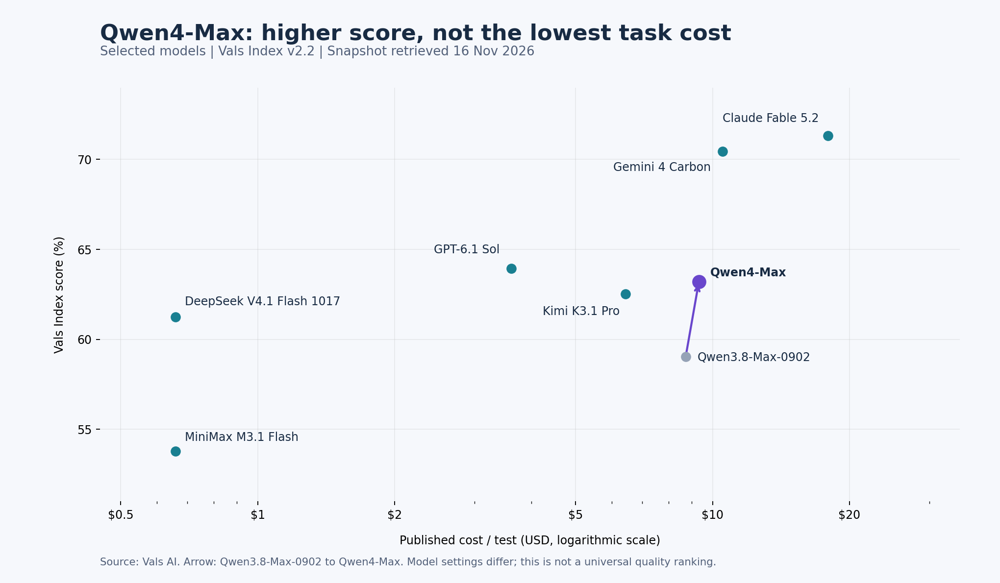

# Qwen4 시리즈 심층 연구: Max의 역량, 가격, 속도와 3년 경쟁력

> 연구일 및 자료 마감일: 2026년 11월 16일, 베이징 시간. Qwen4-Max는 당일 정식 출시되었으며, 본문은 출시일 연구 버전이다.
>
> 방법: 공식 발표, 제품 사양과 가격을 대조하고, 독립 평가 기관의 원 결과로 교차 판단했다. 유료 추론 API를 호출하지 않았고, 작성자가 직접 실측하지 않았다. 모든 속도 숫자에는 외부 테스트 기준을 밝혔으며, 3년 시나리오는 작성자의 판단이다.

## 1. 결론부터: 테스트하고 배포할 가치가 있는 중요한 업그레이드이지만, 우위가 모든 과제를 포괄하지는 않는다

**Qwen4-Max의 가장 설득력 있는 변화는 과제 역량을 높이는 동시에 연산과 실행 효율을 개선했다는 점이다. 중국 내 선두 범용 업무 모델의 대열에 들어섰지만, 현재 증거로는 이를 세계 최강, 최고속 또는 실사용 최저가 모델이라고 부르기에 부족하다.**

세 가지 결과가 이를 가장 잘 보여준다:

| 답해야 할 질문 | 출시일 증거 | 판단 |
|---|---|---|
| 이전 세대보다 얼마나 강한가? | Vals Index가 Qwen3.8-Max-0902의 59.05%에서 63.20%로 올라 4.15%포인트 증가 | 종합적 진전은 명확하나, 세부 과제에서 퇴보한 것이 여전히 있다 |
| 과제 수행이 더 저렴한가? | 같은 기관의 Terminal-Bench 4.0 비용은 12.15달러에서 3.90달러로 하락. 반면 Vals 종합 테스트 비용은 8.73달러에서 9.33달러로 상승 | 절감 정도는 과제, 추론 설정, 캐시에 크게 좌우되며 단가만 봐서는 안 된다 |
| 더 빠른가? | Vals 종합 소요 시간이 105분 46초에서 64분 39초로 단축. GPT-6.1 Sol은 44분 24초 | 자사 이전 세대 대비로는 뚜렷이 개선되었으나, 업체 간 속도 선두는 아니다 |

출처: [S07][S08][S09][S10][S13]. 위의 비용과 소요 시간은 평가 기관이 정의한 지표이며, 일반 채팅 요청 1회의 비용이나 대기 시간과 같지 않다.

모델 선정 관점에서, 작성자는 이를 복잡한 중국어 업무, 이미지·텍스트 자료 처리, 다단계 사무 작업, 범용 Agent의 1차 후보 명단에 넣을 것이다. 터미널 프로그래밍, 초저비용 고동시성, 실시간 상호작용에 대해서는 각각 더 우위에 있는 경쟁 제품을 함께 테스트해야 한다. 기존 Qwen3.8-Max 사용자도 업무 회귀 테스트 결과에 따라 이전해야 한다.

**2029년에서 돌아보면, 오늘의 이 Qwen4-Max 버전 자체는 이미 최전선의 프로덕션 1순위가 아닐 가능성이 높다. 가치를 남길 가능성이 더 큰 것은 이 세대가 검증한 효율 노선, 개발자 생태계, 그리고 실제 업무를 중심으로 형성된 데이터, 도구, 평가 체계다. Qwen 시리즈가 계속 선두를 유지할 수 있는가와 알리바바가 그 선두를 이익으로 전환할 수 있는가는 각각 따로 검증해야 할 두 가지 문제다.**

## 2. 먼저 "Qwen4 시리즈"를 명확히 한다

연구 마감일 기준, 확인할 수 있는 정식 출시의 중심은 **Qwen4-Max**다. 공식 측은 이후 더 작은 오픈 웨이트 모델을 내놓겠다고 밝혔지만, 이를 근거로 아직 확인되지 않은 Qwen4-Plus, Flash, 구체적인 파라미터 등급, 라이선스, 출시일을 써서는 안 된다. [S01]

| 대상 | 마감일 기준 상태 | 본문의 처리 방식 |
|---|---|---|
| Qwen4-Max 정식 버전, API ID `qwen4-max` | 정식 출시됨. 종량 과금과 제품 문서가 있다 | 핵심 연구 대상 |
| `qwen4-max-preview` | 기간 한정 프리뷰 채널. 프리뷰 문서는 이용 가능 기간을 11월 11일~11월 25일로 정하고 Token Plan 대상으로만 제공 | 따로 식별하며, 프리뷰의 혜택과 제한을 정식 버전에 적용하지 않는다 |
| Qwen4 후속 소형 모델 | 공식 예고. 완전한 사양과 출시 시점은 아직 확인되지 않음 | 잠재적 영향을 논의하되, 제품 목록을 지어내지 않는다 |
| Qwen3.8-Max / `qwen3.8-max-0902` | 이전 세대 정식 모델과 업데이트 버전 | 성능 비교에는 명확히 표기된 0902 버전을 우선 사용 |
| Qwen3.8-Flash-Next | 이미 공개된 실험적 아키텍처 모델 | 기술 노선을 이해하는 데 사용하며, Qwen4-Max의 오픈 웨이트 버전으로 가장하지 않는다 |

출처: [S01][S02][S03][S05][S06].

정식 버전 문서가 제시한 핵심 경계는 다음과 같다: 텍스트, 이미지, 동영상 이해를 지원하고 텍스트를 생성한다. 컨텍스트는 1,000,000 token, 비사고 최대 출력은 131,072 token, 사고와 최종 답변의 합계 상한은 262,144 token이다. 함수 호출, 구조화 출력, 캐시를 지원한다. 현재 제품 문서는 모델 튜닝, 자체 배포, 배치 추론을 지원하지 않는다고 명시한다. [S02]

여기에는 흔한 오독이 두 가지 있다. 첫째, **100만 컨텍스트, 긴 출력 상한, 이미지·동영상 입력 가능은 모두 인터페이스 용량 또는 기능이며, 모델이 창 전체를 안정적으로 잘 활용할 수 있다는 뜻도, 음성·동영상을 직접 생성할 수 있다는 뜻도 아니다.** 둘째, Qwen 시리즈에 오픈 모델이 존재한다고 해서 Max의 가중치가 이미 공개되어 프라이빗 배포가 가능하다는 뜻은 아니다.

출시일 문서에는 아직 동기화되지 않은 차이가 있다: Preview 문서와 일부 애그리게이터는 여전히 393,216 등의 출력 상한을 표시한다. 본문은 정식 버전 사양 페이지의 합계 상한 262,144를 채택하며 섞어 쓰지 않는다. Vals는 모델 날짜를 11월 15일로 기록했으나, 본문은 Qwen 공식의 베이징 시간 11월 16일 출시 기록을 기준으로 삼는다. 이 둘을 두 개의 정식 모델로 보지 않는다. [S01][S02][S03][S09]

## 3. 이전 세대와 비교해 정말 중요한 변화는 무엇인가?

### 3.1 백본은 더 커지지 않았고, 활성 연산은 뚜렷이 줄었다

Qwen 공식 공개에 따르면 Qwen4-Max는 2.4T의 백본 파라미터 규모를 유지하고, token당 활성 파라미터는 71B다. 별도로 328B의 N-gram Embedding 파라미터가 있다. Qwen3.8-Max의 백본도 2.4T이고 활성 파라미터는 95B다. 따라서 이번 세대의 token당 활성 파라미터는 약 **25.3%** 감소했다. 2.4T 백본과 추가 임베딩 파라미터는 나누어 이해해야 하며, "매번 2.4T 파라미터를 전부 계산하는 밀집 모델"이라고 써서는 안 된다. [S01][S05]

이 변화의 의미는 이렇다: 모델 용량은 계속 매우 클 수 있지만, 실제로 token 하나를 생성할 때 전체 용량이 연산에 참여할 필요는 없다. 그러나 활성 파라미터 감소가 실제 컴퓨팅 비용, 메모리 점유, 엔드투엔드 지연도 같은 비율로 줄어든다는 뜻은 아니다. 메모리 접근, 전문가 간 통신, 어텐션, 동시성 활용률, 서비스 전략이 여전히 비용에 영향을 준다.

### 3.2 아키텍처 업그레이드는 긴 컨텍스트 효율과 정보 전달에 집중되어 있다

공식 측이 설명한 세 가지 핵심 설계는 다음과 같다. 유사한 기술은 Qwen3.8-Flash-Next에서 이미 프리뷰되었고, 이번 세대의 중요성은 이 노선을 Max 규모까지 밀고 간 데 있다. [S01][S06]

| 설계 | 확인 가능한 메커니즘 | 작성자의 판단: 무엇을 해결할 수 있는가 | 이것만으로 아직 증명할 수 없는 것 |
|---|---|---|---|
| Gated DeltaNet + Qwen Sparse Attention | GDN 층 세 개마다 QSA 층 하나를 배치. 상태 압축과 희소 선택으로 이력을 처리 | 긴 시퀀스 처리 부담을 낮추고, 장기 과제에 연산 예산을 확보 | 긴 문서의 임의 위치 정보가 모두 손실 없이 보존된다고 보장하지 않는다 |
| Gated Residual | 네 개의 잔차 분기가 게이팅을 통해 정보를 전달 | 깊은 네트워크의 정보 흐름과 학습 안정성 개선 | 완전한 절제 실험이 공개되지 않아, 이것이 단독으로 몇 점을 기여했는지 정량화할 수 없다 |
| N-gram Embedding | 국소 패턴 테이블 조회로 표현을 보강 | 일부 흔한 패턴의 처리를 더 저렴한 저장과 검색에 넘긴다 | 파라미터 증가가 범용 추론 능력의 같은 비율 증가를 뜻하지 않는다 |

이는 연산 예산 배분 방식의 업그레이드에 더 가깝다: 제한된 연산을 추론할 가치가 더 큰 부분에 쓰는 것이다. 기업에게 그 최종 가치는 아키텍처 이름 자체가 아니라, 같은 서비스 품질에서 더 많은 업무를 처리할 수 있는지로 드러나야 한다.

### 3.3 역량 증분은 주로 더 나은 업무 수행으로 나타나며, 일부 역량은 처음 등장한 것이 아니다

네이티브 비전과 100만 컨텍스트는 이전 세대에 이미 있었다. 이번 세대에서 검증해야 할 것은 차트 이해, 문서 종합, 도구 사용, 장기 과제 납품 품질이 높아졌는지이며, 기존 기능을 다시 돌파구로 계산해서는 안 된다. [S05][S02]

공식 자체 구축 Work360의 점수는 47.74에서 52.69로 올랐다. 공식 보고에 따르면 같은 effort 등급에서 Work360의 token 사용량은 약 24%—35%, Terminal-Bench 4.0은 약 48%—49% 줄었다. 이는 특정 평가, 특정 설정에서의 결과이며, 임의의 과제에서 token을 절반 덜 쓴다고 추론할 수 없다. [S01]

주목할 만한 제품 변화는 과제가 먼저 확인 가능한 납품물을 만들고, 피드백에 따라 계속 수정하게 한 것이다. 공식 Live Delivery 플러그인은 이미 공개되었고, Codex 환경에서 설정된 모델을 사용할 수 있다. **이는 모델과 실행 시스템을 함께 설계하는 것의 중요성을 보여주는 동시에, 이런 납품 메커니즘이 Qwen4 가중치만 가질 수 있는 독점 역량이 아님도 보여준다.** [S20]

이번 자료는 Max를 재현하기에 충분한 완전한 학습 레시피, 총 학습 비용, 요소별 절제 실험을 제공하지 않는다. 전체 효과가 좋아졌다고 판단할 수는 있으나, 이를 공개되지 않은 특정 강화학습 알고리즘에 정확히 귀속시킬 수 없고, 낮은 가격을 근거로 알리바바의 추론 매출총이익률을 곧바로 판단할 수도 없다.

## 4. 성능 비교: 중국 내 선두에는 증거가 있고, 글로벌 전방위 선두에는 증거가 없다

### 4.1 먼저 독립적인 종합 업무 평가를 본다

Vals Index v2.2는 금융, 프로그래밍, 법률, 세무 과제를 집계하며, 관련 산업이 미국 GDP에서 차지하는 가중치로 지수를 구성한다. 일부 전문 업무의 성과를 관찰하기에 적합하지만, 모든 중국어 기업 과제, 창작 경험, 실시간 음성, 모델 안전성을 포괄하지는 않는다. [S07]

아래 표는 출시일에 읽은 같은 리더보드의 스냅샷이다. 비용과 소요 시간은 모두 Vals의 정의를 유지한다. 모델마다 추론 등급과 출력 예산이 완전히 같지 않으므로, 이는 "각자의 설정에서의 제품 성과"이지 엄밀한 동일 연산량 아키텍처 실험이 아니다.

| 모델 | Vals 점수, % | 비용/테스트, 달러 | 소요 시간/테스트 |
|---|---:|---:|---|
| Claude Fable 5.2 | 71.31 | 17.94 | 43분 42초 |
| Claude Sonnet 5.5 | 70.85 | 16.18 | 약 86분 |
| Gemini 4 Carbon | 70.45 | 10.51 | 47분 45초 |
| Claude Opus 5.5 | 70.14 | 24.77 | 약 85분 |
| GPT-6 Astra | 65.02 | 21.28 | 33분 39초 |
| GPT-6.1 Sol | 63.94 | 3.61 | 44분 24초 |
| **Qwen4-Max** | **63.20** | **9.33** | **64분 39초** |
| Kimi K3.1 Pro | 62.52 | 6.44 | 63분 36초 |
| DeepSeek V4.1 Flash 1017 | 61.26 | 0.66 | 39분 55초 |
| GLM 5.3 | 59.85 | 8.52 | 약 64분 |
| Hy4 | 59.35 | 1.72 | 51분 31초 |
| Qwen3.8-Max-0902 | 59.05 | 8.73 | 105분 46초 |
| MiMo V2.6 Pro | 57.81 | 0.43 | 약 73분 |
| Step 5 Preview | 54.76 | 2.73 | 약 65분 |
| MiniMax M3.1 Flash | 53.78 | 0.66 | 43분 18초 |

출처: [S07]. Qwen 신구 버전과 Kimi의 정확한 시간은 해당 모델 페이지 [S09][S10][S14]에서 가져왔다. 이는 포지셔닝이 서로 다른 제품들의 묶음이며, Flash와 플래그십의 가격 차이를 같은 역량에 대한 할인으로 곧바로 간주할 수 없다.

그림의 세로축은 Vals 종합 점수, 가로축은 해당 기관이 발표한 테스트 비용이며 로그 눈금을 쓴다. 화살표는 Qwen의 신구 두 세대를 잇는다. 왼쪽 위 방향은 이 테스트에서의 더 높은 점수와 더 낮은 비용을 뜻하며, 모든 시나리오의 최적 선택을 뜻하지 않는다.

이 결과는 네 가지 판단을 뒷받침한다:

1. **Qwen4-Max는 이미 중국 내 1군에 진입했다.** 이 스냅샷에서 테스트된 중국 모델 중 점수가 가장 높다. 그러나 Qwen의 63.20%는 Kimi의 62.52%, Sol의 63.94%와 매우 가깝다. 세 모델이 보고한 표준오차는 각각 약 1.01, 1.14, 1.07%포인트로, 1%포인트에 못 미치는 차이만으로 안정적인 승패를 단정할 수 없고, 이 표준오차를 이미 완료된 대응 유의성 검정으로 간주해서는 더욱 안 된다. [S09][S13][S14]
2. **선두 해외 모델과는 여전히 뚜렷한 격차가 있다.** Fable, Sonnet, Opus와 Gemini Carbon은 이 종합 과제군에서 모두 약 70점 이상에 도달했다. "중국 내 최고 점수"를 "세계 최강"으로 바꿔 써서는 안 된다.
3. **Qwen의 token 단가가 Sol보다 낮다고 해서 같은 종류의 업무를 실제로 더 싸게 완료한다는 뜻은 아니다.** 이 평가에서 Sol은 점수가 비슷한데 비용과 시간은 모두 더 낮다. 이는 자신의 과제에서 중점적으로 재확인해야 할 경쟁 압력이다.
4. **저가 모델은 대규모 업무에서 또 다른 압력을 형성한다.** DeepSeek와 MiniMax는 단위 비용이 매우 낮아, 일부 과제 점수가 Max에 못 미치더라도 업무 검수를 통과하는 하위 과제에서는 우위에 설 수 있다. 대체 가능한지는 실패 비용과 사람 재검토 비용을 봐야 한다.

### 4.2 프로그래밍은 반드시 서로 다른 과제로 나누어 봐야 한다

| 모델 | Terminal-Bench 4.0, % | 비용/테스트, 달러 | 소요 시간/테스트 |
|---|---:|---:|---|
| Claude Fable 5.2 | 65.15 | 14.56 | 55분 07초 |
| Claude Opus 5.5 | 65.15 | 12.04 | 약 64분 |
| Kimi K3.1 Pro | 63.64 | 4.57 | 49분 21초 |
| Gemini 4 Carbon | 63.13 | 7.45 | 45분 07초 |
| GPT-6.1 Sol | 55.05 | 1.72 | 45분 12초 |
| **Qwen4-Max** | **48.48** | **3.90** | **약 75분** |
| Qwen3.8-Max-0902 | 38.89 | 12.15 | 약 143분 |
| DeepSeek V4.1 Flash 1017 | 31.82 | 0.54 | 41분 10초 |
| MiniMax M3.1 Flash | 25.25 | 0.73 | 50분 31초 |

출처: [S08]. 이 행들은 모두 Mini-SWE-agent 사용으로 표기되어 있다. 점수, 가격, 시간을 다른 harness에서의 성적과 직접 이어 붙일 수 없다.

이 터미널 과제 집합에서 Qwen은 이전 세대 대비 **9.59%포인트** 올랐고, 비용은 **67.9%** 낮아졌으며, 리더보드의 반올림된 시간으로 계산한 소요 시간은 약 **47.6%** 단축되었다. 이 진전은 매우 크다. 동시에 Kimi, Claude, Gemini, Sol의 결과는 Qwen이 여전히 고난도 터미널 과제의 선두가 아님을 보여준다.

프런트엔드 웹페이지 선호도 평가는 다른 측면을 보여준다: Arena Code/WebDev에서 Qwen4-Max는 1750 Elo, Qwen3.8-Max-0902는 1676, Sol은 1742, Opus는 1816이다. Qwen4 항목은 여전히 preliminary로 표기되어 있고 구간은 약 ±15다. Sol보다 8 Elo 점 앞선 것을 확정적인 역량 우위라고 말할 수 없고, Elo 상승을 품질 상승 백분율로 환산할 수도 없다. [S11]

따라서 "만족스러운 웹페이지를 만들 수 있다", "실제 저장소를 수정할 수 있다", "터미널에서 복잡한 환경 문제를 해결할 수 있다", "대형 시스템을 장기간 유지보수할 수 있다"는 서로 다른 검수 세트로 나누어야 한다. 보기 좋은 데모 하나가 완전한 소프트웨어 엔지니어링 역량을 대표할 수는 없다.

### 4.3 빠뜨려서는 안 되는 퇴보: 법률, 세무, 금융이 함께 오른 것은 아니다

| Vals 하위 항목 | Qwen3.8-Max-0902, % | Qwen4-Max, % | 어떻게 해석해야 하는가 |
|---|---:|---:|---|
| Finance Agent v2.1 | 58.83 | 66.68 | 금융 에이전트 과제의 개선이 비교적 뚜렷하다 |
| Vals Finance Index | 61.66 | 61.99 | 금융 종합 지표는 소폭 상승에 그쳐, 전면적 급등으로 요약할 수 없다 |
| Legal Research Bench | 46.15 | 41.35 | 점 추정치가 하락했으며, 법률 리서치에 대한 회귀 점검이 필요하다 |
| Tax Agent Bench | 49.66 | 40.35 | 점 추정치가 하락했으며, 새 버전이 구버전을 전면 대체한다고 기본 가정할 수 없다 |
| Vibe Code Bench v1.1 | 77.14 | 86.66 | 코드 생성 관련 과제는 향상 |

출처: [S09][S10]. 이는 각자의 테스트 설정에서의 점 추정치다. 문항별 대응 결과를 확보하지 못했으므로 모든 상승과 하락을 통계적으로 유의한 변화로 해석할 수 없고, 특정 학습 모듈에 귀속시킬 수는 더욱 없다. 미국의 법률·세무 테스트가 중국 업무에 대한 적용 가능성을 직접 대표하지도 않는다.

새 버전을 올릴 때는 구모델 대조군과 롤백 경로를 유지해야 한다. 특히 종합 리더보드가 올랐다는 이유로 법률, 컴플라이언스, 재무 등 전문 프로세스에 이미 있는 사람 검토와 증거 검증을 걷어내서는 안 된다.

### 4.4 멀티모달과 고난도 추론: 공식 데이터는 진전을 뒷받침하면서 약점도 남겼다

공식 발표의 비교 평가에서 Qwen4-Max는 Chartography 54.2로 이전 세대 42.0보다 올랐으나 GPT-6 Astra의 71.1보다 낮다. HLE는 51.7로 이전 세대 43.9보다 올랐으나 Opus 5.5의 59.8보다 낮다. 이는 공식 비교 평가 기준이며 본문의 실측으로 볼 수 없고, 표도 마감일 기준 최신 경쟁 제품을 모두 포괄하지 않는다. [S01]

멀티모달에 대한 작성자의 판단은 "역량은 높아졌으나 여전히 시나리오별 검수가 필요하다"이다. 긴 동영상 내 위치 특정, 복잡한 표, 페이지를 넘나드는 증거 병합, 작은 글자, 여러 이미지 간 충돌 처리는 전혀 다른 실패 모드를 가질 수 있다. 100만 컨텍스트 지원이 이런 테스트를 대신할 수 없다.

현재로서는 충분한 독립 중국어 산업 과제 결과, 긴 문서의 위치별 재현율 곡선, 여러 시간 연속 실행 시의 실패율, 안정성 재측정이 아직 부족하다. 이 공백 때문에 보고서는 선정 후보 판단만 뒷받침할 수 있고, 출시 검수를 대신할 수 없다.

## 5. 가격: 단가 하락은 사실이나, "과제 비용이 모두 내렸다"는 성립하지 않는다

### 5.1 중국 사이트의 위안화 가격

단위는 위안/100만 token이며 공식 종량 가격 기준이다. 출력에는 과금되는 사고와 최종 답변이 포함된다. 아래에는 Token Plan 구독 혜택을 섞지 않았다. [S04]

| 가격 항목 | Qwen3.8-Max / 0902 | Qwen4-Max |
|---|---:|---:|
| 일반 입력 | 12 | 10 |
| 출력 | 36 | 30 |
| 암묵적 캐시 읽기 | 1.5 | 0.5 |
| 명시적 캐시 생성, 기본 등급 | 15 | 12.5 |
| 명시적 캐시 읽기 | 1 | 0.5 |

신구 입력·출력 단가는 모두 **16.7%** 하락했고, 암묵적 캐시 읽기는 **66.7%** 하락했다. Qwen4의 기본 명시적 캐시 생성 등급은 5분이며, 1시간 등급의 생성 비용은 별도로 20위안/100만 token이다. 12.5위안으로 모든 보존 시간을 포괄할 수 없다. [S04][S19]

### 5.2 국제 달러 가격: 중국 내 가격과 분리하며, 임의의 환율 환산을 하지 않는다

QwenCloud 국제 배포 기준은 입력 1.50, 출력 4.50달러/100만 token이다. 이전 세대는 2.00, 6.00으로, 모두 **25%** 하락했다. 다른 배포 리전에는 다른 가격이 있으므로 하나의 "전 세계 단일 판매가"로 뭉뚱그려서는 안 된다. [S15]

아래 표는 텍스트 입력, 일반 온라인 종량 가격을 비교한다. 통일 금액 산출 예시는 **캐시되지 않은 입력 token 10만 + 총 출력 token 1만**을 가정하며, 검색, 도구, 재시도, 세금, 쿠폰은 포함하지 않는다.

| 모델/라우트 | 입력, 달러/100만 token | 출력, 달러/100만 token | 동일 token 산출 예시, 달러 | 주요 기준 |
|---|---:|---:|---:|---|
| **Qwen4-Max** | **1.50** | **4.50** | **0.195** | 국제 배포 [S15] |
| Qwen3.8-Max-0902 | 2.00 | 6.00 | 0.260 | 같은 국제 배포 [S15] |
| GPT-6.1 Sol | 2.00 | 10.00 | 0.300 | 일반 모드, 긴 입력 할증 미발동 [S16] |
| Claude Fable 5.2 | 8.00 | 40.00 | 1.200 | 표준 가격 [S17] |
| Claude Opus 5.5 | 4.00 | 20.00 | 0.600 | 표준 가격 [S17] |
| Claude Sonnet 5.5 | 2.00 | 10.00 | 0.300 | 표준 가격 [S17] |
| Gemini 4 Carbon, 현재 프로모션 | 2.00 | 10.00 | 0.300 | 2026-11-30까지 [S18] |
| Gemini 4 Carbon, 공지된 복귀 가격 | 4.00 | 20.00 | 0.600 | 2026-12-01부터 [S18] |
| Kimi K3.1 Pro | 2.00 | 10.00 | 0.300 | Vals 모델 페이지 기록이며, 이번에 확보한 공식 전체 가격표가 아님 [S14] |
| GLM 5.3 | 1.40 | 4.40 | 0.184 | Z.AI 직접 연결 가격 [S21] |
| DeepSeek V4.1 Flash, 혼잡 시간대 | 0.30 | 1.20 | 0.042 | 공식 직접 연결, 클라우드 플랫폼 재판매 아님 [S22] |
| DeepSeek V4.1 Flash, 한가한 시간대 | 0.15 | 0.60 | 0.021 | 공식 시간대 규칙 기준 [S22] |
| MiniMax M3.1 Flash | 0.15 | 0.60 | 0.021 | 공식 직접 연결 [S23] |

산식은 `0.1 × 입력 단가 + 0.01 × 출력 단가`다. 이는 같은 token 수의 청구액만 측정한다: 업체마다 토큰화, 사고 길이, 도구 회차, 실패 재시도가 다르므로, **같은 token이 같은 작업량을 뜻하지 않고, 같은 품질을 뜻하지는 더욱 않는다**. 비전 입력은 각 업체의 이미지 또는 동영상 과금 규칙에 따라 따로 계산해야 한다.

이는 Max가 플래그십 가격대에서는 경쟁력이 있지만, 초저비용 모델 앞에서는 절대적인 가격 우위가 없음을 보여준다. 반대로 저렴한 모델도 여러 번 재시도해야 하거나 사람 검토가 더 많이 필요하다면 장부상의 우위를 잃을 수 있다.

### 5.3 캐시가 모델 단가 변화보다 실제 청구액에 더 큰 영향을 줄 수 있다

고정된 10만 token의 공통 접두부가 유효 기간 내에 연속 20회 사용된다고 가정하고, 이 부분의 입력 비용만 계산한다:

- 캐시 미사용: `20 × 0.1 × 10 = 20위안`.
- Qwen4의 5분 명시적 캐시: 첫 번째 생성에 `0.1 × 12.5`, 이후 19회 적중에 각각 `0.1 × 0.5`를 내어 합계 **2.20위안**.
- 이 가정에서는 **89%** 절감된다. 실제로는 서로 다른 사용자 입력, 출력, 도구 비용을 더해야 한다. [S04][S19]

이는 실제 청구액에 대한 약속이 아니다. 접두부가 반드시 일치해야 하고, 캐시는 유효 기간 내에 있으면서 인터페이스 요건을 충족해야 한다. 암묵적 캐시는 적중을 보장하지 않는다. 업무에서 타임스탬프, 무작위 내용, 회차마다 바뀌는 사용자 자료를 공유 접두부 앞에 두거나 호출 간격이 유효 기간을 넘기면 절감 폭이 크게 줄어들 수 있다.

시스템 프롬프트, 도구 정의, 고정 업무 매뉴얼이 매우 긴 Agent의 경우, 이런 엔지니어링 최적화가 입력 가격을 조금 더 낮추는 것보다 더 유용할 수 있다. 캐시 적중률과 정확성을 함께 관찰해야 하며, 캐시 적중을 위해 이미 낡은 정책과 데이터를 남겨 두어서는 안 된다.

### 5.4 공식의 "과제 비용 하락" 숫자를 왜 그대로 가져올 수 없는가?

공식 영문 Work360 예시는 4.43달러에서 1.67달러로 약 62% 하락했고, 공식 중문 발표 자료는 26.58위안에서 11.16위안으로 약 58% 하락했다. 두 숫자 묶음은 서로 다른 가격 책정 기준에 관련되어 있으므로, 하나의 환율로 억지로 맞춰 완전히 일치하는 데이터로 만들어서는 안 된다. [S01][S24]

더 핵심적인 것은 독립 테스트가 다른 방향을 보여준다는 점이다: 터미널 과제 비용은 약 68% 하락했지만, 종합 업무 테스트 비용은 약 7% 증가했다. 원인은 과제 구성, 출력 예산, 추론 전략, 캐시, 테스트 버전에 걸쳐 있을 수 있으며, 공개 자료로는 각 요인의 기여를 정확히 분해하기에 부족하다.

기업이 실제로 최적화해야 할 지표는 다음과 같다:

**검수 통과 과제당 총비용 = (모든 시도의 API 비용 + 도구 및 인프라 비용 + 사람 검토 및 재작업 비용) ÷ 검수를 통과한 과제 수.**

여기서 분모는 실제 검수 결과다. 혼합 벤치마크 점수 하나를 실제 업무 성공 확률로 그대로 쓰고 기계적으로 "성공 1회당 비용"을 계산해서는 안 된다.

## 6. 속도: 과제 소요 시간 단축은 증명되었으나, token/s나 온라인 지연의 선두는 아직 증명되지 않았다

"빠르다"에는 적어도 네 가지 다른 의미가 있으며, 반드시 나누어 측정해야 한다:

| 지표 | 무엇을 반영하는가 | 이번에 확보한 증거 |
|---|---|---|
| 첫 token 지연, TTFT | 서비스가 스트리밍 응답을 시작하기까지의 대기 | 비교 가능한 독립 데이터를 확보하지 못함 |
| 사용자가 읽을 수 있는 첫 단락 답변의 지연 | 내부 사고를 제외하거나 포함한 뒤, 사용자가 언제 유용한 내용을 보는가 | 통일된 측정법의 데이터를 확보하지 못함 |
| 디코딩 속도, token/s | 생성 시작 후 token을 지속적으로 내보내는 속도 | 횡비교하기에 충분한 신뢰할 만한 값을 확보하지 못함. 추정치를 기입하지 않는다 |
| 전체 과제 완료 시간 | 추론, 도구 호출, 대기, 재시도, 납품의 총 시간 | Vals와 Arena에 외부 측정이 있으나 과제와 설정이 다르다 |

Vals 종합 과제에서 Qwen 새 버전의 소요 시간은 약 **38.9%** 단축되었고, 터미널 과제는 약 **47.6%** 단축되었다. 전자는 모델 상세 페이지의 초 단위 수치로, 후자는 리더보드의 반올림된 분 수로 계산해 정밀도가 다르다. [S08][S09][S10]

그러나 또 다른 실무 출처인 Arena Agent에서는 Qwen4-Max xhigh의 과제 시간 P50이 15.7분, Sol max는 9.3분, Gemini Carbon high는 9.6분이다. 이는 실제 과제 분포, 등급, 서비스 조건이 섞인 관찰이므로 대응 속도 측정으로 삼을 수 없지만, "Qwen4가 반드시 가장 빠르다"는 결론에 근거가 없음을 보여주기에는 충분하다. [S12]

아키텍처 효율 향상, token 감소, 클라우드 총 처리량 향상, 개별 사용자가 답을 더 빨리 보는 것은 서로 관련될 때도 있고 어긋날 수도 있다. 예컨대 추론이 더 적극적으로 바뀌면 고난도 과제의 성공률은 높아지지만 읽을 수 있는 첫 단락 답변의 대기는 늘어날 수 있다. 더 높은 서비스 동시성도 자원 활용을 개선하면서 꼬리 지연을 악화시킬 수 있다.

실제 응용에서 작성자는 먼저 `high`를 테스트하고, `xhigh`에는 깊은 추론이 정말로 필요한 소수의 과제를 맡기며, 저위험 상호작용에는 `low`나 사고 끄기를 시도할 것이다. 등급 이름은 공급업체 간에 통일된 연산량 의미가 없으므로, 최종적으로는 품질, P50/P95 지연, 비용을 함께 검수해야 한다. [S02]

## 7. 경쟁 구도: Qwen4-Max가 마주한 것은 한 종류의 상대가 아니다

아래 포지셔닝은 앞의 테스트와 가격에 대한 종합 판단이며, 업체의 공식 시장 점유율 결론이 아니다.

| 경쟁 대상 | Qwen4-Max에 가하는 주된 압력 | 어떤 경우에 Qwen을 선택할 가치가 더 큰가 |
|---|---|---|
| Claude Fable / Opus / Sonnet | 전문 업무와 고난도 프로그래밍 성과가 강하다. 일부 과제는 시간도 짧다 | Qwen이 검수 기준에 도달하고, 비용, 연동, 업무 적합성에서 우위가 생길 때 |
| GPT-6.1 Sol; GPT-6 Astra | Sol은 이번 종합 업무 테스트에서 비슷한 점수에 더 낮은 과제 비용을 갖췄다. Astra는 일부 고난도 과제에서 더 강하다 | 자신의 중국어, 비전 또는 도구 과제에서 Qwen이 더 나은 결과를 낼 때. token 단가만으로 결정할 수 없다 |
| Gemini 4 Carbon | 종합 점수, 터미널 과제, 일부 비전 역량이 압력이 된다. 현재 프로모션이 있다 | 업무에 그 차별화된 역량이 필요 없고, Qwen의 적용과 비용이 더 적합할 때. 복귀 가격으로 장기 예산을 다시 계산해야 한다 |
| Kimi K3.1 Pro | 종합 수준이 비슷하고 터미널 과제 결과가 더 강하다 | Qwen이 구체적인 사무, 문서, 도구 프로세스에서 대조 테스트로 이길 때 |
| DeepSeek V4.1 Flash | 낮은 가격과 괜찮은 종합 역량으로 고빈도 과제에 유리하다 | Max의 추가 신뢰성이나 복잡 과제 역량이 재작업을 뚜렷이 줄일 수 있을 때 |
| GLM 5.3 | 단가가 비슷해 중국 내 같은 급 제품의 대체 선택지가 된다 | Qwen의 역량 차이가 자체 검수 세트에서 재현되고 이전 비용을 감당할 때 |
| MiniMax M3.1 Flash | 저비용 노선으로, 대량의 단순하거나 제약된 과제에 매력적이다 | 과제 복잡도가 Max의 추가 비용이 보상을 낳을 만큼 충분할 때 |
| Hy4, MiMo V2.6 Pro, Step 5 Preview 등 | 대체 가능성을 더욱 높이고, "범용 모델 인터페이스만으로" 프리미엄을 유지할 공간을 압축한다 | 과제별로 계층을 나눠 비교하고, 종합 리더보드를 영구 공급업체 명단으로 만들지 않을 때 |

더우바오(豆包), 원신(文心) 등 다른 중국 제품에 대해서는, 본문이 위의 같은 버전 모델들과 항목별로 맞출 수 있을 만큼 충분한 최신 공개 데이터를 확보하지 못했으므로 순위를 지어내지 않는다. 중국 내 경쟁에 대한 포괄이 불완전한 것도 후속 업데이트 항목이다.

Qwen의 잠재적 강점은 플래그십 역량, 소형 모델, 개발 도구, 배포 서비스를 지속적으로 채택할 수 있는 하나의 체계로 묶는 것이다. 그러나 향후 Qwen4 소형 모델의 실제 역량, 공개 방식, 배포 경제성은 아직 실현되지 않았으며, 현재로서는 생태계 잠재력을 전부 Max의 기성 우위로 산입할 수 없다.

## 8. 3년 뒤에 서서: 2029년에는 이 세대를 어떻게 평가해야 하는가?

### 8.1 먼저 세 가지 대상을 구분해, "모델이 좋다"에서 곧바로 "사업이 반드시 성공한다"로 넘어가지 않는다

**오늘의 이 버전 가중치.** 작성자의 판단은, 2029년에는 최전선의 품질과 비용 효율을 추구하는 신규 프로젝트 대부분이 후속 모델을 우선 선택할 것이라는 점이다. 버전 동결, 감사 일관성, 특정 동작이 필요한 소수의 프로세스는 구버전을 계속 쓸 수 있겠지만, 그 버전이 계속 서비스되는지는 공급업체의 버전 정책에 달려 있다. 본문은 정식 버전의 3년 뒤 서비스 기한을 확인할 수 없다.

**지속적으로 반복 개선되는 모델 시리즈로서의 Qwen.** 이번 결과는 Qwen이 활성 연산을 줄이면서 과제 수준을 높이는 능력을 갖췄음을 보여주며, 이는 다음 라운드의 경쟁에 유리하다. 그러나 글로벌 선두 모델과의 몇몇 격차, 세부 과제의 후퇴, 저가 경쟁자의 압력은 여전히 존재한다. 한 번의 출시가 향후 3년의 연구개발 위치를 증명할 수는 없다.

**알리바바의 사업적 수익.** 모델이 사용되면 매출 기회가 생길 수 있지만, 수익은 가격 경쟁, 컴퓨팅 비용, 고객 유지, 응용 가치의 귀속에도 영향을 받는다. 고객이 인터페이스를 언제든 교체할 수 있는 부품으로만 여긴다면 역량 선두가 반드시 높은 이익으로 이어지지는 않는다. 고객이 지속적인 업무 프로세스를 그 플랫폼 위에 구축해야 가치 포착의 가능성이 더 커진다. 이는 사업 메커니즘에 대한 추론이며, 알리바바의 미래 이익에 대한 수치 예측이 아니다.

### 8.2 세 가지 시나리오: 관찰 가능한 조건을 중점적으로 본다

아래 가중치는 작성자가 판단을 정리하기 위해 쓴 주관적 가정이며, 합계 100%이고 통계 모델에서 나온 것이 아니다.

| 2029년 시나리오 | 주관적 가중치 | Qwen 시리즈의 가능한 위치 | 이번 세대 Max에 대한 회고 | 어떤 증거가 이를 뒷받침하는가 |
|---|---:|---|---|---|
| 기준: 중국 내 선두 진영을 유지하고, 글로벌에서는 여러 업체가 경쟁 | 55% | 몇몇 업무 과제에서 경쟁력이 있고, 일부 고난도 과제는 여전히 외부 최전선 모델이 필요 | 효율과 업무 납품의 중요한 과도기 버전이며, 후속 모델이 점차 대체 | 여러 버전이 품질과 단위 검수 비용을 지속 개선. 고객은 멀티 모델 전략을 유지 |
| 상방: 역량이 계속 따라잡고, 플랫폼이 고객 유지를 형성 | 25% | 범용 역량이 강할 뿐 아니라 기업 과제에서도 안정적 우위를 형성 | 모델 공급에서 업무 플랫폼으로 나아가는 핵심 세대 | 독립 평가와 비공개 과제 모두에서 격차가 축소. 고객 재구매와 워크플로 이전 비용이 함께 상승 |
| 하방: 역량이 수렴하고, 가격·생태계 우위가 수익으로 전환되기 어렵다 | 20% | 여전히 중요한 공급업체이나 점유율과 이익이 압박받는다 | 괜찮은 출시였으나 사업 기여는 이후 경쟁에 희석됨 | 같은 품질의 과제를 저가 모델이 가져가고, 고가치 시나리오는 계속 다른 플랫폼을 선택 |

"2029년에 token 단가가 더 싸다"를 "기업의 AI 지출이 줄어든다"와 곧바로 같다고 봐서는 안 된다. 모델이 더 긴 과제를 맡고, 더 많은 도구를 호출하고, 더 많은 자료를 처리하면 총예산은 여전히 늘 수 있다. 같은 검수 기준에서 과제 하나를 완료하는 데 필요한 비용을 관찰해야 한다.

민감도를 설명하기 위해, 오늘 이 비용 지수를 100으로 놓고 향후 3년간 매년 각각 15%, 40% 또는 60% 하락한다고 가정하면 3년 뒤 지수는 약 **61.4, 21.6 또는 6.4**가 된다. 이는 산술 시나리오이며 Qwen 가격에 대한 예측이 아니다. 응용 방안은 비용 변화에 따라 업그레이드할 수 있어야 하고, 오늘의 가격에 맞춰 설계를 영구히 고정해서는 안 된다는 점을 보여준다.

### 8.3 어떤 역량이 기본 사양이 되고, 무엇이 여전히 희소한가?

작성자의 기준 판단은 기본적인 도구 호출, 긴 컨텍스트, 일반 문서 생성, 표준 코드 과제, 이미지·텍스트 이해가 더욱 보편화된다는 것이다. 모델 하나를 연동하고 프롬프트 한 단락을 쓰는 것만으로 얻는 차별화는 약해질 것이다. 이 판단의 근거는 이번 비교 평가에 역량은 비슷하지만 가격과 구현이 다른 공급업체가 이미 여럿 존재한다는 점이며, 모든 기술 문제가 저절로 해결된다고 가정한 것이 아니다.

상대적으로 대체하기 더 어려운 부분은 다음과 같다:

- **검증 가능한 산업별 결과.** 텍스트가 전문적으로 보이는 데 그치지 않고, 실제 업무를 올바르게 완료하며 명확한 검수가 있는가.
- **지속적으로 갱신되는 데이터와 피드백.** 과제가 왜 실패했고 어떻게 고치는지, 새 버전 모델이 어떤 분포에서 퇴보하는지를 아는 것.
- **도구 권한과 신뢰할 수 있는 실행.** 실제 시스템에서 안전하게 조작을 완료하고, 중단에서 복구하고, 결과를 점검하고, 책임을 추적하는 것.
- **사용자 신뢰와 프로세스 내재화.** 사용자가 중요한 업무를 계속 맡길 의향이 있는가, 팀이 모델 교체 후에도 품질을 유지할 수 있는가.

따라서 애플리케이션 개발자에게는 Qwen4-Max와 함께 구축하는 평가 세트, 업무 프로세스, 업무 데이터, 오류 수정 메커니즘이 이 모델 ID에 묶이는 것보다 3년간의 가치가 더 클 수 있다.

### 8.4 무엇을 추적해야 판단이 틀렸음을 알 수 있는가?

| 후속 관찰 | 낙관적 판단을 뒷받침하는 변화 | 판단을 하향해야 하는 변화 |
|---|---|---|
| 같은 비공개 과제 세트의 품질 | 연속된 버전이 최고 경쟁자와의 격차를 좁히고, 퇴보 항목이 통제 가능 | 종합 리더보드는 오르지만 핵심 업무가 계속 퇴보 |
| 검수 과제당 총비용 | 사람 검토, 도구, 재시도를 포함하고도 하락 | 낮은 단가가 더 긴 사고와 재작업에 상쇄됨 |
| 상호작용 경험 | P95 지연이 개선되고, 속도 제한과 오류율이 통제 가능 | 데모는 빠르지만 실제 피크 시간대 서비스가 불안정 |
| Qwen4 소형 모델 | 채택 가능한 역량, 라이선스, 배포 비용을 실제로 제공 | 예고가 오래도록 사용 가능한 제품이 되지 못하거나, 플래그십과의 낙차가 지나치게 큼 |
| 업무 플랫폼의 가치 | 고객이 지속적 납품에 돈을 낼 의향이 있고 유지됨 | 사용량은 늘지만 가격 인하에만 의존하고, 사용자가 쉽게 이전함 |
| 생태계 이전 가능성 | 도구와 데이터 자산이 빠른 전환과 지속적 평가를 지원 | 응용이 퇴역하기 쉬운 모델 동작이나 인터페이스에 심하게 묶임 |

이 지표들에는 후속의 실제 증거가 필요하다. 출시일에 데모 수나 리더보드 순위 하나로 이를 대신할 수 없다.

## 9. 지금 어떻게 채택할 것인가: 모델 경쟁이 업무 결과에 복무하게 한다

버티컬 어시스턴트, 판매자 서비스, 기업 리서치, 내부 사무 시스템에 대해 작성자는 계층별 선정을 채택할 것이다:

| 업무 유형 | 초기 테스트 방안 | 핵심 검수 |
|---|---|---|
| 의도 인식, 필드 추출, 템플릿형 답변 | 먼저 저비용 모델을 테스트 | 구조화 정확도, 재현율, P95, 과제당 비용 |
| 다중 문서 종합, 차트 해석, 복잡한 도구 오케스트레이션 | Qwen4-Max를 Sol, Kimi 등과 병렬 대조 | 증거 일관성, 도구 성공, 사실 오류, 완전 납품률 |
| 복잡한 터미널 및 저장소 수정 | Kimi, Claude, Gemini, Sol을 함께 테스트 | 테스트 통과, 패치 정확성, 시간 예산 내 완료율 |
| 영향이 큰 전문 판단 | 도메인 전문가 검토와 출처 검증을 유지 | 치명적 오류율, 뒷받침할 수 없는 결론의 비율, 책임 추적 가능성 |
| 저지연 온라인 상호작용 | 추론 예산을 통제하고, 복잡한 과제는 비동기로 전환 | 유효한 첫 단락 답변까지의 시간, P95, 중단 가능성 |

이는 제안 방안이며, 본문은 이 업무 테스트를 수행하지 않았다. 실제로는 비식별화하고 사람이 검수한 대표 과제 약 200개에서 시작해, 과제 난이도와 실패 유형별로 계층을 나누고, 숨겨진 테스트 세트를 유지할 수 있다. 과제 수는 출발점일 뿐이다. 드문 고위험 오류에는 더 큰 전용 표본이 필요하며, 표본 200개로 이미 충분히 안전하다고 증명할 수 없다.

1차에서는 입력 자료, 도구, 타임아웃, 재시도, 채점 규칙을 고정해 모델 자체의 차이를 비교한다. 2차에서는 모델에 맞춘 프롬프트, 캐시, 사고 등급의 최적화를 허용해 실제로 출시를 준비하는 시스템을 비교한다. 두 차수의 결과는 따로 보고해, 엔지니어링 최적화를 가중치 역량으로 잘못 계산하지 않도록 한다.

장기 과제에서는 각 단계의 출처, 도구 반환, 오류 복구, 사람의 개입도 기록해야 한다. "최종적으로 파일 하나가 나왔다"와 "파일이 쓸 수 있고 추적 가능하다"를 구분한다. 지식이 빠르게 갱신되는 과제에서는 최신 자료를 검색하고 증거를 검증해야 하며, 100만 컨텍스트를 지식 최신성의 보증으로 삼을 수 없다.

## 10. 최종 판단

**Qwen4-Max는 진지하게 테스트할 가치가 있다.** 이번 세대의 가장 큰 진전은 같은 백본 규모에서 활성 연산을 줄이고, 여러 실제 과제 집합에서 역량을 높이며 과제 시간을 단축한 것이다. 플래그십 단가와 캐시 가격도 더 경쟁력이 있다.

**아직 모든 과제의 기본 답이 될 수는 없다.** 현재 증거는 동시에 다음을 보여준다: 고난도 터미널 과제에서 여전히 일부 경쟁자에 뒤지고, 법률과 세무 테스트에 후퇴가 있으며, 종합 업무 테스트 비용은 단가와 함께 내려가지 않았고, 실제 온라인 지연과 중국어 산업 신뢰성에 대해서도 충분한 공개 데이터가 없다.

**3년 뒤 가장 돌아볼 만한 것은 오늘의 리더보드 순위만은 아닐 것이다.** Qwen이 검수 과제당 비용을 계속 낮추고, 핵심 역량을 보완하고, 고객이 안정적인 업무 프로세스를 그 플랫폼에 남겨 두고 싶게 만들 수 있다면 이 세대는 중요한 출발점으로 여겨질 것이다. 그렇지 않다면 빠르게 반복되는 일련의 좋은 모델 가운데 하나에 그칠 수 있다. 사용자에게 가장 안전한 투자 방향은 이전 가능한 업무 프로세스, 평가, 데이터 자산이다.

## 부록 A: 증거 기준과 아직 해결되지 않은 문제

| 항목 | 본문의 처리 | 남은 불확실성 |
|---|---|---|
| 정식 버전과 Preview | 정식 사양과 과금을 중심으로 하고, 프리뷰 버전은 따로 나열 | 출시일의 애그리게이터와 옛 페이지가 동기화되지 않았을 수 있다 |
| 이전 세대 베이스라인 | 주로 Qwen3.8-Max-0902를 사용 | 날짜 없는 별칭과 0902의 성적을 서로 바꿔 쓰지 않는다 |
| 공식 성적과 독립 성적 | 나누어 제시하며, 서로 다른 harness의 터미널 점수를 섞지 않는다 | 모든 비공개 문항과 문항별 궤적을 확보할 수 없다 |
| 가격 | 통화, 리전, 과금 채널, 프로모션 기간을 명시 | 기업 계약 할인은 조회하지 않았고, Kimi 공식 전체 가격표는 이번에 확보하지 못했다 |
| 과제 비용 | 평가 기관 지표를 그대로 사용하며, 현재 가격으로 과거 결과를 역산하지 않는다 | 캐시, 과금 버전, 과제 가중치가 기관별 결과에 영향을 준다 |
| 속도 | 외부 과제 시간만 보고하며, TPS, TTFT를 지어내지 않는다 | 같은 지역, 같은 부하의 온라인 P95 실측이 없다 |
| 유의성 | 점 추정치를 사용하고 오차를 환기하며, 대응 통계 검정을 했다고 주장하지 않는다 | 문항별 원시 데이터가 없으면 엄밀한 검정을 완료할 수 없다 |
| 시리즈와 오픈 웨이트 | 출시된 모델, 예고된 모델, 실험 모델을 각각 구분해 표시 | 후속 크기, 라이선스, 시점은 공식 확인을 기다려야 한다 |
| 미래 시나리오 | 주관적 가중치와 비용 가정을 명확히 표기 | 업계 컨센서스, 기관 예측 또는 확정적 결과가 아니다 |

공식 측이 고른 법률, 의료, 제조, 과학 연구 데모를 산업 생산성으로 직접 외삽하지 않았고, 이를 근거로 알리바바의 매출과 밸류에이션을 추산하지도 않았다. 확인되지 않은 총 학습 비용, 시장 점유율, token/s, 3년 이익 숫자는 기입하지 않는다.

## 부록 B: 주요 원 출처

모두 2026-11-16에 읽었다. 리더보드와 가격은 동적 페이지이므로 업데이트할 때 다시 수치를 가져와야 한다. Qwen 발표 페이지의 본문이 동적 로딩을 필요로 하면 같은 공식 사이트의 공개 글 인터페이스로 읽을 수 있다. 인터페이스 메타데이터와 첫 화면은 11월 16일이며, 본문 템플릿의 옛 날짜는 출시 시점의 근거로 삼지 않는다.

| 번호 | 출처 | 용도와 성격 |
|---|---|---|
| S01 | [Qwen4-Max 공식 발표](https://qwen.ai/blog?id=qwen4-max); [공식 공개 글 인터페이스](https://qwen.ai/api/v2/article/?path=qwen4-max&language=en-US&type=qwen_ai) | 업체 공개: 아키텍처, 평가, 시리즈 계획 |
| S02 | [첸원(千问) 정식 버전 사양](https://platform.qianwenai.com/docs/developer-guides/getting-started/latest-model) | 공식 제품 사양과 호출 제한 |
| S03 | [Qwen4-Max Preview 문서](https://www.alibabacloud.com/help/en/model-studio/qwen4-max-preview) | 프리뷰 이용 가능 기간과 연동 차이 |
| S04 | [첸원 위안화 모델 가격](https://platform.qianwenai.com/docs/developer-guides/getting-started/model-prices) | 공식 중국 사이트 가격 |
| S05 | [Qwen3.8 공식 발표](https://qwen.ai/blog?id=qwen3.8) | 이전 세대 아키텍처와 기능 베이스라인 |
| S06 | [Qwen3.8-Flash-Next 공식 모델 카드](https://huggingface.co/Qwen/Qwen3.8-Flash-Next) | 아키텍처 프리뷰이며, Max 사양을 대신할 수 없다 |
| S07 | [Vals Index v2.2](https://www.vals.ai/benchmarks/vals_index) | 독립 종합 업무 과제 평가와 방법 |
| S08 | [Vals Terminal-Bench 4.0](https://www.vals.ai/benchmarks/terminal-bench-4) | 독립 터미널 과제 평가 |
| S09 | [Vals: Qwen4-Max](https://www.vals.ai/models/alibaba_qwen4-max) | 새 버전의 하위 항목, 설정, 정확한 시간 |
| S10 | [Vals: Qwen3.8-Max-0902](https://www.vals.ai/models/alibaba_qwen3.8-max-0902) | 이전 세대의 대응 데이터 |
| S11 | [Arena Code/WebDev](https://arena.ai/leaderboard/code/webdev) | 웹 개발 선호도 평가. Qwen4는 여전히 preliminary |
| S12 | [Arena Agent](https://arena.ai/leaderboard/agent) | 실제 과제 분포에서의 시간과 결과 지표 |
| S13 | [Vals: GPT-6.1 Sol](https://www.vals.ai/models/openai_gpt-6.1-sol) | 경쟁 제품의 설정, 오차, 비용 |
| S14 | [Vals: Kimi K3.1 Pro](https://www.vals.ai/models/kimi_kimi-k3.1-pro) | 경쟁 제품 성적과 해당 기관이 기록한 가격 |
| S15 | [QwenCloud 달러 가격](https://docs.qwencloud.com/developer-guides/getting-started/model-prices) | 리전별 공식 가격. 본문은 국제 배포를 선택 |
| S16 | [OpenAI: GPT-6.1 Sol](https://developers.openai.com/api/docs/models/gpt-6.1-sol) | 공식 가격, 긴 입력 및 모드 규칙 |
| S17 | [Anthropic 모델 목록](https://platform.claude.com/docs/en/models/overview) | 공식 모델과 표준 가격 |
| S18 | [Google AI Studio 가격](https://aistudio.google.com/docs/pricing) | 공식 가격과 Carbon 프로모션 종료일 |
| S19 | [Qwen4 명시적 캐시](https://platform.qianwenai.com/docs/developer-guides/run-and-scale/explicit-cache-qwen4) | 생성, 읽기, TTL, 적중 조건 |
| S20 | [Qwen Live Delivery 공식 저장소](https://github.com/QwenLM/Qwen-Live-Delivery-Plugin) | 오픈 플러그인 및 모델과 도구의 경계 |
| S21 | [Z.AI 가격](https://docs.z.ai/guides/overview/pricing) | GLM 공식 달러 가격 |
| S22 | [DeepSeek 가격](https://api-docs.deepseek.com/quick_start/pricing/) | 현재 별칭과 혼잡·한가 시간대 공식 가격 |
| S23 | [MiniMax 가격](https://platform.minimax.io/docs/pricing/overview) | M3.1 Flash 공식 가격 |
| S24 | [알리연구원(阿里研究院) 공식 계정 발표문](https://m.sohu.com/a/1102096678_384789) | 중문 Work360 위안화 비용 기준이며, 업체 자료에 해당 |

수치 발췌, 계산, 차트의 재현 가능 자료는 저장소 [research_notes/qwen4-20261116](../../research_notes/qwen4-20261116/README.md)에 있다. 점검에는 핵심 사양, 가격, 벤치마크 성적, 산술의 출처 대조가 포함되며, 비공개 소스 모델의 성능을 독립적으로 재현했다는 뜻은 아니다.

[S01]: https://qwen.ai/blog?id=qwen4-max
[S02]: https://platform.qianwenai.com/docs/developer-guides/getting-started/latest-model
[S03]: https://www.alibabacloud.com/help/en/model-studio/qwen4-max-preview
[S04]: https://platform.qianwenai.com/docs/developer-guides/getting-started/model-prices
[S05]: https://qwen.ai/blog?id=qwen3.8
[S06]: https://huggingface.co/Qwen/Qwen3.8-Flash-Next
[S07]: https://www.vals.ai/benchmarks/vals_index
[S08]: https://www.vals.ai/benchmarks/terminal-bench-4
[S09]: https://www.vals.ai/models/alibaba_qwen4-max
[S10]: https://www.vals.ai/models/alibaba_qwen3.8-max-0902
[S11]: https://arena.ai/leaderboard/code/webdev
[S12]: https://arena.ai/leaderboard/agent
[S13]: https://www.vals.ai/models/openai_gpt-6.1-sol
[S14]: https://www.vals.ai/models/kimi_kimi-k3.1-pro
[S15]: https://docs.qwencloud.com/developer-guides/getting-started/model-prices
[S16]: https://developers.openai.com/api/docs/models/gpt-6.1-sol
[S17]: https://platform.claude.com/docs/en/models/overview
[S18]: https://aistudio.google.com/docs/pricing
[S19]: https://platform.qianwenai.com/docs/developer-guides/run-and-scale/explicit-cache-qwen4
[S20]: https://github.com/QwenLM/Qwen-Live-Delivery-Plugin
[S21]: https://docs.z.ai/guides/overview/pricing
[S22]: https://api-docs.deepseek.com/quick_start/pricing/
[S23]: https://platform.minimax.io/docs/pricing/overview
[S24]: https://m.sohu.com/a/1102096678_384789
