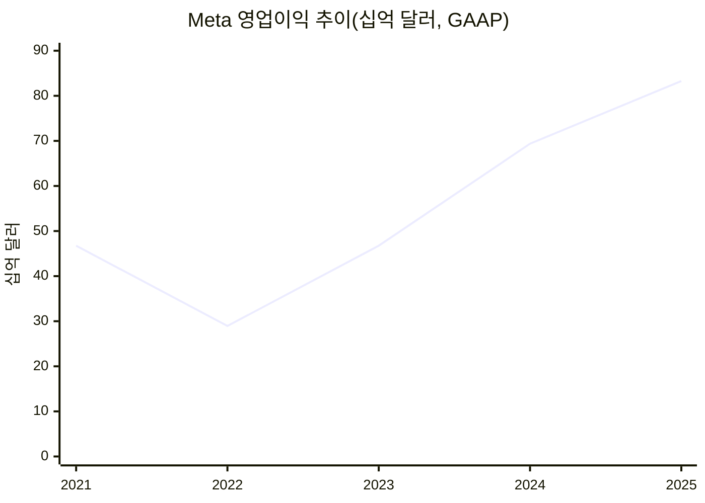
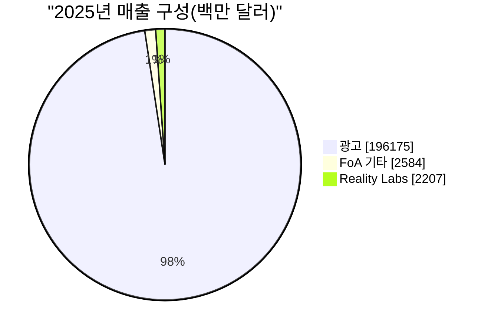

# Meta Platforms(META) 독립 투자 연구 보고서

> 연구일: 2026-10-19(베이징 시간). 시세: 2026-10-16 미국 주식 정규장 종가. 최신 공시 실적: 2026Q2. 연간: 2021—2025. `/investment-research` 8단계 프레임워크를 수행했다. 달러가 유일한 밸류에이션 통화다. 재무 표는 별도 설명이 없는 한 단위가 **백만 달러**다. 본 보고서는 학습·연구용이다.

**결론: 709.33달러는 합리적 가치 구간에 있으며 보유한다. 미보유자는 소액으로 관찰 포지션을 만들 수 있고, 500—600달러가 더 매력적인 분할 매수 구간이다.** 핵심 광고 사업은 여전히 우수하지만 자본 지출, 감가상각, 인재 비용, 법률 지출이 매출 성장을 흡수하고 있다. AI가 광고 효율을 높였다고 해서 모든 AI 투자가 고수익이라고 추론할 수는 없다. 10년 모델은 비중을 제약할 뿐 단독으로 매매를 결정하지 않는다.

**정보 풍부도: A급.** AI 분석 신뢰도가 높은 것은 공시가 충분하기 때문이며, 실제 투자 확실성은 중간 수준에 그친다. 컴퓨팅 투자 수익, 새로운 진입점에서의 점유율, 규제 꼬리 손실은 많은 글에서 확정적인 답을 얻을 수 없다. 본 보고서에는 채널 인터뷰, 내부 광고 집행 실험, 데이터센터 자산의 항목별 평가가 없다. 2026Q3는 10월 21일 장 마감 후 발표 예정이며 연구 시점에는 아직 발표되지 않았으므로, 가이던스를 실제 실적으로 쓸 수 없다. [S14]

## 사전: AI 연구 편향 자체 점검

자료가 풍부할 때 가장 쉽게 생기는 착각은 "추천 시스템이 매출 성장을 가져왔으니 범용 초지능 투자도 반드시 돈을 번다"는 것이다. 본 보고서는 광고 효율, 자본 지출, Agent 사업을 각각 따로 다룬다. 언론 보도가 절반으로 줄어도 소셜 네트워크와 광고 피드백 폐쇄 루프에 대한 판단은 바뀌지 않지만, AI 신제품의 수익성에 대한 확신은 뚜렷하게 낮아진다. 정말 반대 방향에서 검증할 만한 질문은 이것이다. 똑똑한 사람들은 왜 이 광고 현금 기계를 보유하기를 거부하는가? 답은 자본 배분 권한이 고도로 집중되어 있고, 현금 기계의 산출이 반드시 보통주주에게 돌아오는 것은 아니라는 데 있을 수 있다.

- 확실성은 보도 건수가 아니라 광고의 반복 수요와 사용자 네트워크에서 나온다.
- 모델 평가 선두, 다운로드 수, 경영진의 비전을 곧바로 순이익으로 환산하지 않는다.
- 모든 미래 파라미터는 연구 가정이며 회사 가이던스나 시장 컨센서스가 아니다.
- Macrotrends 매출·순이익 페이지는 읽기에 실패했으며, 그 데이터를 확보한 것처럼 꾸미지 않았다. SEC/회사 원본 실적과 StockAnalysis를 사용했고 충돌은 그대로 남겼다.

## 1단계: 데이터, 기준, 증거

### 5년 재무

| 지표 | 2021 | 2022 | 2023 | 2024 | 2025 |
|---|---:|---:|---:|---:|---:|
| 매출 | 117929 | 116609 | 134902 | 164501 | 200966 |
| GAAP 순이익 | 39370 | 23200 | 39098 | 62360 | 60458 |
| GAAP 영업이익 | 46753 | 28944 | 46751 | 69380 | 83276 |
| 매출총이익률 | 80.79% | 78.35% | 80.76% | 81.67% | 82.00% |
| 영업이익률 | 39.65% | 24.82% | 34.66% | 42.18% | 41.44% |
| 영업현금흐름 | 57683 | 50475 | 71113 | 91328 | 115800 |
| 회사 기준 잉여현금흐름 | 38439 | 18439 | 43010 | 52103 | 43585 |
| 현금 및 유가증권 | 47998 | 40738 | 65403 | 77815 | 81592 |

출처: [S1][S2][S3][S4]. 매출총이익률과 영업이익률은 원본 보고 금액으로 계산했으며 제3자 수치를 그대로 옮긴 것이 아니다. 현금은 현금 및 현금성자산에 유가증권을 더한 것이며, 비상장 지분 투자는 현금으로 보지 않는다.

### 최근 4개 분기 부문

| 분기 | 그룹 매출 | FoA 매출 | FoA 전년 대비 | FoA 영업이익 | FoA 영업이익률 | RL 매출 | RL 전년 대비 | RL 영업이익 |
|---|---:|---:|---:|---:|---:|---:|---:|---:|
| 2025Q3 | 51242 | 50772 | 25.93% | 24967 | 49.17% | 470 | 74.07% | -4432 |
| 2025Q4 | 59893 | 58938 | 24.60% | 30766 | 52.20% | 955 | -11.82% | -6021 |
| 2026Q1 | 56311 | 55909 | 33.43% | 26900 | 48.11% | 402 | -2.43% | -4028 |
| 2026Q2 | 60801 | 60370 | 28.05% | 23394 | 38.75% | 431 | 16.49% | -4619 |

FoA는 앱 패밀리, RL은 Reality Labs다. 출처: [S5][S6][S7][S8]. **부문 매출총이익률은 공시되지 않으며, 영업이익률을 매출총이익률로 둔갑시키지 않는다.** 본 표의 Q1은 해당 분기의 원본 공고를 사용했다. Q2 반기 매출에서 당분기를 빼면 56310이 나와 1백만 달러 차이가 나는데, 원본 공시 표 사이의 미세한 차이이므로 원래 값을 유지하고 고치지 않았다. 전년 대비는 모두 각 분기 원본 보고의 비교 기간으로 계산했다.

2025년 부문: FoA 매출 198759, 영업이익 102469. RL 매출 2207, 영업손실 19193. [S6] 광고 매출 196175, 기타 FoA 매출 2584. [S3]

### 현재 스냅샷

| 항목 | 수치 | 일자/설명 |
|---|---:|---|
| 정규장 종가(달러) | 709.33 | 2026-10-16. 회사 시세와 StockAnalysis 이중 출처 |
| A+B 총 주식 수(주) | 2547506225 | 2026-07-24 10-Q 표지의 최신 입수 가능 수치. 10월 실시간 주식 수가 아니다 |
| 계산 시가총액(백만 달러) | 1807022.59 | 종가에 위 주식 수를 곱한 값 |
| TTM 매출 | 228247 | 2026Q2까지 |
| TTM 순이익 | 68098 | GAAP |
| TTM 희석 EPS(달러) | 26.54 | 과거 희석 가중평균 주식 수 기준. 기말 총 주식 수로 볼 수 없다 |
| 세금 항목 조정 후 EPS(달러) | 29.61 | 26.54+6.20−3.13. 두 차례의 세금 항목만 조정 |
| 현금 및 유가증권 | 90260 | 2026-06-30 |
| 장기 채권 장부금액 | 83664 | 리스 제외 |
| 채권 차감 순현금 | 6596 | 현금에 증권을 더하고 채권을 뺀 값 |
| 리스 포함 총부채 | 112318 | 제3자의 운용리스 포함 기준 |
| 리스 포함 순부채 | 22058 | 운용리스 포함. 모든 부채는 아니다 |
| 자기자본 | 261221 | 2026-06-30 |
| TTM 회사 기준 FCF | 37872 | 2025년 연간+2026H1−2025H1 |

[S3][S7][S8][S9][S10]. 리스 포함 부채 112318은 채권 83664, 유동 운용리스 2425, 장기 운용리스 26229로 구성된다. 여기서는 제3자 정의를 따랐으며, 모든 금융리스 부채를 항목별로 연결했다고 주장하지 않는다. 회사의 Q2 장기 부채 문구 설명은 반올림해 83660이다. 모델은 재무상태표의 83664를 썼고 차이는 중요하지 않다. 제3자의 총 주식 수는 약 25.5억 주로 원본 보고와 1퍼센트포인트 미만 차이다. A주 22.05억 주만 쓰면 시가총액을 과소평가한다. Macrotrends 시가총액 검색 요약은 약 1.807조 달러, StockAnalysis는 약 1.81조 달러로 계산 결과와 일치한다. 다른 집계 사이트에는 1.88조 달러가 나오지만 시점/주식 수 기준이 밝혀지지 않아 채택하지 않았다. [S11]

**세금 항목은 무시할 수 없다.** 2025Q3에 일회성 비현금 세금 비용이 15930 증가했고, 2026Q1에 세금 비용 일부가 환입되어 8030의 이익이 생겼다. 전자만 더하고 후자를 빼지 않으면 이익이 부풀려진다. 조정 후 EPS는 회사가 발표한 연간 non-GAAP EPS가 아니며, 법률 비용과 감원 비용을 모두 영구히 재발하지 않는 것으로 보지도 않았다. [S5][S7]

### 원래 값의 충돌과 수정

| 필드 | 원본 실적 | StockAnalysis 원래 값 | 처리 |
|---|---:|---:|---|
| 2025년 매출 | 200966 | 200966 | 일치 |
| 2025년 순이익 | 60458 | 60458 | 일치 |
| 2026Q2 현금 및 증권 | 90260 | 90260 | 일치 |
| 2022년 영업이익 | 28944 | 33555 | 차이가 1퍼센트포인트를 넘는다. SEC GAAP를 채택. 제3자가 일부 구조조정 항목을 제외한 것으로 추정되나 완전한 조정 내역은 확인하지 못했다 |
| 2022년 매출총이익률 | 78.35% | 79.63% | 원본 보고의 원가는 25249이며 원본 보고를 채택. 이중 출처 일치라고 할 수 없다 |
| 2025년 잉여현금흐름 | 43585 | 46109 | 제3자는 금융리스 원금 2524를 차감하지 않았고, 조정하면 같아진다 |
| 2021년 잉여현금흐름 | 38439 | 38993 | 제3자 CAPEX는 18690, 회사의 순 취득·건설은 18567. 여기에 금융리스 원금 677을 더 빼면 회사 기준이 된다 |

원본 실적과 제3자는 회사 공시라는 공통의 상류를 가지므로 두 벌의 독립된 감사를 뜻하지 않는다. 여기서의 "이중 출처"는 전사/기준의 교차 점검에 쓴다. 원래 값, 실패 안내, 재계산은 `data.json`, `tool-audit.log`에 보존했으며, 제3자 수치를 고쳐 써서 일치를 만들어 내지 않는다.

**추궁: 순이익과 PE만 보면 매년 지불해야 하는 컴퓨팅 현금을 놓치지 않는가? 놓친다. FCF, 금융리스, 약정 구매를 함께 추적해야 한다.**

## 2단계: 사업의 본질 — 사용자의 주의력과 측정 가능한 상업적 효과

한 문장 정의: Meta는 무료 통신·콘텐츠 제품으로 주의력을 모으고, 광고주가 측정 가능한 도달과 전환을 경쟁 입찰로 사게 한다. 최종 사용자는 주된 지불자가 아니며 상인과 브랜드가 지불자다. 광고 수요는 효과와 예산에 따라 반복 발생하며, 다년 계약으로 묶인 구독 매출이 아니다.

| 사업 요소 | 판단 |
|---|---|
| 사용자 가치 | 지인 연결, 인스턴트 메시징, 콘텐츠 발견. 앱마다 서로 다른 관계를 분담한다 |
| 지불 이유 | 대규모 인구 속에서 구매, 설치, 문의를 더 낮은 비용으로 얻는다 |
| 유지 메커니즘 | 연락처, 크리에이터와 브랜드의 오디언스 축적, 소비 습관, 추천 품질 |
| 영업 레버리지 | 추천·광고 모델은 수많은 고객에게 서비스할 수 있다. 다만 추론, 감가상각, 콘텐츠 관리 비용은 규모에 따라 오른다 |
| 전환 폐쇄 루프 | 광고 노출→전환 신호→집행 최적화→광고주의 예산 추가 |
| 경계 | 광고 부하를 무한히 높일 수 없고 사용자의 시간은 유한하다. 경기 침체 시 예산은 즉시 줄어들 수 있다 |

2026Q2 노출량은 전년 대비 14% 늘고 단가는 12% 올랐으며, 앱 패밀리 일간 활성 인원은 약 36억 명이다. 매출은 여전히 강하지만 그룹 영업이익은 줄었다. "물량과 가격이 함께 오르는 것"이 "주주 현금이 함께 늘어나는 것"과 같지 않음을 보여 준다. [S8] 기존 소셜 관계는 진짜 자산이지만 광고 예산은 충성스럽지 않아, 효과가 나빠지면 검색, 전자상거래, 다른 숏폼 플랫폼으로 옮겨 갈 수 있다.

**추궁: 이 사업은 어디가 좋은가? 동일한 사용자와 피드백 시스템이 규모가 다른 무수한 상인의 고객 확보를 반복해서 도울 수 있고, 맞춤 소프트웨어를 하나하나 판매할 필요가 없다. 전제는 고객 확보의 가치가 플랫폼의 지속적인 투입을 넘어서는 것이다.**

## 3단계: 해자와 경쟁

| 유형 | 강약과 증거 | 향후 검증 |
|---|---|---|
| 브랜드/가격 결정 | 중간. 경쟁 입찰 광고의 가격 인상은 효과와 수요에서 나오며 임의로 올리는 것이 아니다 | 가격이 오를 때 전환 수익이 유지되는가 |
| 전환 비용 | 사용자 측은 중상, 광고주 측은 중하. 지인 네트워크는 옮기기 어렵고 예산은 옮기기 쉽다 | 그룹 채팅/크리에이터가 다른 플랫폼으로 옮겨 가는가 |
| 네트워크 효과 | 통신에서는 강하다. 알고리즘 콘텐츠는 콘텐츠 풀과 매칭 역량에 더 의존한다 | AI 생성 콘텐츠가 원작 공급과 신뢰를 약화시키는가 |
| 규모의 경제 | 강하다. 학습, 추천, 광고 인프라를 재사용할 수 있다 | 단위 유효 전환 비용이 컴퓨팅 투입에 따라 내려가는가 |
| 기술 장벽 | 중강이지만 동적이다. 광고 모델과 엔지니어링 폐쇄 루프는 강하나 기초 모델의 선두는 영구화될 수 없다 | 연구개발 투입을 지속 가능한 증분 이익으로 바꾸는가 |

| 경쟁자 | 직접 다투는 것 | Meta의 상대적 위치 |
|---|---|---|
| Alphabet/YouTube | 영상 시청 시간, 광고 예산, AI 진입점 | Meta는 소셜/비즈니스 메시징이 강하고, Google은 검색 구매 의도와 시스템 배포가 강하다 |
| TikTok | 숏폼과 젊은 사용자의 주의력 | 소셜 관계가 숏폼 시청 시간을 온전히 지켜 주는 보호막은 아니다 |
| Amazon | 구매 의도가 있는 광고와 상인 예산 | Meta는 수요를 일으킬 수 있고, Amazon은 거래와 구매 신호를 갖췄다 |
| Apple | 모바일 시스템, 프라이버시 규칙, 웨어러블 진입점 | Meta에는 휴대폰 운영체제 통제권이 없다 |
| OpenAI 등 Agent 플랫폼 | 사용자 의도, 어시스턴트 진입점, 작업 수행 | Meta에는 배포력이 있지만, 독립 Agent 플랫폼이 거래 경로를 재편할 수 있다 |
| Snap/Pinterest | 특정 인구, 시각적 발견 광고 | 규모는 작지만 특색 있는 장면을 차지할 수 있다 |

통일된 시장 점유율을 꾸며 내지 않는다. 글로벌 광고, 미국 디지털 광고, 소셜 광고, 숏폼 시청 시간은 기준이 서로 다르고 같은 기간의 비교 가능한 데이터가 부족하다. 이번에는 모든 경쟁자의 같은 날짜·같은 기준 밸류에이션을 확보하지 못했으므로, 정밀해 보이는 동종 업계 PE 순위를 만들지 않는다. 5년 해자는 전반적으로 여전히 강하며, 추천 엔지니어링이 프라이버시 신호 손실의 일부를 보완했다. 그러나 인프라의 자본 집약도가 오르고 있어, 해자가 있다고 자본수익률이 반드시 오르는 것은 아니다.

**추궁: 10년 뒤에도 해자가 남아 있는가? 관계 네트워크는 높은 확률로 여전히 가치가 있다. 상호작용과 구매가 모두 플랫폼을 넘나드는 Agent에 넘어가고, Meta가 진입점을 잃은 채 비싼 인프라만 떠안는다면 광고 피드백 폐쇄 루프는 약해질 수 있다.**

## 4단계: 거꾸로 생각하기 — 실패 경로

아래의 "고/중/저"는 주관적 위험 등급이며 통계 가능한 확률이 아니다. 수치 시나리오 확률은 밸류에이션에서 따로 본다.

| 경로 | 확률 판단 | 영향 | 관찰 가능한 신호 |
|---|---|---|---|
| AI 자본 지출을 장기간 회수하지 못함 | 중상 | FCF, 자사주 매입 여력, 증분 ROIC 하락 | 매출 성장은 여전히 강한데 FCF가 장기간 부진. 자금 조달 증가 |
| 광고 효과가 대체되거나 트래픽이 이동 | 중 | 구조적인 이익률 하락 | 노출량/전환 가치 성장이 경쟁자에 계속 뒤처진다 |
| 규제 중징계, 분할 또는 아동 보호 조치 | 저에서 중. 금액은 정확히 추정할 수 없다 | 중대한 꼬리 손실 | 새 판결, 구제 조치, 공시된 발생 부채의 변화 |
| 지배구조 불균형, 장기 프로젝트에 끝없는 추가 투입 | 중상 | 보통주주 수익이 희석된다 | 프로젝트에 마일스톤이 없고 자사주 매입이 SBC를 상쇄하지 못한다 |
| 감가상각 과소 계상/설비 내용연수 과대 | 중 | 회계 이익이 경제적 이익보다 높다 | 교체 주기 단축, 처분 손실 증가 |
| 핵심 공급사/전력/데이터센터 공급 중단 | 저에서 중 | 상업화가 늦어지고 고정비가 확대된다 | 프로젝트 지연, 유휴 및 구매 약정 손실 |
| 광고의 거시적 침체 | 중, 경기순환적 | 단기 이익과 밸류에이션이 동시에 하향된다 | 중소 상인 예산, CPM 하락 |

역사적 유추는 메커니즘을 시사할 뿐이다. 전통 포털은 거대한 사용자 트래픽을 갖고도 새로운 진입점에 잠식당했다. 통신망과 광섬유 건설은 "사회에 더 많은 인프라가 필요하다"는 것이 "모든 건설자가 높은 수익을 번다"와 자동으로 같지 않음을 보여 준다. Meta를 포털이나 통신사와 기계적으로 동일시할 수는 없다. 소셜 네트워크와 성과 피드백에는 다른 장벽이 있기 때문이다.

재무상태표 밖의 추가 제약: 2026Q2 10-Q는 아직 개시되지 않은 리스 의무 약 278990, 취소 불가 계약 약정 약 349310(백만 달러)을 공시했으며, 후자에는 클라우드 용량과 하드웨어/인프라가 포함된다. 둘을 점검 없이 그대로 더해 당기 부채로 볼 수는 없고 미래 구매는 미래 서비스에 대응하지만, 자본 지출의 철회 가능성을 크게 제한한다. 이 금액들을 EV에 전액 중복 차감하지 않았다. 밸류에이션은 미래 이익률/현금흐름에 대한 압력을 이미 일부 반영했으며, 계약별 만기 현금흐름은 아직 모델링하지 않았다. [S8]

주된 매도 측 논점은 광고 사업이 내일 사라진다는 것이 아니라, 핵심 광고 이익이 연구 경쟁과 하드웨어 베팅에 영구히 묶인다는 것이다. 매수 측은 신규 투입이 만들어 내는 현금이 자본비용을 넘는다는 것을 증명해야 하며, 알고리즘 지표 개선만 보여 줘서는 안 된다. 2025년 일부 서버/네트워크 자산의 내용연수 연장은 감가상각 증가율에 영향을 주며, 재검토가 필요한 회계 추정에 해당한다. 곧바로 분식이라고 단정해서는 안 된다. [S2]

**추궁: 가장 저지르기 쉬운 실수는 무엇인가? 단기 비용 조정 후의 보기 좋은 이익을 장기 주주이익으로 여기고, 금융리스, 주식 보상, 유지보수성 CAPEX를 빠뜨리는 것이다.**

## 5단계: 경영진과 자본 배분

Zuckerberg는 창업자이자 이사회 의장 겸 CEO다. 2026년 위임장 자료는 그의 A주 639347주, B주 341823978주, 의결권 60.8%를 공시했다. 경제적 지분은 약 10%를 조금 넘어 지배권보다 훨씬 낮으므로 "지분 60%"라고 쓸 수 없다. 이는 4월 위임장 자료 시점의 수치이며 10월의 최신 보유량이 아니다. 제3자 뉴스는 지배권이 약 60%임을 확인했다. 정확한 경제적 지분은 같은 날짜의 독립된 이중 출처 검증을 얻지 못했으므로, 거짓 정밀도의 백분율은 제시하지 않는다. [S12]

| 결정 | 관찰된 결과 | 연구 판단 |
|---|---|---|
| Instagram, WhatsApp 플랫폼 포석 | 앱 패밀리의 중요한 네트워크가 되었다 | 전략적 안목이 강하다. 개별 이익은 공시되지 않아 인수 IRR을 정밀 계산할 수 없다 |
| 2022—2024년 효율 조정 | 영업이익이 저점에서 뚜렷하게 회복했다 | 오류를 바로잡을 수 있다. 다만 사이클과 비용 조정이 모두 기여했다 |
| Reality Labs 지속 투입 | 2025년 영업손실 19193 | 제품 탐색에는 옵션 가치가 있으나 현금 수익은 아직 투입의 합리성을 증명하기에 부족하다 |
| 2024년 배당 개시, 지속적인 자본 환원 | 가시적인 현금 환원을 높였다 | 자사주 매입은 SBC 차감 후의 주식 수 변화로 평가해야 한다 |
| 2026년 컴퓨팅 투입 대폭 확대 | 최신 CAPEX 가이던스 130000—145000 | 회사를 자산 경량형 광고 플랫폼에서 자본 집약 단계로 밀어 넣는다 |

2025년 연구개발 지출 57372, SBC 20427. [S2] 연구개발비는 이미 손익에 들어갔으므로 밸류에이션에서 다시 전액을 중복 차감해서는 안 된다. FCF는 SBC를 더해 넣으므로 희석 또는 희석 상쇄에 필요한 자사주 매입 현금을 반드시 고려해야 한다. 2025년 공고는 자사주 매입 26260을 공시했다. 제3자 현금흐름의 "보통주 매입" 항목을 가려 보지 않고 순수한 시장 매입으로 볼 수는 없다. 거기에는 임직원 주식 보상 결제 관련 현금이 포함되어 있을 수 있기 때문이다. [S6][S4]

경영진 평가: 제품 반복 개선과 조직 동원은 강한 편이다. 자본 배분은 중간이며 불확실한 쪽에 가깝다. 소액주주에 의한 지배구조 견제는 약한 편이다. CEO가 은퇴해도 핵심 제품과 광고 인프라가 즉시 무력화되지는 않지만, 사이클을 넘나드는 자본 배분과 차세대 진입점에 대한 통일된 리더십에는 아직 검증 가능한 승계 사례가 없다.

**추궁: 그에게 자본 배분 권한을 맡길 의향이 있는가? 한도를 두고 맡길 수 있다. 다만 창업자의 과거 성공을 이유로 투입 수익에 대한 점검을 없앨 수는 없다.**

## 6단계: AI, 산업, 장기 이익

미국 디지털 광고의 2025년 규모는 약 2946억 달러, 전년 대비 약 13.9% 성장이며 IAB/PwC에서 나온 수치다. 이는 미국 시장이므로 Meta의 글로벌 광고 매출을 그대로 나눠 글로벌 점유율을 추정할 수 없다. [S13] TAM의 장기 성장은 경제 규모, 광고의 디지털화, 거래 효율에 달려 있으며, 사회 전체의 모든 상업 매출을 광고가 가져갈 수 있는 매출로 볼 수는 없다.

AI는 Meta에 세 가지 경제적 경로를 준다. 첫째, 추천과 광고 매칭이 전환을 높인다. 둘째, 생성형 소재, 자동 집행, 비즈니스 메시징이 상인의 집행 효율을 높인다. 셋째, 개인 Agent/웨어러블이 새로운 진입점을 형성한다. 앞의 둘은 기존 매출이 받쳐 주지만, 셋째는 유지율, 유료화, 단위 추론 비용을 여전히 증명해야 한다.

최신 제품을 빠뜨릴 수 없다. Meta는 2026년 9월 Muse 개인 Agent를 공개했고, 소기업을 대상으로 Meta 광고 및 비즈니스 계정과 연결하는 기능을 추가로 소개했다. [S15][S16] **출시는 사실이고 상업적 성공은 추론이다.** 본 보고서는 Muse의 독립 매출, 유료 유지율, 작업당 매출총이익 데이터를 얻지 못했으므로 거액의 독립 밸류에이션을 직접 부여하지 않는다. Llama와 기타 모델, 추천 인프라, 맞춤형 컴퓨팅, 외부 공급사가 함께 기술 역량을 이루며, 오픈소스 다운로드 수만으로 해자를 평가할 수 없다.

| 시점/시나리오 | 매출 가정(백만 달러) | 이익 메커니즘 |
|---|---:|---|
| 2029 비관 | 260000 | 성장 둔화, AI 비용이 압박. 3년 모델 순이익 약 68844 |
| 2029 기준 | 350000 | 상업적 효과의 성장이 비용을 상쇄. 3년 모델 순이익 약 105976 |
| 2029 낙관 | 400000 | 광고 효율과 비즈니스 메시징의 수익화, 순이익 약 130346 |
| 2036 비관 | 320000 | 순이익률 20%, 이익 64000 |
| 2036 기준 | 650000 | 순이익률 32%, 이익 208000 |
| 2036 낙관 | 1000000 | 순이익률 36%, 이익 360000 |

모두 시나리오이며 회사 가이던스가 아니다. 3년 이익은 주당순이익 성장 모델에서 나왔고 기말 주식 수를 불변으로 뒀다. 10년 이익은 매출에 순이익률을 곱해 계산했다. 기준 2036년 이익은 **연 2080억 달러**이지만, 분배 가능한 비율은 유지보수성 CAPEX, 부채, 지속적인 연구개발에 달려 있으며 2080억 달러의 현금이 전부 환원된다는 뜻이 아니다.

향후 3년 AI의 순증 이익은 "신규 광고/비즈니스 메시징 매출총이익−신규 추론 운영비−인재 비용−감가상각"으로 따져야 하며, 투자 현금흐름에서는 CAPEX를 따로 뺀다. 2026년 Q2 한 분기의 자본 지출은 리스 원금을 포함해 약 31080, FCF는 784에 그쳤다. 매출 차원의 AI 수익이 모든 신규 자본 투자가 기준을 충족함을 증명하기에는 아직 부족함을 보여 준다. [S8] 기준 가정은 이후 성장이 둔화하고 지출 규율이 개선된다는 것이다. 자본 지출이 장기간 매출을 쫓아간다면 기준 순이익률과 FCF 회복을 모두 하향해야 한다.

소비자/광고주가 분산되어 있어 단일 고객 위험은 줄지만, 첨단 칩, 제조, 전력, 클라우드 서비스 공급망은 상대적으로 집중되어 있고 회사의 글로벌 배포력으로 이 위험을 없앨 수는 없다. 인터넷 시대의 사회적 연결 가치는 여전히 남아 있으며, AI 시대에 거래 진입점을 지킬 수 있는지가 가치 사슬에서의 위치를 결정한다.

**추궁: 20년 뒤에는 인프라에 가까운가, 반짝 유행에 가까운가? 소셜·상업 네트워크는 인프라의 특징을 가진다. 범용 AI와 안경은 아직 검증이 필요한 장기 선택권이다.**

## 7단계: 가격, 안전마진, 비중 압력

### 현재 밸류에이션

| 지표 | 결과 | 기준 |
|---|---:|---|
| GAAP TTM PE | 26.73배 | 주가/26.54 |
| 세금 항목 조정 PE | 23.96배 | 주가/29.61. 모든 법률·감원 비용을 제외하지는 않는다 |
| TTM PS | 7.92배 | 계산 시가총액/매출 |
| EV/Revenue | 8.01배 | 리스 포함 부채, 현금·증권 전액 차감 |
| 회사 기준 FCF 수익률 | 2.10% | TTM 37872/계산 시가총액 |

PEG에는 객관적인 유일한 값이 없다. 이익 성장은 세금 항목 환입과 CAPEX 사이클에 의해 왜곡되므로, "정밀한 PEG"로 싸다는 결론을 만들어 내지 않는다. 세금 항목, 수정주가, 시점을 통일할 수 있는 과거 PE 시계열을 얻지 못했으므로 과거 분위수를 주장하지 않는다. 본 보고서는 옛 최고가로의 복귀를 가치의 근거로 삼지 않는다.

### 3년 3개 시나리오 — 비싼가에 대한 답

출발점 EPS는 29.61달러다. 주식 수를 불변으로 두고 자사주 매입에 따른 증가분을 따로 얹지 않는다. 밸류에이션의 성장 파라미터는 주당순이익 성장이며, 배당은 3년 자본 이득 연환산에 넣지 않는다. 2029년 PE는 유한 기간에 대한 시나리오 판단이며 **10년 잔존가치 배수의 근거로 쓰지 않는다**.

| 시나리오 | EPS 연 성장률 | 2029 EPS | 2029 PE | 2029 가격 | 10%로 할인한 현재가치 | 가격 연환산 수익률 |
|---|---:|---:|---:|---:|---:|---:|
| 비관 | -3% | 27.02 | 18배 | 486.44 | 365.47 | -11.82% |
| 기준 | 12% | 41.60 | 24배 | 998.40 | 750.11 | 12.07% |
| 낙관 | 20% | 51.17 | 28배 | 1432.65 | 1076.37 | 26.40% |

기준 할인 현재가치는 현재가를 조금 웃도는 데 그쳐 안전마진이 제한적이다. 3년 합리적 가치의 중심은 약 750달러이며, 시나리오 불확실성을 감안해 **650—800달러를 합리적 구간**으로 제시한다. **500—600달러에서 분할 매수**한다. **900달러를 넘으면 더 강한 이익/현금흐름 증거가 필요하다.** 구간은 종합 판단이며 단일 모델이 자동으로 생성한 것이 아니다. 기준 PE 24배는 성장이 여전히 남아 있다는 기대를 반영하지만, 2029년에도 무거운 CAPEX와 낮은 FCF 상태라면 반드시 하향해야 하며 시장이 영원히 소프트웨어 플랫폼으로 평가할 것이라고 미리 전제할 수 없다.

### 역DCF

달러 기준 주주 귀속 현금흐름을 사용하며 r=10%, 10년 후 g=3%다. 시가총액에 현금을 다시 더해 이중 계산하지 않는다. 여기서는 FCF가 주주에게 귀속되는 세후 현금흐름의 대리 지표라고 명시적으로 가정한다. 최근의 자금 조달/확장 때문에 이 대리 지표는 불안정하다. 향후 10년의 일정 성장률은 가격이 요구하는 바를 설명하는 데만 쓰며 실제 연도별 경로의 예측이 아니다.

| 출발 현금흐름(백만 달러) | 현재가에 맞추는 데 필요한 10년 연 성장률 |
|---|---:|
| 실제 TTM 회사 기준 37872 | 18.89% |
| 정상화 가정 60000 | 12.66% |
| 정상화 가정 80000 | 8.79% |

현재가가 싼지 여부는 장기 현금흐름의 정상화 수준에 달려 있다. 유지보수성 자본 지출을 너무 낮게 잡으면 밸류에이션 결론이 "싸게 계산"된다. 60000과 80000은 민감도 가정이며 실현된 잉여현금흐름이 아니다.

### 10년 잔존가치 — 비중을 얼마나 실을 수 있는가에 대한 답

r=10%, USD. rf는 장기 모델링 가정 4.5%, β=1, ERP 가정 5.5%를 썼으며, 10월 16일 국채 현물 수익률이라고 주장하는 것이 아니다. 합리적인 달러 r 구간은 9%—11.5%다. 영구 g는 각각 1.5%, 3%, 4%이며 상한은 4%다. 정상 상태 증분 ROIC는 20%로 잡았다. 이는 자본 집약도가 높아진 후기의 수익에 대한 판단이며, 자산 경량 시기의 과거 수익을 그대로 가져올 수 없음이 분명하다. 3단계 순이익은 앞 절을 참조한다. 확률 25/50/25는 주관적인 시나리오 가중치이며 통계적 보정을 하지 않았다. 배당에서 순희석을 뺀 k=0.3%는 근사치다. 주식 수는 불변으로 두고 자사주 매입을 중복 계산하지 않는다.

엑시트 배수는 오직 `PE=(1−g/ROIC)/(r−g)`에서 나오며 동종 업계 수치를 그대로 가져온 것이 아니다. 도구의 IRR 공식은 잔존가치 자본 이득의 기하 연환산에 k를 더한 단순화 근사이며, 연도별 완전한 배당 현금흐름으로 근을 구한 것이 아니므로 이 한계를 감안해 해석해야 한다.

| 시나리오 | 2036 순이익(백만 달러) | g | r−g | 엑시트 PE | 10년 근사 IRR |
|---|---:|---:|---:|---:|---:|
| 비관 | 64000 | 1.5% | 8.5% | 10.88배 | -8.79% |
| 기준 | 208000 | 3.0% | 7.0% | 12.14배 | 3.71% |
| 낙관 | 360000 | 4.0% | 6.0% | 13.33배 | 10.56% |

확률 가중 IRR은 시나리오별 연환산 수익률의 가중 평균이며 합성 현금흐름의 IRR이 아니다. 세 단계가 모든 결과를 포괄하지는 않는다. 중대한 규제 중징계/강제 분할과 데이터센터 공급 중단은 여전히 계량화하지 않았으며, 극단적 손실은 비관 시나리오보다 낮을 수 있다.

| r | 기대 IRR | r을 충족하는가 | 유효성 |
|---|---:|---|---|
| 8% | 5.82% | 아니오 | 구간 밖이라 참고용. 또한 낙관의 r−g가 5퍼센트포인트에 못 미친다 |
| 10% | 2.29% | 아니오 | 기준 |
| 12% | -0.25% | 아니오 | 구간 밖이라 참고용 |
| 9% | 3.89% | 아니오 | 구간 내 ±1퍼센트포인트 재검토 |
| 11% | 0.94% | 아니오 | 구간 내 ±1퍼센트포인트 재검토 |

**합리적 통화 구간 안에서 반전은 없으며, 스트레스 테스트는 시종 자본비용을 충족하지 못했다.** ±2퍼센트포인트는 양쪽 모두 구간 밖이므로 ±1퍼센트포인트를 따로 돌렸다. g는 고정이며 r에 따라 변하지 않는다. 모든 기준 잔존가치의 분모는 최소 5퍼센트포인트다. audit 로그 안의 고정 참고 설명에 나오는 내장 무위험 이자율/ERP 문구는 본 보고서의 채택 수치를 뜻하지 않는다. 본 보고서의 파라미터는 명령의 `--rf 0.045`와 본 절의 가정을 기준으로 한다.

### 밸류에이션 괴리의 대사

3년 기준의 가격 연환산은 약 12%, 10년 기준은 약 3.7%에 그치는데 이 차이는 계산 착오가 아니다. 3년 전망은 여전히 성장기의 24배 PE를 부여하고, 10년은 정상 상태 공식에 따라 약 12배로 내려간다. 10년 가정은 아직 검증되지 않은 AI 신사업에 영구적인 고성장률을 주지 않았다. **3년은 가격 판단이고, 10년은 비중 스트레스 테스트다.** 장기 모델은 중간의 현금 환원도 단순화했으므로, 이를 근거로 우량한 핵심 사업을 곧바로 일괄 부결할 수는 없다.

6개 차원을 종합한 뒤 보유/소액 관찰 제안을 유지하되 비중은 조인다. 분산된 주식 포트폴리오에서 연구 프레임워크의 예시 상한은 약 5%, 신규 관찰 포지션은 약 1%—2%다. 이는 사용자의 전체 자산·부채에 근거해 정한 개인 맞춤 비율이 아니다. 매수 가격에 도달했을 때도 FCF와 자본 규율을 함께 점검해야 하며, 가격 하락만 기계적으로 기다려서는 안 된다. 10년 결과가 시사하는 바도 있다. 비중을 크게 실으려면 더 낮은 매수가, 뚜렷하게 더 나은 현금 환원, 또는 더 높은 장기 이익을 뒷받침하는 증거가 필요하며, r만 낮춰서는 안 된다.

**추궁: 시장이 5년간 닫혀도 보유할 의향이 있는가? 제한된 비중으로 광고 네트워크를 보유할 의향은 있다. 자본 수익의 증거가 없는 상태에서 AI 예산 전체에 베팅할 의향은 없다.**

## 8단계: 종합 의사결정 메모

| 차원 | 결론 | 확신도 |
|---|---|---|
| 사업의 질 | 핵심 광고와 통신 네트워크가 우수하고 현금 창출이 강하다 | 높음 |
| 해자 | 네트워크, 규모, 광고 피드백이 유효하다. 새로운 진입점에 의한 침식 위험이 있다 | 중상 |
| 경영진 | 제품 역량은 강하나 장기 자본 규율과 소액주주 견제가 부족하다 | 중 |
| 최대 위험 | AI 자본 배분의 수익 부족에 규제 꼬리 손실이 겹친다 | 중 |
| 문명의 추세 | AI가 기존 광고 효율을 높인다. 신규 Agent와 안경의 상업화는 아직 입증되지 않았다 | 중 |
| 밸류에이션 | 3년은 합리적이나 뚜렷한 안전마진이 부족하다. 10년 스트레스는 통과하지 못했고 구간 내에서 반전하지 않아 비중을 제약한다 | 중하 |

밸류에이션 해제 문구: 위 밸류에이션 한 칸은 최종 결정의 유일한 판정이 아니며, 10년이 r을 충족하지 못한 것은 비중만 낮춘다. 보유 결론은 여섯 항목의 병렬 평가와 이미 마친 괴리 대사에서 나온다.

| 전략 | 제안 |
|---|---|
| 미보유자 | 709.33달러에서 소액으로 관찰할 수 있다. 500—600달러이고 펀더멘털이 악화되지 않았을 때 분할 매수하는 편이 더 매력적이다 |
| 보유자 | 보유한다. 집중도가 높다면 포트폴리오 위험 관리를 우선하고, AI 서사 때문에 계속 추가 매수하는 것을 피한다 |
| 매도 신호 | 광고 전환 가치의 지속적 유실, 소셜 네트워크의 이동, AI 투입이 장기간 회수되지 않는데도 조정을 거부하는 경우, 또는 밸류에이션이 900달러를 넘는데 이익 증거가 따라오지 않는 경우 |
| 추가 매수 신호 | FCF 회복, 자본 지출 증가가 영업현금흐름 증가를 뚜렷하게 밑돎, 단위 광고 효과가 개선되고 이익이 남음, 가격이 안전 구간에 진입 |
| 다음 업데이트 | 2026Q3 정식 실적 발표 후 이익, 연간 CAPEX, 2027년 지출, 법률 부채, Muse 유료화/비용 공시를 재검토한다 |

### 네 거장의 원문 제약

이번에는 버핏, 멍거, 돤융핑, 리루가 Meta/이번 AI 자본 배분 의제에 대해 한 원래 발언을 검증 가능한 수준으로 충분히 확보하지 못했으므로, **네 사람 모두 "자료 부족, 대변을 모사하지 않는다"**. 각 장에서 빌린 것은 스킬이 요구하는 분석 질문이며, 그들 본인이 이 주식, 이 가격, 이 모델에 찬성한다는 뜻이 아니다.

### 감사 결론과 한계

금융 도구의 시가총액, 교차 데이터, 밸류에이션, 3년 시나리오를 수행했다. 잔존가치 audit, pe, irr, flip ±2퍼센트포인트 및 ±1퍼센트포인트를 수행했고 최종 audit을 다시 수행했다. 상세 명령, 출력, 0이 아닌 종료 코드는 모두 `tool-audit.log`에 보존했다. 그중 원래 값의 충돌은 의도적으로 남겼고, 원본 데이터 선택은 SEC로 해결했으며 지워서는 안 된다. cross-validate는 기본적으로 중간값과 2퍼센트 임계값으로 표시하지만, 본 보고서는 여전히 원본 실적을 분모로 하고 1퍼센트 규칙에 따라 수작업으로 재검토했다.

`report_audit extract/verdict`를 수행했다. 식별 가능한 수치 137개를 추출했고, 고정 시드 42로 21개 항목을 표본 점검했으며 21개 항목의 수치가 일치했다. 그중 4개 항목은 모델 재계산이며 외부 사실 검증이 아니다. 그 밖에 설명 열의 오추출과 제3자 충돌 원래 값의 대조가 포함된다. 수작업 커버리지 분류는 `audit-results.json`과 `audit-coverage.md`를 참조한다. 자동 감사는 숫자와 검증값의 일치 여부만 검증할 수 있고, 전망의 성립, 자료의 독립성, 커버리지의 완전성을 증명하지 못한다. 모델 파라미터 표본은 "모델 재계산"으로 표시했으며 외부 사실 검증이라고 부르지 않는다. Macrotrends의 완전한 재무 표, 같은 날짜의 정확한 경영진 경제적 지분, 부문 매출총이익률, 모든 경쟁자의 같은 날짜 밸류에이션, Muse의 독립 상업 지표를 얻지 못한 것은 명확한 공백이다. 중대한 규제/분할과 공급 중단의 꼬리는 계량화하지 않았으며, 시나리오 확률을 완전한 분포로 볼 수 없다.

**AI 분석 신뢰도: 과거 주요 재무와 주가는 높은 편, 장기 증분 ROIC, AI의 신규 이익, 10년 밸류에이션은 중하. 투자 확실성: 핵심 광고는 중상, 자본 배분과 새로운 진입점은 중하, 전체적으로 중간.**

## 부록: 출처와 재계산

모두 베이징 시간 2026-10-19에 읽었다. 원본 사실은 SEC/회사 공시를 기준으로 한다. 웹 페이지는 계속 갱신될 수 있으며 데이터 스냅샷은 `data.json`에 남겼다. 도구 출력 부록은 [`tool-audit.log`](tool-audit.log), 계산 스크립트는 [`model.py`](model.py), 결과는 [`model-output.json`](model-output.json)이다. 원본 사이트 읽기 기록의 색인과 실패 설명은 [`source-register.json`](source-register.json)을 참조한다.

- [S1] [Meta 2023 10-K(2021—2023 포함)](https://www.sec.gov/Archives/edgar/data/1326801/000132680124000012/meta-20231231.htm)
- [S2] [Meta 2025 10-K(2023—2025 포함)](https://www.sec.gov/Archives/edgar/data/1326801/000162828026003942/meta-20251231.htm)
- [S3] [StockAnalysis 재무 표](https://stockanalysis.com/stocks/meta/financials/?p=ttm)
- [S4] [StockAnalysis 현금흐름](https://stockanalysis.com/stocks/meta/financials/cash-flow-statement/)
- [S5] [2025Q3 원본 공고](https://investor.atmeta.com/files/doc_financials/2025/q3/Meta-09-30-2025-Exhibit-99-1-Final.pdf)
- [S6] [2025Q4 원본 공고](https://www.sec.gov/Archives/edgar/data/1326801/000162828026003832/meta-12312025xexhibit991.htm)
- [S7] [2026Q1 원본 공고](https://investor.atmeta.com/investor-news/press-release-details/2026/Meta-Reports-First-Quarter-2026-Results/default.aspx)
- [S8] [2026Q2 원본 공고](https://investor.atmeta.com/investor-news/press-release-details/2026/Meta-Reports-Second-Quarter-2026-Results/), [2026Q2 10-Q](https://www.sec.gov/Archives/edgar/data/1326801/000162828026050705/meta-20260630.htm)
- [S9] [회사 과거 시세](https://investor.atmeta.com/stock-info/), [StockAnalysis 과거 시세](https://stockanalysis.com/stocks/meta/history/)
- [S10] [StockAnalysis 주식 수와 밸류에이션](https://stockanalysis.com/stocks/meta/statistics/)
- [S11] [StockAnalysis 시가총액](https://stockanalysis.com/stocks/meta/market-cap/), [Macrotrends 시가총액 요약](https://www.macrotrends.net/stocks/charts/META/meta-platforms/market-cap)
- [S12] [2026 위임장 자료](https://www.sec.gov/Archives/edgar/data/1326801/000162828026025532/meta-20260416.htm), [Reuters 지배구조 보도](https://www.reuters.com/sustainability/sustainable-finance-reporting/metas-18-billion-lesson-ignoring-shareholders-2026-09-02/)
- [S13] [IAB 2025 미국 디지털 광고 보고서](https://www.iab.com/news/digital-ad-revenue-climbs-to-nearly-300b-as-iab-celebrates-30-year-anniversary/)
- [S14] [Meta 2026Q3 실적 발표 일자](https://investor.atmeta.com/investor-news/press-release-details/2026/Meta-to-Announce-Third-Quarter-2026-Results/default.aspx)
- [S15] [Meta, Muse 출시](https://about.fb.com/news/2026/09/introducing-muse-personal-ai-agent/)
- [S16] [Muse 소기업 대상](https://about.fb.com/news/2026/09/introducing-muse-small-business/)
