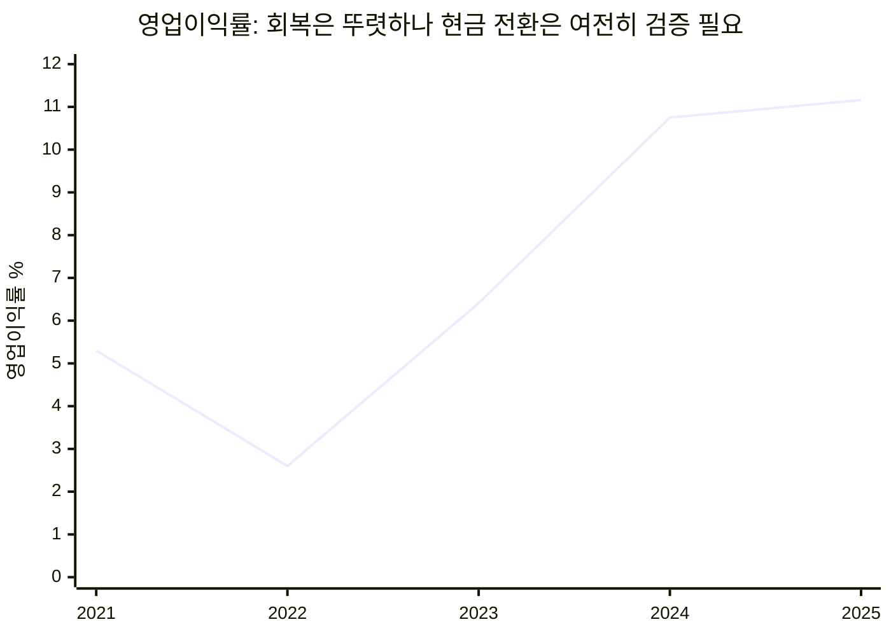

# 아마존(AMZN) 독립 투자 연구 보고서

연구일: 2026년 10월 19일, 베이징 시간. `date`를 실행했다. 시세 기준은 2026년 10월 16일 미국 주식 정식 종가다. 재무 기준은 2025 회계연도와 2026년 6월 30일까지의 최신 공시 분기이며, 아직 공시되지 않은 3분기를 실제 실적으로 삼을 수 없다. 금액은 기본적으로 **십억 달러(USD bn)**, 주당 가격은 달러다. 표 안에서 백만 달러를 명시적으로 쓴 경우에는 표 머리글을 기준으로 한다.

수행 프레임워크: `skills/investment-research.md`의 사전 편향 점검, 8단계 연구, 재무/잔존가치/보고서 표본 점검. 이 보고서는 아마존을 독립적으로 연구하며, 다른 여섯 회사의 결론으로 이 회사의 분석을 대신하지 않는다.

**정보 풍부도 등급: A. AI 연구 한계 선언:** 자료가 풍부하다고 자본 수익을 예측할 수 있는 것은 아니다. 가장 저지르기 쉬운 실수는 AWS 수요 성장을 주주 잉여현금흐름 성장과 동일시하고, Anthropic 밸류에이션 재평가를 영업이익으로 여기고, AI 인프라의 지속적인 갱신 자본 지출을 언제든 멈출 수 있는 "성장 지출"로 전부 분류하는 것이다. 본 보고서는 공개된 재무 사실에 대한 확신은 높은 편이고, 10년 이익과 자본 수익에 대한 확신은 중하다. 고객 인터뷰, 서버 가동률, 리스 프로젝트의 현금 회수 기간 자료가 없다. 분기 부문 데이터는 독립된 제3자의 항목별 재검토를 아직 마치지 못했다.

**핵심 결론: 우량한 사업이며 250달러 부근은 보유에 적합하다. 미보유자는 소액으로 관찰 포지션을 만들 수 있고, 주된 매수 구간은 180—210달러다. 현재는 큰 비중을 뒷받침할 만큼의 안전마진이 없다.** 3년 모델의 가중 할인 가치는 263.71달러로 할인 폭이 작다. 210.97달러가 그 20% 안전마진에 해당한다. 이 판단은 사업의 질, 경쟁, 경영진, AI 자본 지출, 밸류에이션에서 함께 나온 것이며 10년 스트레스 테스트의 일괄 부결이 아니다.

가장 주목할 것은 20.10배 GAAP PE가 아니라 **약 35.97배의 자체 정의 표준화 이익**과 마이너스 잉여현금흐름이다. AWS는 이미 뚜렷하게 가속했고, 문제는 "누가 최종적으로 AI 컴퓨팅 비용을 지불하는가, 그리고 그 돈을 벌려면 자본을 얼마나 투입해야 하는가"로 옮겨 갔다.

## 사전: 편향 자체 점검

- 확실성의 원천은 뉴스의 양이 아니라 소매 이행 밀도, 기업의 클라우드 이전 비용, 구매의 반복이다.
- 자료가 절반으로 줄어도 사업 우위에 대한 판단은 거의 변하지 않는다. 10년 전망은 여전히 넓은 구간을 유지해야 한다.
- "AWS+광고+물류 효율"은 이미 널리 퍼진 컨센서스이며, 본 보고서는 독점적인 정보 우위를 발견하지 못했다. 연구의 증분은 이익 재평가의 분해, 투자와 클라우드 고객의 상호 관계, 리스 부채, 현금 전환에 있다.
- 공시되지 않은 데이터는 공백으로 남기며, 광고 부문 이익, AI 고객 가동률, 유지보수성 자본 지출을 정밀한 숫자로 채워 넣지 않는다.

## 1단계: 데이터 수집과 기준 검증

### 1.1 시세, 주식 수, 시가총액

| 항목 | 수치 | 일자/기준 |
|---|---:|---|
| 정식 종가 | 250.00 | 2026-10-16, StockAnalysis와 Yahoo 재팬 과거 시세가 일치 |
| 최신 원본 공시 보통주 수(주) | 10,786,313,572 | 10-Q 표지, 2026-07-22 |
| 제3자 보통주 수(십억 주) | 10.79 | StockAnalysis 반올림 값 |
| 주가×원본 공시 주식 수로 구한 시가총액 | 2,696.578393 | 십억 달러. 희석 가중평균 주식 수를 기말 총 주식 수로 쓰지 않는다 |
| 제3자 시가총액 | 2,696.578 | StockAnalysis ratios, 백만 달러 환산 |

주가는 이중 출처로 검증했고, 정확한 주식 수와 제3자의 반올림 수치는 약 0.034% 차이다. 원본 주식 수는 7월 스냅샷이므로 10월 16일의 실제 유통 주식 수를 정확히 검증했다고 주장할 수 없다. 시가총액 약 2.697조 달러는 2697억 달러가 아니다. [S3][S6][S7]

### 1.2 최근 5개 완결 회계연도

단위: 백만 달러. 매출총이익률과 영업이익률은 프로그램 계산이다. 회계연도는 모두 12월 31일에 끝난다.

| 재무 지표 | FY2021 | FY2022 | FY2023 | FY2024 | FY2025 |
|---|---:|---:|---:|---:|---:|
| 매출 | 469,822 | 513,983 | 574,785 | 637,959 | 716,924 |
| GAAP 순이익 | 33,364 | -2,722 | 30,425 | 59,248 | 77,670 |
| 매출총이익 | 197,478 | 225,152 | 270,046 | 311,671 | 360,510 |
| 매출총이익률 | 42.03% | 43.81% | 46.98% | 48.85% | 50.29% |
| 영업이익 | 24,879 | 13,348 | 36,852 | 68,593 | 79,975 |
| 영업이익률 | 5.30% | 2.60% | 6.41% | 10.75% | 11.16% |
| 영업현금흐름 | 46,327 | 46,752 | 84,946 | 115,877 | 139,514 |
| 유형자산 취득 총지출 | 61,053 | 63,645 | 52,729 | 82,999 | 131,819 |
| 자산 처분 및 보조금 유입 | 5,657 | 5,324 | 4,596 | 5,341 | 3,499 |
| 잉여현금흐름(회사의 순 자본 지출 기준) | -9,069 | -11,569 | 36,813 | 38,219 | 11,194 |
| 잉여현금흐름(자산 처분 미환입) | -14,726 | -16,893 | 32,217 | 32,878 | 7,695 |
| 현금 및 시장성 증권 | 96,049 | 70,026 | 86,780 | 101,202 | 123,029 |

출처: 2023년과 2025년 10-K, [S1][S2]. StockAnalysis 손익, 현금흐름, 재무상태표, [S4][S5]. 2021년 현금 및 증권 합계는 2021년 원본 XBRL 재무상태표를 추가로 읽었고, 핵심 손익과 현금흐름은 원본 실적과 항목별로 대조했다. [S17] 2025년 매출과 순이익은 Macrotrends 검색 요약으로도 뒷받침되지만 본문은 403을 반환했으므로 **요약 접근을 전체 읽기로 써서는 안 된다**. [S8]

회사 잉여현금흐름=영업현금흐름−유형자산 취득+자산 처분 및 보조금. 제3자는 흔히 영업현금흐름−총 자본 지출을 쓴다. 둘의 차이는 계산 오류가 아니며 2025년에는 각각 11.194와 7.695다. 금융리스 원금과 금융 의무 원금도 있으므로 "회사 FCF"가 주주가 가져갈 수 있는 돈과 자동으로 같지는 않다. SBC는 이미 이익에 반영되었지만 영업현금흐름에서 다시 더해진다. 본 보고서의 밸류에이션은 연 0.8% 희석을 따로 계산하므로, 같은 SBC를 밸류에이션에서 전액 중복 차감할 수 없다.



### 1.3 최근 4개 분기 부문 매출과 이익

각 칸은 순서대로 "매출/영업이익/영업이익률/고정환율 매출 전년 대비"이며, 앞의 두 항목은 단위가 백만 달러다. 회사는 **부문 매출총이익률을 공시하지 않으며**, 영업이익률을 매출총이익률로 둔갑시킬 수 없다. 영업이익률은 회사가 공시한 소수 첫째 자리, 성장률은 고정환율 정수 기준이다. [S3]

| 부문 | 2025Q3 | 2025Q4 | 2026Q1 | 2026Q2 |
|---|---|---|---|---|
| 북미 | 106,267 / 4,789 / 4.5% / 11% | 127,083 / 11,472 / 9.0% / 10% | 104,143 / 8,267 / 7.9% / 12% | 116,177 / 9,123 / 7.9% / 16% |
| 해외 | 40,896 / 1,199 / 2.9% / 10% | 50,724 / 1,040 / 2.1% / 11% | 39,789 / 1,424 / 3.6% / 11% | 42,197 / 1,717 / 4.1% / 15% |
| AWS | 33,006 / 11,434 / 34.6% / 20% | 35,579 / 12,465 / 35.0% / 24% | 37,587 / 14,161 / 37.7% / 28% | 42,232 / 16,621 / 39.4% / 37% |

2025년 연간 북미/해외/AWS 매출은 각각 426.305/161.894/128.725, 영업이익은 29.619/4.750/45.606이다. AWS는 전체 구성에서 주된 이익의 기둥 역할을 맡는다. 광고 매출은 이미 북미와 해외 부문에 포함되어 있으므로 **부문 밸류에이션에서 광고 이익을 한 번 더 더해서는 안 된다**. [S1][S3]

### 1.4 최신 TTM: 이익과 현금의 괴리

| 지표 | 2026Q2까지의 TTM |
|---|---:|
| 매출 | 775.680 |
| 영업이익 | 93.712 |
| GAAP 순이익 | 135.281 |
| 희석 EPS(달러) | 12.44 |
| 영업현금흐름 | 161.403 |
| 순 자본 지출 | 169.007 |
| 회사 기준 FCF | -7.604 |

2026년 상반기 기타 수익은 약 69.1이며 주로 Anthropic 투자 재평가의 영향을 받았다. Q2 단독의 기타 세전 수익은 약 53.4다. 이런 재평가는 클라우드 고객의 대금 회수가 아니며, 135.281의 TTM 순이익을 영업 성장으로 그대로 외삽할 수 없다. [S3][S9]

밸류에이션을 위해 자체 정의 출발점을 세운다. **표준화 이익 대리 지표=TTM 영업이익 93.712×(1−20% 규범 세율)=74.9696**. 순 금융 수익/비용은 장기적으로 약 0이라고 가정하고 투자 재평가는 넣지 않는다. 이는 연구자의 단순화된 영업 이익 대리 지표이며 회사의 Non-GAAP 순이익도 FCF도 아니다. 재무상태가 순부채로 바뀐 뒤 순이자가 뚜렷하게 오르면 추가로 하향해야 한다. 이 대리 지표에는 영업 단계의 SBC, 감가상각, 연구개발비가 이미 포함되어 있으며, 자본 지출이 없는 현금 젖소로 볼 수 없다.

### 1.5 현금, 부채, 지분 투자

6월 말 현금 78.213+시장성 증권 44.775=122.988. 이자부 차입금은 10-Q 장부 기준으로 장기 128.894+1년 내 만기 3.330+단기 부채 0.325=132.549이며 순현금은 **-9.561**이다. StockAnalysis의 광의 부채 251.635는 리스와 기타 금융 항목도 포함해 광의 순현금은 **-128.647**이다. 차이는 부채의 정의에서 나오며, 둘의 차이가 크다는 이유로 실적 보고가 틀렸다고 판단할 수 없다. [S5][S9]

이 현금 스냅샷도 10월의 현재 값이 아니다. 10-Q는 6월 말 OpenAI 투자의 장부상 투입액 28.7을 공시했고, 그 뒤 나머지 약정액 21.3을 추가로 지급했다. 6월의 현금과 이후의 투자를 동시에 줄어들지 않은 현금 자산으로 볼 수 없다. Anthropic/OpenAI 비상장 지분은 현금성자산이 아니며, 그 장부 재평가도 무조건 현금화할 수 있는 가치가 아니다. 모델은 이런 투자의 시장가치를 따로 전액 더해 넣지 않아 "클라우드 이익+고객 조달 자본+투자 평가이익"의 중복 계산을 피한다. 이는 실현될 수 있는 투자 가치를 빠뜨리지만 순환 금융의 가치를 과대평가하는 것도 피한다. [S9]

**본 단계의 추궁: 모든 투자 재평가를 제외한다면 영업 자체를 어떤 가격에 살 의향이 있는가?** 답은 20배의 겉보기 PE가 아니라 표준화 영업이익과 미래의 실제 현금 전환을 봐야 한다는 것이다.

## 2단계: 사업의 본질 — 규모화된 인프라와 거래 신뢰

한 문장: **아마존은 물류, 컴퓨팅, 구매 의도가 높은 트래픽을 공유 인프라로 조직해 규모로 고객의 비용을 낮추고, 상품 마진, 서비스 수수료, 사용료를 받는다.**

2025년 매출을 제품·서비스별로 보면 아래와 같으며, 원본 공시 분류와 제3자 교차 읽기를 사용했다. 이 분류와 위의 지역 부문은 교차 관계이므로 더할 수 없다. [S1][S4]

| 매출 유형 | FY2025 매출 | 경제적 성격 |
|---|---:|---|
| 온라인 직매입 스토어 | 269.287 | 상품 총액을 매출로 인식. 저마진이며 재고를 묶는다 |
| 오프라인 매장 | 22.561 | 매장 소매. 오프라인 이행과 브랜드 접점 |
| 제3자 판매자 서비스 | 172.162 | 수수료, 이행 및 관련 서비스. 순액 매출이라 직매입과 직접 비교할 수 없다 |
| 구독 | 49.619 | Prime 및 콘텐츠 회원의 반복 구매. 혜택 비용이 실제로 존재한다 |
| AWS | 128.725 | 사용량과 계약이 이끈다. 기업의 이전 비용이 높다 |
| 광고 | 68.635 | 구매 의도가 높은 트래픽의 수익화. 이익은 별도 공시되지 않는다 |
| 기타 | 5.935 | 물류, 의료 등의 사업. 고수익이라고 전제하지 않는다 |

소매는 매번 0에서 고객을 확보하지 않는다. Prime, 구매 기록, 배송 약속, 반품이 의사결정의 마찰을 낮춘다. 그러나 소비자는 여전히 월마트와 다른 채널에서 쉽게 가격을 비교할 수 있다. AWS의 점착성은 더 강하며, 가상 머신 임대료만이 아니라 데이터베이스, 권한, 네트워크, 개발 도구, 조직 역량, 이전 위험에서 나온다. 제3자 판매자는 트래픽과 이행의 혜택을 받는 동시에 수수료, 광고비, 규칙의 압박 때문에 여러 플랫폼에서 영업하기도 한다.

그룹 매출총이익률은 2021년 42.03%에서 2025년 50.29%로 올랐다. 일부는 서비스의 순액 인식과 사업 구성 변화에서 나온 것이므로, 이를 근거로 소매 한 건 한 건의 가격 결정력이 더 강해졌다고 주장할 수 없다. 마이크로소프트의 TTM 매출총이익률 67.94%, 월마트의 24.84%는 제3자가 제공한 구조적 참고치일 뿐이다. 소프트웨어와 직매입 상품의 매출 인식은 차이가 커서, 수평 비교한 수치로 사업의 질을 곧바로 판단할 수 없다. [S4][S12][S14]

영업 레버리지는 같은 창고망이 더 많은 주문을 수용하고, 배송 경로 밀도가 높아지고, 클라우드 인프라 가동률이 오르는 데서 나온다. 역레버리지는 수요가 느려져도 감가상각, 전력, 리스를 함께 줄일 수 없는 데서 나온다. 광고 이익은 상품과 서비스의 저가 유지를 도울 수 있지만, 광고 부하가 지나치면 고객 경험과 판매자의 신뢰를 해친다.

**돤융핑식 추궁: 이 사업은 어디가 좋은가?** 고객이 믿을 수 있는 이행과 안정적인 컴퓨팅에 의존할수록 반복 사용이 자연스러워진다. 그러나 성장은 신규 자본이 여전히 가치를 창출할 수 있음을 증명해야 한다.

## 3단계: 해자와 경쟁 구도

| 해자 | 관찰 가능한 증거와 검증 | 평가와 추세 |
|---|---|---|
| 브랜드와 신뢰 | 배송 약속, 사후 서비스, 구매 습관. 임의로 가격을 올릴 수 있는 사치품 브랜드가 아니다 | 강하다. 다만 수수료 투명성과 규제에 의해 침식될 수 있다 |
| 전환 비용 | 기업 데이터, 신원·권한, 데이터베이스, 운영 체계의 이전 비용 | AWS는 강하다. 일반 소매 소비자는 중하 |
| 네트워크 효과 | 구매자가 판매자를 끌어들이고, 풍부한 공급이 플랫폼 효용을 높인다 | 존재한다. 다만 과도한 광고, 가품, 저품질 공급은 역방향으로 작용할 수 있다 |
| 규모 효과 | 창고망 밀도, 구매, 전력, 컴퓨팅 배치가 비용을 분산한다 | 가장 두껍다. 투입이 부족하면 서비스 우위를 잃고, 투입이 지나치면 수익을 파괴한다 |
| 기술 장벽 | 자체 칩, 분산 시스템, 모델 서비스, 로봇과 스케줄링 | 엔지니어링 체계가 강하다. 모델 역량의 영구적 선두는 가정하지 않는다 |

Synergy의 2026Q2 클라우드 인프라 서비스 통계에 따르면 글로벌 분기 시장은 약 143.4, TTM은 약 500이다. AWS, 마이크로소프트, 구글의 점유율은 각각 28%, 20%, 15%다. AWS가 앞서지만 경쟁자의 성장이 더 빠르므로 "산업의 확장"과 "점유율의 확대"는 구분해야 한다. 이 기준은 IaaS/PaaS와 호스티드 프라이빗 클라우드를 포괄하며 각 회사가 공시한 클라우드 매출과 일대일로 대응하지 않는다. [S10]

| 경쟁 장면 | 주요 경쟁자 | AWS/아마존의 우위 | 잃을 수 있는 가치 |
|---|---|---|---|
| 기업 클라우드 | Azure, Google Cloud, Oracle | 폭넓은 서비스, 기존 프로덕션 워크로드, 엔지니어링 신뢰성 | 오피스 소프트웨어 유통, 모델 진입점, 데이터베이스 생태계와의 결속 |
| AI 학습과 추론 | 3대 클라우드와 전문 GPU 클라우드 | 자체 칩, 관리형 플랫폼, 구매 규모 | 대형 고객의 자체 구축, 컴퓨팅의 범용 상품화, 금융이 이끄는 수요 |
| 온라인 소매 | 월마트, 저가 크로스보더 플랫폼, 브랜드 자사몰 | 이행, 반품, 상품의 폭, Prime | 가격, 오프라인 수령, 콘텐츠 발견, 브랜드의 직접 접점 |
| 커머스 광고 | Google, Meta, 리테일 미디어 네트워크 | 구매 행동에 가깝고 거래 기여도를 측정할 수 있다 | Agent가 쇼핑 진입점을 바꾼다. 규제가 입찰과 과금 방식을 제한한다 |

십억 달러급 자금으로 GPU를 빌릴 수도 있고 쇼핑 진입점을 하나 만들 수도 있지만, 폭넓은 품목을 아우르는 안정적인 이행 네트워크와 기업 프로덕션 시스템의 신뢰는 복제하기 어렵다. 반대 측면은 이렇다. 거대 경쟁자들은 같은 급의 자본, 사용자, 연구개발 조직을 갖고 있으며, 아마존은 자금 규모만으로 AI를 독점할 수 없다.

지난 5년간 소매의 규모 장벽은 더 두꺼워졌고 이익 회복은 더 뚜렷했다. AWS의 절대 우위는 여전히 크지만, AI 시대의 상대 점유율과 자본 효율 우위는 같은 수준으로 증명되지 않았다. 향후 5년의 핵심 지표는 모델을 몇 개 내놓았는지가 아니라 **자체 칩의 단위 작업 비용, 클라우드 고객의 유지와 확장, 현금 자본 회수 기간**이다.

**버핏식 추궁: 10년 뒤에도 남아 있는가?** 물류와 기업의 신뢰는 높은 확률로 남아 있다. 쇼핑 결정과 클라우드 스케줄링이 대체 가능한 Agent에 의해 통합 추상화된다면 고객 충성은 플랫폼에서 에이전트 계층으로 옮겨 갈 수 있고 가격 결정력은 약해진다.

## 4단계: 역방향 사고와 실패 경로

아래 확률은 연구자의 주관적 위험 등급이며 과거의 통계적 빈도가 아니다. 사건들은 서로 연관되어 있어 더할 수 없다. 이익 시나리오의 비관 가중치가 25%라고 해서 각 위험이 저마다 25%의 확률을 가진다는 뜻은 아니다.

| 실패 경로 | 주관적 발생 판단 | 영향 | 관찰 신호/모델 내 위치 |
|---|---|---|---|
| AI 고객의 최종 매출이 부족하고, 컴퓨팅 예약이 실제 소비를 밑돈다 | 중상 | 장기 자본 수익 하락, 자산 손상 | 클라우드 매출은 빠르게 느는데 대금 회수/가동률이 맞지 않는다. 비관 시나리오 |
| GPU/자체 칩의 빠른 세대 교체가 경제적 수명을 줄인다 | 중상 | 감가상각 과소 계상, 유지보수 지출의 예상 초과 | 설비 내용연수 가정의 변화. 비관 이익과 ROIC |
| 광고 과금과 플랫폼 운영이 제한된다 | 중 | 광고 요율, 배상, 판매자 신뢰에 대한 압력 | 독립된 규제 사건. beta에 넣지 않는다 |
| AWS가 Azure/Google/전문 클라우드에 신규 워크로드를 빼앗긴다 | 중 | 고수익 사업의 성장 하향 | 점유율과 증분 매출. 총매출만 보지 않는다 |
| Agent가 사이트 내 검색 광고를 우회한다 | 중, 경로 불확실 | 광고 트래픽 지대가 낮아지나 물류는 계속 과금할 수 있다 | 구매 진입점의 이동과 고객 확보 비용 |
| 해외 소매와 위성 등의 확장이 장기 적자다 | 중 | 경영의 주의를 분산하고 현금을 소모한다 | 단위 경제성과 프로젝트 추가 투자 규율 |
| 대규모 장애, 사이버 공격, 전쟁에 따른 공급 중단 | 저빈도이나 중대 | 연쇄적인 고객 이탈, 꼬리의 영구 손실 | 계량화하지 않고 한계에 기재. 할인율에 밀어 넣지 않는다 |

**최신 규제 사실은 이미 유죄로 확정된 사실과 구분해야 한다.** FTC는 2026년 8월 광고 경매 부가 수수료에 대한 소송 제기 내용을 공개했고, 아마존의 입찰 메커니즘 설명과 실제 과금이 일치하지 않는다고 주장했다. 이는 원고의 주장이며 법원이 위법을 인정했다고 서술할 수 없다. 다만 광고의 높은 이익이 전부 공정 경쟁과 실제 가치 창출에서 나오는지에 직접 도전하는 것이므로, 위험을 소액 벌금으로만 적을 수는 없다. Prime 환불 집행 건이 따로 있으며 서로 다른 사건을 뒤섞어서는 안 된다. [S11]

역사적 유추는 결말을 억지로 끼워 맞추지 않고 메커니즘을 취한다. 통신망 확장은 수요가 장기간 존재해도 초기 자본 제공자의 수익이 보장되지 않음을 보여 준다. 성숙한 소매 플랫폼은 효율의 선두가 오래갈 수 있지만 가격 인상 여지는 여전히 경쟁에 제약됨을 보여 준다. 아마존은 단일 통신 자산보다 사업 선택권이 더 많지만 자본 수익의 제약에서 벗어날 수 없기는 마찬가지다.

가장 강한 매수 논거는 클라우드 매출과 이익이 동시에 가속하고, 광고와 소매 효율 개선이 여러 성장 엔진을 제공한다는 것이다. 가장 강한 매도 논거는 GAAP 이익이 비현금 재평가로 미화되었고, AI 투자와 고객 수요가 서로를 떠받치며, 자산 갱신에 반복해서 돈이 든다는 것이다. 둘은 동시에 성립할 수 있다.

**멍거식 추궁: 나는 어디에서 틀릴 가능성이 가장 큰가?** 장기 고객 계약을 최종 지불 능력과 동일시하는 것. 설비 구매 현금흐름을 전부 "미래에 자유롭게 잘라 낼 수 있는" 성장 지출로 보는 것. AWS 이익률만 보고 투하 자본을 보지 않는 것.

## 5단계: 경영진, 지배구조, 자본 배분

Andy Jassy의 주된 강점은 단기적인 재무 포장이 아니라 기업 클라우드 사업, 엔지니어링 조직, 장기 투자에 대한 이해다. 영업이익 회복은 조직이 오류를 바로잡을 수 있음을 보여 준다. 신규 AI 투자가 같은 성공을 거둘 수 있을지는 아직 검증되지 않았다. 장기적으로 회사는 더 이상 창업자의 직접 경영에 전적으로 의존하지 않지만, 핵심 기술과 소매 리더십의 승계는 여전히 실행에 영향을 준다.

| 시기/결정 | 결과 또는 현황 | 연구 평가 |
|---|---|---|
| 팬데믹 기간의 이행 역량 증설 | 이후 비용 압박이 나타났고 2022년 영업이익률이 뚜렷하게 하락했다 | 확장 판단에 오차가 있었다. 경영진을 신격화할 수 없다 |
| 이후 소매 비용과 네트워크 효율 개선 | 2023—2025년 영업이익이 연속 개선됐다 | 오류 수정 능력이 양호하다 |
| 자체 칩과 AWS 플랫폼에 대한 지속 투입 | 외부 가속기 공급사에 대한 의존을 낮출 수 있다 | 기술 선택권에는 가치가 있다. 경제성은 고객 결과로 검증해야 한다 |
| Anthropic과 OpenAI에 투자하고 클라우드 협력 체결 | 모델과 컴퓨팅 수요를 얻는 동시에 자본과 고객의 상호 의존도 생겼다 | 투자 평가이익을 경영 능력 점수로 삼을 수 없다 |
| 위성과 Globalstar 등의 확장 | 10-Q가 인수 계획을 공시했고 조건 충족을 기다리는 중이다 | 자본 배분의 복잡도가 오른다. 확정 이익을 미리 반영하지 않는다 |

2025년 "Technology and infrastructure" 비용은 108.521로 연구개발, 기술 인력, 인프라 운영을 포괄하며 순수 연구개발비가 아니다. 2025년 SBC는 19.467이다. 투입 규모는 크지만 공개 재무제표로는 개별 AI 프로젝트의 연구개발 ROI를 직접 계산할 수 없다. [S1][S5]

2026년 위임장 설명서는 2월 24일을 지분 스냅샷 기준일로 한다. Bezos의 공시된 실질 보유는 950,434,581주, 약 8.8%이며, 그중 68,232,131주는 의결권만 있고 투자 처분권은 없다. 위임장 문서에 따라 이 부분을 빼면 경제적 지분의 대리 수치는 약 8.21%이고, 의결 통제를 포함한 실질 보유 비율은 프로그램 계산으로 약 8.84%다. Jassy는 2,313,536주, 약 0.0215%다. **아마존 보통주는 차등의결권 주식의 배수 의결로 통제되지 않는다. 다만 "실질 보유"에는 경제적 지분과 같지 않은 위임 의결 약정이 포함되어 있을 수 있다.** 이는 10월의 최신 보유량이 아니며, 그 이후의 모든 Form 4/13G 변동과 독립된 두 번째 출처와의 대사를 아직 마치지 못했다. [S13]

상반기에는 보통주 매입이 없었다. 연환산 희석 가정은 0.8%를 사용했고, 제3자의 최신 전년 대비 주식 수 변화 0.88%에 가깝지만 미래에는 다를 수 있다. 현금 보수가 낮다고 전체 인센티브 비용이 낮은 것은 아니며, 역대 주식 부여, 귀속, 주식 수 변화를 함께 봐야 한다. 규제 당국의 문제 제기는 "고객 최우선"이 광고주라는 고객 유형에도 일관되게 지켜지는지 다시 검증할 것도 요구한다. [S6][S9]

**돤융핑식 추궁: CEO가 은퇴한 뒤에도 경쟁력을 유지할 수 있는가?** 대부분의 인프라와 고객 조직의 점착성은 남을 수 있다. 그러나 거액 투자의 취사선택과 적자 프로젝트를 멈추는 규율은 규모가 자동으로 보장해 주지 않는다.

## 6단계: 산업과 AI 문명의 추세

AI는 컴퓨팅과 저장 수요를 키우고, 소프트웨어 가치의 일부를 좌석당 과금에서 작업 완료당 과금으로 옮긴다. 아마존은 인프라 제공자로서 여러 모델에 걸쳐 사용료를 받을 기회가 있다. 모델의 승자가 하나가 아니어도 수혜를 볼 수 있다. 더 강력한 우위는 자사의 범용 모델이 영원히 앞선다는 주장이 아니라 데이터, 권한, 보안, 신뢰성, 이행 결과다.

산업 TAM은 글로벌 소매 GMV, 클라우드 매출, 광고 매출을 그대로 더해서는 안 된다. 같은 상품 거래에 플랫폼 수수료, 광고, 물류 비용이 동시에 들어 있기 때문이다. 클라우드 인프라 TTM 약 500은 출처가 있는 현재 시장 규모다. 10년 시장 규모는 충분한 확실성이 없으므로, 본 보고서는 회사의 매출과 이익 가정으로 추론하며 단일 수치의 TAM 전망을 꾸며 내지 않는다. [S10]

| AI 영향 채널 | 향후 3년의 가능한 효과 | 10년의 가능한 변화 | 검증이 필요한 증거 |
|---|---|---|---|
| AWS 학습/추론 | 매출과 용량이 뚜렷하게 확장된다. 먼저 자금을 쓰고 나중에 회수한다 | 작업 비용 하락이 수요를 충분히 늘리면 절대 이익이 커진다 | 가동률, 단위 자본 산출, 대금 회수, 계약의 질 |
| 광고와 쇼핑 Agent | 매칭과 판매자의 집행 효율을 높인다 | 전환을 높일 수도 있고 전통적인 검색 광고 지면을 줄일 수도 있다 | 구매 건당 실제 판매자 ROI와 고객 만족도 |
| 로봇, 수요 예측, 배송 | 처리 능력과 재고 회전을 높인다 | 네트워크 비용 구조가 개선된다. 인력 절감을 전부 이익으로 볼 수는 없다 | 단일 시연이 아니라 주문 한 건당 총비용 |
| 소프트웨어 개발과 고객 서비스 | 업무 일부가 자동화된다 | 인력 효율이 높아지는 동시에 추론 비용과 관리 비용이 늘어난다 | 비용 하락이 판매가 하락 또는 이익으로 이어지는가 |

고객 측면에서 소매 고객은 극히 분산되어 있지만, 신규 AI 컴퓨팅 수요는 소수의 대형 모델 업체에 집중될 수 있다. 회사는 충분히 세밀한 AI 고객 집중도를 제시하지 않았으므로, 소매의 분산을 근거로 그룹 전체에 집중 위험이 없다고 추론할 수 없다. 공급 측면에서 첨단 공정, 가속기, 네트워크 장비, 전력, 단지 건설에는 여전히 공통의 병목이 있다. 자체 칩은 단일 GPU 공급 의존을 줄이지만 자체 칩 생태계와 제조에 대한 의존도 들여온다. [S9]

**미래 이익에 대한 판단:** 3년 표준화 연간 이익은 94—157 사이에 놓일 수 있고 기준은 약 130이다. 10년 정상 상태 연간 이익의 스트레스 구간은 125—550, 기준은 300이다. 모두 시나리오 가정이며 투자 재평가를 포함하지 않고, 아직 실현되지 않은 투자 수익을 본업 이익에 넣지 않았다. AI는 순이익을 자동으로 늘리지 않는다. 먼저 성장 속도와 자본 수요를 바꾼다.

**리루식 추궁: 20년 뒤에는 인프라에 가까운가, 단명하는 진입점에 가까운가?** 물류와 컴퓨팅 인프라는 장수의 조건을 갖췄고, 광고 진입점은 변형될 가능성이 더 높다. 진짜 검증은 고객의 총비용을 지속적으로 낮추고 신규 자본의 수익을 자본비용보다 높게 만드는 것이다.

## 7단계: 밸류에이션, 역DCF, 안전마진

### 7.1 현재 밸류에이션과 비교 기준

| 지표 | 수치 | 해석 |
|---|---:|---|
| GAAP TTM PE | 20.10배 | 250/12.44. 비영업 재평가의 영향을 받는다 |
| 표준화 이익 대리 지표 PE | 35.97배 | 2696.578393/74.9696, 자체 정의 연구 기준 |
| PS | 3.48배 | 시가총액/TTM 매출 |
| EV/매출, 리스 및 기타 금융 부채 제외 | 3.49배 | 순 차입금 기준 |
| EV/매출, 제3자 광의 부채 기준 | 3.64배 | StockAnalysis와 비교 가능 |
| 제3자 Forward PE | 26.58배 | 애널리스트 전망 기준. 실현된 이익이 아니다 |
| 제3자 PEG | 1.28배 | 성장 구간과 일회성 수익의 영향이 커 가격 기준점으로 쓰지 않는다 |

회사 기준 FCF가 마이너스이므로 양의 P/FCF로 "싸다"는 판단을 내리지 않는다. 재무 도구로 EPS, PS, 장부가치, 시가총액의 검산을 모두 실행했다. [S6][S7]

과거 연말 GAAP PE는 차례로 2021년 약 50.68배, 2022년 적자로 해당 없음, 2023년 약 51.61배, 2024년 약 38.94배, 2025년 약 31.77배다. 현재 20.10배는 겉보기에 낮지만, 회계 재평가와 이익 기저 때문에 분위수의 비교 가능성이 매우 낮다. 여기서는 같은 출처의 주식 분할 조정 후 주당/시가총액 기준을 인용했으며, 수정되지 않은 가격 시계열을 섞지 않았고 정확한 과거 백분위에 있다고 주장하지 않는다. [S7]

당일 제3자 TTM PE: 마이크로소프트 29.47배, Alphabet 17.09배, 월마트 43.05배. 각각 소프트웨어·클라우드, 광고·클라우드, 소매에 치우쳐 있고 GAAP 비영업 수익과 리스의 차이가 크다. 동종 업계 표는 배경일 뿐이며, 이 회사의 보고서에서 동종 업계 재무제표를 완전히 재검토하지 않았다. "월마트 43배"에서 아마존의 10년 잔존가치에도 같은 배수를 줘야 한다는 결론을 끌어낼 수는 더더욱 없다. [S12][S14][S15]

### 7.2 3년 3개 시나리오: "비싼가"에 대한 답

표준화 이익 대리 지표 74.9696, 주당 6.95044에서 출발하며 이익 성장률은 비관/기준/낙관이 8%/20%/28%다. 매년 0.8% 희석되므로 `three-scenario`에 입력한 EPS 성장률은 각각 7.142857%/19.047619%/26.984127%다. 확률 25%/50%/25%는 주관적 가중치다. 도구에 입력한 EPS 성장에는 이미 희석을 뺐다. 도구가 현재 주식 수에 미래 EPS를 곱해 만든 "순이익"은 고정 주식 수 등가일 뿐이며, 본 표의 실제 총이익은 독립 스크립트가 이익 성장률로 계산했고 둘을 섞어 쓰지 않는다. 3년 뒤에도 여전히 확장기이며, 22/30/36배는 유한 기간의 밸류에이션 가정이지 **10년 영구 잔존가치 배수가 아니다**.

| 시나리오 | 3년 후 표준화 이익 | 3년 후 EPS | 3년 후 PE | 3년 후 가격 | 10%로 현재까지 할인 | 주가 연환산 수익률 |
|---|---:|---:|---:|---:|---:|---:|
| 비관 | 94.44 | 8.55 | 22배 | 188.07 | 141.30 | -9.05% |
| 기준 | 129.55 | 11.73 | 30배 | 351.80 | 264.31 | 12.06% |
| 낙관 | 157.22 | 14.23 | 36배 | 512.35 | 384.93 | 27.02% |

기준의 영업 브리지는 AWS 매출이 계속 비교적 빠르게 성장하되 이익률은 내려가고, 북미의 광고와 이행 효율이 개선되고, 해외가 흑자를 유지하는 것이다. 순이익 속의 투자 평가이익이 계속 두 배로 불어나는 데 의존하지 않는다. 비관 단계에서도 이익은 성장하지만 PE 축소만으로 주주가 손실을 보기에 충분하다. 낙관 단계는 AI 수요와 공급 투입이 동시에 실현될 것을 요구한다. AWS 성장이 뚜렷하게 둔화하고 광고 과금이 제한된다면 20%의 기준 성장을 그대로 유지할 수 없다.

확률 가중 할인 가치 263.71달러는 보장된 가격이 아니다. **가격 구간: 180—210달러는 우선 분할 매수 구간, 210—270달러는 합리적 보유/소액 배분 구간, 270—320달러는 더 강한 현금 전환 증거를 요구하고, 320달러 이상에서는 현재의 기준 가정만으로 추격 매수해서는 안 된다.** 180이라는 하단은 위험 관리상의 선택이며 모델이 증명할 수 있는 단단한 바닥이 아니다. 수학적인 비관 할인값 약 141달러는 여전히 뚜렷한 하방 위험을 시사한다.

### 7.3 역DCF: 시장이 무엇의 실현을 요구하는가

마이너스 FCF에는 양의 현금흐름을 전제한 일정 성장 모델을 그대로 적용할 수 없다. 본 보고서는 마이너스 FCF가 이미 정상으로 회복했다고 주장하지 않고 **명시적 전환 모델**을 쓴다. 표준화 이익은 미지의 성장률 h로 10년간 성장하고, 연환산 희석은 0.8%, 현금 전환율 경로는 -10%, 10%, 25%, 40%, 50%, 60%, 70%, 75%, 80%, 83.333%다. r은 10%, 잔존가치 g는 3%, ROIC는 18%, 잔존가치 PE는 11.90476이다. 현금 전환율은 자본 지출 회수에 대한 판단이며 공시 데이터가 아니다.

공식은 다음과 같다. 매년 분배 현금=74.9696×(1+h)^t×해당 연도 현금 전환율÷1.008^t. 잔존가치=10년 차 이익×11.90476÷1.008^10이며 이를 다시 10%로 할인한다. 이분법으로 풀면 내재 이익 연 성장률은 **20.38%**, 10년 차 표준화 이익은 약 479.07이다. h가 15%에 그치면 모델의 주주가치는 약 1758.61로 현재 시가총액을 뚜렷하게 밑돈다.

따라서 250달러가 필요로 하는 것은 "AI가 잘 발전한다"만이 아니라 고성장이 여러 해 이어지고 자본 지출이 최종적으로 분배 가능한 현금으로 전환되는 것이다. 현금 전환의 회복이 느리거나, 조달 비용이 오르거나, 대규모 설비 갱신이 계속 필요하면 내재 성장 요구는 더 높아진다. 이 역방향 모델은 중간 기간의 현금흐름을 명시적으로 반영하며, 다음 절의 "엑시트만 보고 배당/희석을 근사로 더하는" 저장소 도구와 다르다. 둘을 하나의 정밀한 내재가치로 뒤섞어서는 안 된다.

### 7.4 10년 잔존가치와 비중 스트레스 테스트

달러 현금흐름에는 달러 할인율을 맞춘다. 미국 재무부의 2026-10-16 10년물 수익률은 5.09%이며, 주로 r=10%를 쓰고 이는 beta=1과 약 4.91퍼센트포인트의 규범 ERP에 대응한다. beta는 규범화 가정이며 실측 회귀 계수인 것처럼 꾸미지 않는다. 통화의 합리적 범위는 9%—11.5%다. 위험 사건은 시나리오에 넣으며 beta를 높여 중복 처벌하지 않는다. 도구 로그는 여전히 내장된 "4.70%" 과거 설명을 출력하지만 이 설명은 이번 입력으로 쓰이지 않았다. 이번에는 실제로 rf=0.0509를 명시적으로 넘겼다. [S16]

정상 상태 증분 ROIC는 18%로 잡았다. 성숙한 자산 경량 소프트웨어의 이상적 수익보다 낮고, 아마존의 과거 좋았던 해의 전체 수익에 가까우며, 현재 건설기의 제3자 ROIC보다 높다. 이는 **투자 수익의 회복을 요구하는 판단**이며 현재의 사실이 아니다. AI가 장기적으로 자본 집약적 저수익 사업이 된다면 18%는 높은 편이다. 10년 후 영구 g는 1.5%/3%/4%이며 기준은 달러 상한 4%를 넘지 않는다. 향후 10년의 성장률을 영구 성장으로 삼는 것이 아니다.

잔존가치 공식은 엄격히 PE=(1−g/ROIC)/(r−g)다. 세 단계의 분모는 각각 8.5, 7, 6퍼센트포인트로 모두 최소 5퍼센트포인트라는 문턱을 충족한다. 세 단계의 이익 125/300/550은 표준화 출발점 대비 각각 약 5.25%/14.87%/22.05%의 10년 복합 성장에 대응한다.

| 10년 시나리오 | 2036 표준화 연간 이익 | 영구 g | 잔존가치 PE | 도구의 10년 연환산 수익률 |
|---|---:|---:|---:|---:|
| 비관 | 125 | 1.5% | 10.78배 | -7.50% |
| 기준 | 300 | 3.0% | 11.90배 | 2.05% |
| 낙관 | 550 | 4.0% | 12.96배 | 9.41% |

이익 브리지 예시: 기준 300은 AWS 매출 800×영업이익률 30%=240, 북미 매출 1000×10%=100, 해외 매출 500×7%=35, 합계 영업이익 375에 세율 20%를 적용한 약 300으로 구성할 수 있다. 이는 2036년 가정이며 광고를 중복해 더하지 않았다. 오늘의 규모와 비교하면 여러 해의 성장이 필요하고, "반드시 도달한다"고 할 만큼 보수적이지 않다. 비관은 클라우드 가격 경쟁과 자본 낭비를 기준보다 낮은 이익으로 나타낸다. 낙관은 AI 관련 사용량, 이익, 물류 효율이 함께 실현될 것을 요구한다.

도구는 엑시트 가치의 기하 수익에 배당수익률을 더하고 희석률을 빼며 k=-0.8%로 뒀다. **이는 단순화된 연환산 수익 대리 지표이며, 실제 연도별 배당으로 정밀하게 근을 구한 IRR이 아니다.** 확률 가중은 1.50%이며, 확률 가중 잔존가치를 구한 뒤 IRR을 다시 구한 것이 아니다. 중간 기간의 현금 축적이나 배당은 이 스트레스 테스트를 보수적으로 만들 수 있다. 성장에 자금 조달이 필요하고 설비가 도태되면 낙관적으로 만들 수 있다. 이 모델의 역할은 큰 비중을 싣고 싶은 충동을 제약하는 것이다.

| r | 가중 10년 수익률 | 해당 r을 충족하는가 | 적용 가능성 |
|---|---:|---|---|
| 8% | 5.04% | 아니오 | 구간 밖, 참고용. 낙관 g에서 분모가 4퍼센트포인트라 밸류에이션에 쓰지 않는다 |
| 9% | 3.10% | 아니오 | 합리적 구간 안. 낙관의 분모는 5퍼센트포인트 |
| 10% | 1.50% | 아니오 | 기준 |
| 11% | 0.14% | 아니오 | 합리적 구간 안 |
| 12% | -1.04% | 아니오 | 구간 밖, 참고용 |

±2퍼센트포인트와 ±1퍼센트포인트의 flip을 두 차례 실행했다. **통화의 합리적 구간 안에서 반전은 없으며, 스트레스 테스트는 시종 자본비용을 충족하지 못했다.** 8%라는 구간 밖 결과로 매수를 논증할 수 없고, 10%를 충족하지 못했다는 것만으로 보유를 부결할 수도 없다.

### 7.5 밸류에이션 괴리의 대사

3년 기준은 351.80달러의 엑시트 가격, 약 12.06%의 주가 연환산 수익률이 나와 현재가는 합리적 가치에 가깝다. 10년 스트레스 테스트는 약한 편이며 둘 사이에는 실제 괴리가 있다. 3년 가정은 계속 성장주의 30배로 가격을 매기고, 10년 가정은 성장이 성숙한 뒤 자본 수익과 영구 성장에서 도출한 약 12배로 가격을 매긴다.

**전자는 유한 기간의 가격 판단이고, 후자는 비중 스트레스 테스트다.** 단기에 여전히 성장할 수 있다고 해서 10년간 높은 배수가 압축되지 않는다는 보장은 없으며, 사업이 나쁘다는 증명도 아니다. 6개 차원을 종합하면 결론은 "보유/소액 배분"을 유지하며, 10년 숫자가 낮다고 전면 회피로 억지로 바꾸지 않는다. 포트폴리오 예시 상한은 고려 가능한 핵심 포지션에서 주식 포트폴리오 비중 약 3%—5%로 낮추고, 초기 관찰 포지션은 약 1%다. 이는 연구용 상한 예시이며 사용자의 전체 재무상태표에 근거한 것이 아니다. 상한을 높이는 조건은 자본 지출 수익과 현금 전환이 연속으로 검증되는 것이며, r을 낮추는 방식에 기댈 수 없다.

**버핏식 추궁: r이 2퍼센트포인트 틀리면 반전하는가?** 도구로 이미 답했다. 합리적 구간 안에서는 반전하지 않았다. 다만 이는 스트레스 테스트의 결론이 안정적이라는 뜻일 뿐, 10년 이익 전망이 믿을 만하다는 뜻은 아니다.

**돤융핑식 추궁: 시장이 5년간 닫혀도 보유할 의향이 있는가?** 그 영업 자산을 작은 비율로 보유할 의향은 있다. 다만 매수 가격과 비중이 거액 자본 지출의 불확실성을 보상할 것을 여전히 요구한다.

## 8단계: 종합 의사결정 메모

| 여섯 개의 병렬 차원 | 결론 | 확신도 |
|---|---|---|
| 사업의 질 | 반복 구매가 높은 인프라. 현금 실현에는 여전히 경기순환성이 있다 | 높음 |
| 해자 | 물류 밀도와 기업 클라우드의 점착성이 강하다. AI의 상대 점유율은 미리 전제할 수 없다 | 중상 |
| 경영진 | 영업상의 오류 수정 능력은 드러났다. AI 투자 규율은 아직 검증이 필요하다 | 중 |
| 최대 위험 | 자본 수익이 기대를 밑돎, 광고 규제, 고객 금융 의존 | 중상. 심각도는 계량화하기 어렵다 |
| 문명의 추세 | AI와 디지털 거래 수요가 장기 성장을 뒷받침한다 | 중상. 가치 배분은 불확실하다 |
| 밸류에이션 | 3년 합리적 가치는 약 264달러이고 현재 안전마진이 부족하다. 10년 스트레스는 통과하지 못했고 ±1pp에서 반전하지 않으며, 비중만 조인다 | 중하 |

밸류에이션 차원은 최종 결정의 유일한 판정이 아니다. 10년 할인이 r을 충족하지 못했다는 것만으로 미보유자/보유자 전략을 회피로 바꿀 수 없다. 위의 괴리는 이미 명확히 대사했다.

| 전략 | 제안 |
|---|---|
| 미보유자 | 250달러에서 소액 관찰 포지션을 만들 수 있다. 주된 분할 매수는 180—210달러에 두고, 서둘러 큰 비중을 싣지 않는다 |
| 보유자 | 사업 논리가 반증되지 않았다면 보유할 수 있다. AI 자산이 포트폴리오에 이미 과도하게 집중되어 있다면 집중도를 낮춘다 |
| 매도/비중 축소 신호 | AWS가 신규 수요를 계속 잃는데 자본 지출이 수렴하지 않는다. 금융이 떠받친 수요의 대금 회수가 악화된다. 광고 규제가 정상 이익을 계속 약화시킨다. 가격이 기준 가치를 뚜렷하게 넘는데 이익이 상향되지 않는다 |
| 추가 매수 신호 | 표준화 이익 성장과 잉여현금흐름이 동시에 실현된다. 신규 자본의 수익이 개선된다. 가격이 안전마진 구간에 들어오고 사실이 악화되지 않았다 |
| 다음 검증의 중점 | 최신 분기 보고서의 클라우드 계약 이행, 자본 지출, 감가상각 내용연수, 현금과 조달의 변화, 투자 재평가를 제외한 이익 |

### 네 거장의 원문과 모사 논평의 규율

이번에는 "버핏/멍거/돤융핑/리루의 현재 아마존 가격에 대한 입장"을 뒷받침하기에 충분한 검증 가능한 1차 원문 발언을 얻지 못했으므로 네 사람 모두 **자료 부족, 대변을 모사하지 않는다**. 위의 "거장식 추궁"은 저장소가 정한 방법론상의 질문이며 거장이 아마존에 대해 직접 한 인용문이 아니고, 그들의 실제 보유나 추천을 암시하지도 않는다. 저장소의 2차 연구 보고서는 거장 본인의 원문을 대신할 수 없다.

## 데이터 한계, 검증 상태, 재계산 가능한 자료

1. 회사 원본 실적과 StockAnalysis를 읽었고, 최신 주가에는 두 번째 시세 출처가 있다. Macrotrends는 검색 요약만 읽을 수 있었고 본문은 403이다. 지정된 모든 출처를 마쳤다고 꾸미지 않았다.
2. 최근 4개 분기 부문 표는 회사의 보충 표에서 나왔다. 이는 SEC와 여전히 같은 발행인에 속하므로 **두 개의 독립 출처로 치지 않는다**. 분기 부문, 경영진 지분의 이후 변동, 동종 업계 밸류에이션은 항목별 독립 이중 출처 검증을 마치지 못했다. 표본 점검에 걸린 일부 분기 매출은 외부 뉴스의 반올림 값으로 뒷받침되지만, 이를 표 전체의 이중 출처 검증으로 확대하지 않는다.
3. 광고의 독립 이익률, AI 사업의 유지보수성 자본 지출, 고객 금융 의존도, 칩의 실제 경제적 수명은 충분히 공시되지 않았다. 보고서는 정밀한 값을 지어내지 않는다.
4. 시스템적인 사이버 공격, 전쟁, 공급망 재난은 계량 모델링하지 않았다. 광고 규제와 AI 과잉은 비관 시나리오에 반영했지만 사건 확률은 통계적 추정이 아니다.
5. 지분 투자의 실현 가능한 세후 가치, 미래의 이자 부담, 주식 희석 경로는 모델을 바꿀 수 있다. 현재의 규범화 이익은 정밀한 비경상 항목 차감 순이익이 아니다.
6. 보고서 표본 점검 도구는 모델 가정과 본문 속 숫자를 잡아내지만 네트워크에서 자동으로 검증하지는 못한다. 사실은 이미 읽은 출처를 채택했고, 모델은 스크립트로 재계산했으며, 사실이 아닌 오추출은 명확히 표시했다. 프로그램의 "통과"를 모든 가정이 외부 검증을 받았다는 뜻으로 이해해서는 안 된다.

재계산 입구: `python3 reports/미국M7-20261019/아마존/recalculate.py`. 입력과 출력은 각각 [source-data.json](source-data.json), [model-results.json](model-results.json)에 있고, 잔존가치 파라미터는 [terminal-config.json](terminal-config.json), 도구의 명령별 기록과 종료 코드는 [financial-audit.log](financial-audit.log)에 있다. 표본 추출과 검증 설명은 같은 디렉터리의 `report-audit-*` 파일을 참조한다. 금액, 이익률, PE, 밸류에이션, 민감도는 프로그램으로 계산하며 암산에 의존하지 않는다.

### 핵심 데이터 교차검증 기록(도구 출력 요약)

```text
verify-market-cap: price=250, shares=10,786,313,572
계산 시가총액=2,696,578,393,000 USD; 제3자 약식=2,700,000,000,000 USD; 편차 0.13%, 통과.
정밀한 제3자 시가총액 2,696,578백만 달러와 계산값은 반올림 차이만 있다.
cross-validate FY2025 revenue: SEC=716924, StockAnalysis=716924, Macrotrends 요약=716924, 백만 달러.
cross-validate FY2025 net income: SEC=77670, StockAnalysis=77670, Macrotrends 요약=77670, 백만 달러.
cross-validate June2026 cash and securities: SEC=122988, StockAnalysis=122988, 백만 달러.
cross-validate shares: SEC=10786313572, StockAnalysis 반올림=10790000000, 차이 1% 미만.
verify-valuation: GAAP PE=20.10; standardized earnings proxy PE=35.97.
terminal_value audit: USD, r=10%, ROIC=18%, g=1.5%/3%/4%, C1/C2/C3 통과.
flip ±2pp: 8%/10%/12%는 5.04%/1.50%/-1.04%에 대응; 양쪽 모두 구간 밖, 참고용.
flip ±1pp: 9%/10%/11%는 3.10%/1.50%/0.14%에 대응; 구간 안에서 모두 미통과, 반전 없음.
```

**AI 분석 신뢰도와 투자 확실성은 다르다.** 재무 추세, 공시 기준, 현재 가격, 클라우드 경쟁 구도에는 비교적 충분한 자료가 있다. 장기 이익, 자본 수익의 회복, 현금 전환은 제한된 정보에 기댄 추론이다. 데이터의 양이 뒷받침하는 것은 설명 가능한 연구이지 10년 수익에 대한 보장이 아니다. 본 보고서는 학습과 연구에만 쓴다.

## 출처 목록(실제 읽은 날: 2026-10-19)

- [S1 2025 Form 10-K](https://www.sec.gov/Archives/edgar/data/1018724/000101872426000004/amzn-20251231.htm): FY2023—2025 재무, 부문, 연구개발 관련 기준.
- [S2 2023 Form 10-K](https://www.sec.gov/Archives/edgar/data/1018724/000101872424000008/amzn-20231231.htm): FY2021—2023 손익과 현금흐름.
- [S3 Q2 2026 earnings release](https://ir.aboutamazon.com/news-release/news-release-details/2026/Amazon-com-Announces-Second-Quarter-Results/default.aspx): 4개 분기 부문, 보충 지표, 현금흐름.
- [S4 StockAnalysis 재무](https://stockanalysis.com/stocks/amzn/financials/): 5년 손익과 매출 구성.
- [S5a StockAnalysis 현금흐름](https://stockanalysis.com/stocks/amzn/financials/cash-flow-statement/); [S5b 재무상태표](https://stockanalysis.com/stocks/amzn/financials/balance-sheet/): 독립 집계 기준.
- [S6 StockAnalysis 통계](https://stockanalysis.com/stocks/amzn/statistics/); [S6b Yahoo 재팬 과거 가격](https://finance.yahoo.co.jp/quote/AMZN/history): 가격과 주식 수의 교차 검증.
- [S7 StockAnalysis 과거 밸류에이션](https://stockanalysis.com/stocks/amzn/financials/ratios/): 정밀 시가총액과 밸류에이션 이력.
- [S8a Macrotrends 매출](https://www.macrotrends.net/stocks/charts/AMZN/amazon/revenue/Amazon); [S8b 순이익](https://www.macrotrends.net/stocks/charts/AMZN/amazon/net-income/): 검색 요약만 확보 가능, 본문 403.
- [S9 Q2 2026 Form 10-Q](https://www.sec.gov/Archives/edgar/data/1018724/000101872426000026/amzn-20260630.htm): 주식 수, 부채, 현금, 투자, 위험.
- [S10 Synergy Q2 2026 시장 연구](https://www.srgresearch.com/articles/q2-cloud-market-passes-143-billion-highest-growth-rate-in-eight-years?trk=public_post_comment-text): 클라우드 시장 규모와 점유율.
- [S11 FTC 광고 소송 공고](https://www.ftc.gov/news-events/news/press-releases/2026/08/ftc-states-sue-amazon-over-secret-ad-surcharge-scheme); [Prime 환불](https://www.ftc.gov/enforcement/refunds/amazon-refunds): 소송상의 주장과 합의 집행을 구분.
- [S12 Microsoft 통계](https://stockanalysis.com/stocks/msft/statistics/): 동종 업계 배경용.
- [S13 2026 Proxy](https://www.sec.gov/Archives/edgar/data/1018724/000110465926041026/tm261382-1_def14a.htm): 2월 지분 스냅샷과 의결권 각주.
- [S14 Walmart 통계](https://stockanalysis.com/stocks/wmt/statistics/); [S15 Alphabet 통계](https://stockanalysis.com/stocks/googl/statistics/): 동종 업계 배경용.
- [S16 미국 재무부 2026 금리표](https://home.treasury.gov/resource-center/data-chart-center/interest-rates/TextView?type=daily_treasury_yield_curve&field_tdr_date_value=2026): 10월 16일 10년물 5.09%.

- [S17 FY2021 XBRL 재무상태표](https://www.sec.gov/Archives/edgar/data/1018724/000101872422000005/R7.htm): 현금 36,220과 증권 59,829백만 달러.
