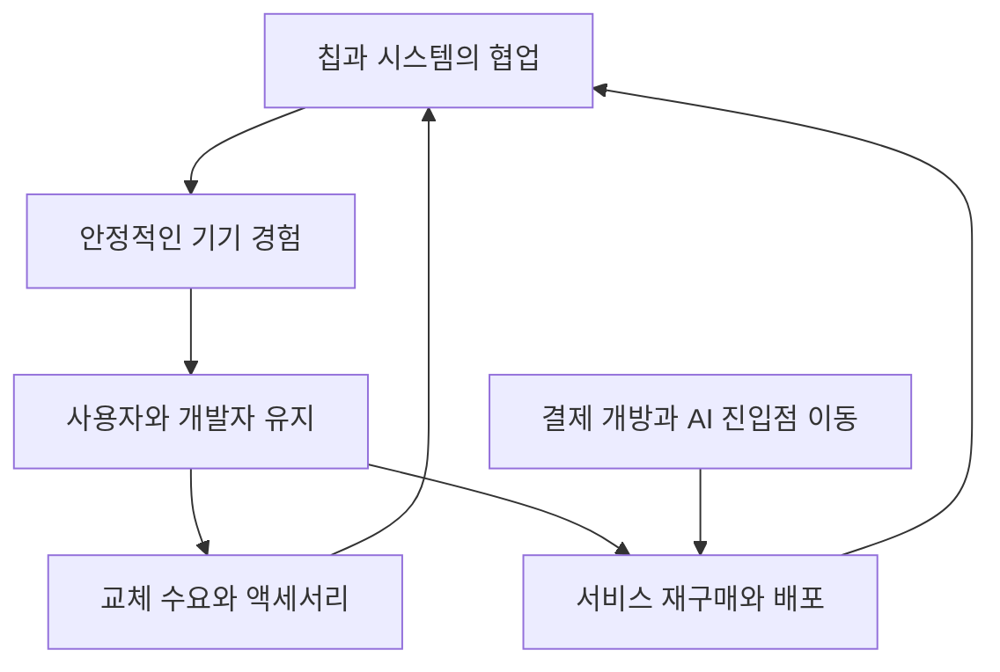

# 애플(AAPL) 독립 투자 연구 보고서

연구일: 2026-10-19(베이징 시간). 시세 기준: 2026-10-16 미국 동부 종가. 최신 공시 분기: 2026-06-27 종료 FY2026 Q3. FY2026 연간 실적은 아직 공시되지 않았다. 본 보고서는 `/investment-research` 8단계 절차를 단독으로 수행했다. 금액은 별도 언급이 없는 한 **백만 달러**, 밸류에이션 모델은 **십억 달러**, 주가는 달러 기준이다.

**결론: 훌륭한 사업이지만 현재 가격은 비싼 편이다. 미보유자는 관망하고, 기존 보유자는 적정 수준의 핵심 비중을 유지하되 추격 매수하지 않는다. 펀더멘털이 변하지 않았다면 200—230달러 분할 매수 구간을 우선 기다리고, 180달러 이하에서는 안전마진이 더 충분하다.** 343.46달러에 반영된 시장 기대는 강한 성장이 계속 실현되어야 충족된다. 10년 스트레스 테스트가 자본비용에 못 미친다는 이유로 애플을 부정하는 것이 아니다. 3년 중립 가치의 현재가치는 약 228달러, 적정 밸류에이션 관찰 범위는 210—260달러다. 이는 연구 가정하의 가격이며 단기 주가 예측이 아니다.

정보 풍부도 등급: **A**. AI 연구 한계 고지: 공개 자료가 많다는 것은 과거 수치를 검증하기 쉽다는 뜻이지, 애플의 AI 수익화, 교체 주기, 서비스 수수료, 신임 CEO의 실행력을 예측하기 쉽다는 뜻이 아니다. 본문은 사실, 계산, 시나리오 가정을 구분한다. 언론의 제품 루머를 이익으로 취급하지 않으며, 네 투자자의 스타일을 본인의 매매 조언으로 취급하지 않는다. 모든 장기 확률은 주관적 스트레스 테스트 가중치이며 통계적 빈도의 의미가 없다.

## 1단계: 데이터 수집과 재무 검증

### 5년 재무

| 지표 | FY2021 | FY2022 | FY2023 | FY2024 | FY2025 |
|---|---:|---:|---:|---:|---:|
| 매출 | 365,817 | 394,328 | 383,285 | 391,035 | 416,161 |
| GAAP 순이익 | 94,680 | 99,803 | 96,995 | 93,736 | 112,010 |
| 영업현금흐름 | 104,038 | 122,151 | 110,543 | 118,254 | 111,482 |
| 자본적 지출 | 11,085 | 10,708 | 10,959 | 9,447 | 12,715 |
| 현금 및 전체 유가증권 | 190,516 | 169,109 | 162,099 | 156,650 | 132,420 |
| 매출총이익률 | 41.78% | 43.31% | 44.13% | 46.21% | 46.91% |
| 영업이익률 | 29.78% | 30.29% | 29.82% | 31.51% | 31.97% |
| 잉여현금흐름 CFO−자본적 지출 | 92,953 | 111,443 | 99,584 | 108,807 | 98,767 |

출처: [S1], [S2], [S3] 연차보고서와 [S4] StockAnalysis. FY2025 매출과 이익은 Macrotrends 검색 결과로 별도 교차 확인했다 [S5]. 현금 열은 금융상품 공정가치 합계이며, **과거 일부 연도는 사용제한 증권을 포함하므로 전액을 언제든 배당할 수 있는 것이 아니다.** FY2022 원본 연차보고서가 사용제한 증권을 명시적으로 공시했으므로, 이를 근거로 제약 없는 과거 순현금을 도출할 수 없다. FY2024 순이익에는 아일랜드 세무 사안의 일회성 충격이 포함되어 있어, FY2025 순이익 반등을 전부 영업 가속으로 돌릴 수 없다.

### 최근 4개 분기 제품 매출과 증가율

괄호 안은 전년 동기 대비다. 본 표의 매출과 비교 기간은 분기 원본 PDF [S6—S9]에서 가져왔고, StockAnalysis 분기 표 [S10]와 대조했다. 애플의 법정 보고 부문은 실제로 지역이며, 제품 분류를 독립적으로 검증 가능한 순이익 부문인 것처럼 내세울 수 없다.

| 제품 분류 | FY25Q4 | FY26Q1 | FY26Q2 | FY26Q3 |
|---|---:|---:|---:|---:|
| iPhone | 49,025 (6.06%) | 85,269 (23.33%) | 56,994 (21.68%) | 54,252 (21.69%) |
| Mac | 8,726 (12.68%) | 8,386 (-6.69%) | 8,399 (5.66%) | 10,352 (28.66%) |
| iPad | 6,952 (0.03%) | 8,595 (6.27%) | 6,914 (8.00%) | 6,191 (-5.93%) |
| 웨어러블/홈/액세서리 | 9,013 (-0.32%) | 11,493 (-2.16%) | 7,901 (5.04%) | 7,883 (6.47%) |
| Services | 28,750 (15.13%) | 30,013 (13.94%) | 30,976 (16.25%) | 30,739 (12.09%) |
| 총매출 | 102,466 (7.94%) | 143,756 (15.65%) | 111,184 (16.60%) | 109,417 (16.36%) |

### 법정 지역 부문 매출 및 공시 매출총이익 기준

| 지역 | FY25Q4 | FY26Q1 | FY26Q2 | FY26Q3 |
|---|---:|---:|---:|---:|
| 미주 | 44,192 | 58,529 | 45,093 | 45,781 |
| 유럽(인도 등 포함) | 28,703 | 38,146 | 28,055 | 29,395 |
| 중화권 | 14,493 | 25,526 | 20,497 | 18,816 |
| 일본 | 6,636 | 9,413 | 8,401 | 6,554 |
| 기타 아시아태평양 | 8,442 | 12,142 | 9,138 | 8,871 |

| 매출총이익률 | FY25Q4 | FY26Q1 | FY26Q2 | FY26Q3 |
|---|---:|---:|---:|---:|
| 하드웨어 제품 합계 | 36.22% | 40.68% | 38.69% | 40.07% |
| 서비스 | 75.28% | 76.52% | 76.68% | 75.62% |
| 전사 | 47.18% | 48.16% | 49.27% | 50.06% |

**공시 경계:** 회사는 제품별 매출총이익률을 공개하지 않는다. 표의 전사 또는 하드웨어 전체 매출총이익률을 iPhone 매출총이익률로 쓸 수 없다. 지역 부문이 공시하는 것은 매출총이익이 아니라 부문 영업이익이며, 이번에는 지역 영업이익을 완전히 옮겨 적지 못했으므로 그 매출총이익률을 지어내지 않는다. FY26Q3 전사 매출총이익률에는 약 2%포인트의 관세 환급 이익이 포함되어 있다. 이를 제외하면 회사 공시 기준 약 48.1%이며, 이 환급을 영구화해서는 안 된다. [S6]

### 재무상태와 시장 스냅숏

| 항목 | 수치 | 기준 |
|---|---:|---|
| 종가(달러) | 343.46 | 2026-10-16, StockAnalysis + IBD [S11,S12] |
| 발행 보통주(십억 주) | 14.59418 | SEC 2026-07-17 표지 수치. 제3자는 14.59로 반올림 [S13,S11] |
| 재계산 시가총액(십억 달러) | 5012.5171 | 주가에 발행 주식 수를 곱한 값. 분기 희석 평균 주식 수를 쓸 수 없다 |
| 사이트 표시 시가총액(십억 달러) | 5010 | 저정밀 표시이며 재계산과의 차이는 임계치보다 훨씬 작다 |
| TTM 매출 | 466823 | FY25 + FY26 9개월 누계 − FY25 9개월 누계 |
| TTM GAAP 순이익 | 128930 | 같은 기준의 롤링 계산 |
| TTM 잉여현금흐름 | 136683 | 영업현금흐름 146724에서 자본적 지출 10041 차감 |
| 현금+단기 증권 | 62399 | FY26Q3. 엄격한 단기 현금 기준 |
| 장기 유가증권을 더한 총액 | 146517 | 전부가 현금성 자산은 아니다 |
| 이자부 부채(운용리스 제외) | 84344 | 기업어음 1997+단기 부채 11007+장기 부채 71340 |
| 엄격한 단기 현금에서 이자부 부채 차감 | -21945 | 장기 채권을 요구불 예금으로 취급하지 않는다 |
| 전체 현금·증권에서 이자부 부채 차감 | 62173 | 광의의 순현금. 이후 EV는 이 기준을 쓴다 |

주식 수는 실시간 수치가 아니라 가장 최근 공개 스냅숏이다. 7월부터 10월까지의 자사주 매입으로 실제 시가총액은 다소 낮을 수 있다. 제3자의 FY2025 total debt는 기준이 다른 항목을 포함해 어음과 채권의 합과 일치하지 않으므로, 그 과거 순현금 증가율을 기계적으로 따르지 않는다. 당기 84,344는 원본 재무제표의 이자부 부채와 일치한다. 매입채무는 영업 부채에 속한다. “현금에서 전체 부채를 뺀 값”과 순현금을 혼동해서는 안 된다.

**추가 질문(연구자가 돤융핑 프레임워크에 따라 제기): 이 숫자들 가운데 어느 것이 사용자의 지속적 지불이고, 어느 것이 세금 항목과 자본 배분 효과일 뿐인가?**

## 2단계: 사업의 본질 — 소비자 진입점, 완제품 경험, 서비스 재구매

한 문장: 애플은 신뢰할 수 있는 개인 기기와 통합된 시스템으로 고가치 사용자를 확보하고, 교체 수요, 액세서리, 디지털 서비스를 통해 그 관계의 가치를 반복적으로 실현한다.

| 가치사슬 단계 | 고객이 돈을 내는 이유 | 수익의 질 | 취약점 |
|---|---|---|---|
| iPhone | 통신, 촬영, 신뢰성, 정체성과 생태계 | 프리미엄 가격 책정, 여전히 교체 주기가 있다 | 교체 지연, 경쟁 브랜드가 충분히 좋아지는 경우 |
| Mac/iPad | 소프트웨어·하드웨어 협업, 창작과 업무 | 생태계를 강화하고 다양한 사용 환경을 포괄 | PC 사이클, 저가 대체재, AI 워크플로 이전 |
| 웨어러블 | 건강, 오디오, 휴대성 | 기기 조합 확대 | 신제품 수요가 불확실하며 초기 증가율을 외삽할 수 없다 |
| 서비스 | 저장, 콘텐츠, 결제, 배포 등 | 재구매와 수수료, 낮은 한계비용 | 규제, 모델 공급자의 과금, 제3자의 수수료 우회 |

FY2025 iPhone 매출은 209,586, 서비스는 109,158이다. 스크립트 계산상 비중은 각각 약 절반과 4분의 1이다. 서비스 성장은 매출보다 이익에 더 큰 의미가 있다. 서비스 매출총이익률은 하드웨어보다 훨씬 높지만 성격이 다른 사업들이 섞여 있으므로, 광고 분배금, 앱 배포, 클라우드 저장, 콘텐츠 구독을 모두 무위험 연금으로 볼 수 없다. 기기 설치 기반은 저량이고 서비스 매출은 유량이다. 여러 대의 기기가 한 사람에게 속할 수 있으므로, 공식 공시된 25억 대 이상의 활성 기기를 25억 명의 독립 유료 사용자로 취급할 수 없다. [S1,S8]



지난 5년간 매출은 직선으로 오르지 않았지만 매출총이익률과 영업이익률은 전반적으로 개선됐다. 구조 고도화와 운영 역량이 유효했다는 뜻이다. 향후 영업 레버리지에는 반대 면도 있다. 기기 매출이 흔들려도 연구개발 투자는 계속해야 하고, 무료 AI 기능은 추론, 메모리, 클라우드 비용을 먼저 늘린 뒤에야 교체 수요의 수익으로 돌아올 수 있다. 높은 가격의 자사주 매입은 주식 수를 줄이지만, 회사 전체 이익을 높이는 것과 같은 말이 아니다.

**추가 질문: 소비자가 3년에 한 번만 휴대폰을 바꾼다면, 애플은 사용자당 생애 매출총이익을 높일 수 있는가? 판단은 긍정 쪽이며, 근거는 서비스 재구매와 기기 간 경험이지 “브랜드는 영원히 변하지 않는다”가 아니다.**

## 3단계: 해자 — 넓지만 부분마다 변화 방향이 다르다

| 해자 | 현재 판단 | 증거와 반증 가능한 신호 | 향후 5년 |
|---|---|---|---|
| 브랜드/가격 결정력 | 강함 | 프리미엄 수요와 서비스 매출총이익. 다만 단일 분기 매출로는 수량과 가격의 기여를 구분할 수 없다 | 안정적이나 메모리 가격 인상과 소비 여력의 시험을 받는다 |
| 전환비용 | 강함 | 데이터, 구매한 앱, 기기 간 협업, 가족의 사용 습관 | AI 크로스플랫폼 어시스턴트가 전환비용을 낮출 수 있다 |
| 네트워크 효과 | 중강, 독점은 아님 | 개발자와 고가치 사용자가 서로를 끌어들인다. Android에도 대규모 생태계가 있다 | 앱 배포 규칙 개방이 독점적 수익화를 약화시킨다 |
| 규모의 경제 | 강함 | 글로벌 조달, 자체 설계 칩의 상각, 유통과 서비스 인프라 | 비용 상승기에 우위가 확대될 수 있으나 선단 생산능력은 여전히 공급사에 좌우된다 |
| 기술 장벽 | 통합에서 강함, 개별 항목 선도에서는 중간 | 칩, OS, 제품 엔지니어링의 공동 최적화. 기반 모델 선도와 같지 않다 | 계속 투자해야 하며 특허로 정적인 임대료를 받을 수 없다 |

경쟁의 단위는 사용자의 하루 과업 경험이지 특정 모델 순위표가 아니다. 외부 모델의 능력이 가장 강하더라도 애플은 기기 권한, 프라이버시, 기본 진입점으로 가치를 지킬 수 있다. 그러나 모델 사업자가 사용자 관계를 직접 장악하면 애플은 서비스 배포 플랫폼에서 우수한 하드웨어 제조사로 후퇴할 수 있다. 후자도 돈은 벌지만 같은 밸류에이션을 받을 자격은 없다.

역사적 유추: 노키아는 하드웨어 브랜드가 플랫폼 이동을 막지 못한다는 것을 보여 주고, 마이크로소프트는 성숙한 플랫폼이 새로운 워크플로로 가치를 다시 키울 수 있다는 것을 보여 준다. 이는 메커니즘 비교일 뿐이며, 유추에서 애플의 운명을 직접 도출할 수 없다. 지난 5년간 하드웨어/서비스 협업의 경제적 효과는 강화됐고, 규제 보호 아래 있던 배포 수수료의 경계는 좁아졌다. “해자가 전부 넓어졌다”는 성립하지 않는다.

**추가 질문(버핏 프레임워크): 10년 뒤에도 해자가 남아 있는가? 높은 확률로 남아 있겠지만 소비자 진입점, 서비스 분배, 가격 민감도는 달라질 수 있으며, 지속적 우위가 지속적 고밸류에이션과 같지는 않다.**

## 4단계: 역발상 리스크, 강세·약세 논점과 실패 경로

| 경로 | 확률 판단 | 이익 영향과 모니터링 | 모델 처리 |
|---|---|---|---|
| AI로 크로스플랫폼 서비스가 OS 잠금 효과를 약화 | 중간, 객관적 정량화 불가 | 유지율/서비스 증가율 하락, 하드웨어가 대체 가능한 단말로 전락 | 비관 성장 구간 |
| App Store 수수료와 검색 분배금 압박 | 중상, 규칙 시행 폭 불확실 | 서비스 고마진 매출 축소 | 시나리오로 처리, 할인율에 더하지 않는다 |
| 메모리, 선단 공정, 무역 비용 | 변동성 높음, 지속성 불확실 | 가격 인상, 판매량 감소 또는 매출총이익 압박 | 기준 이익률 제한, 비관 구간에서 가중 |
| 중국 내 경쟁과 브랜드 선호 변화 | 중간 | 중화권 매출과 출하 점유율의 괴리 | 시나리오 |
| 대만해협 심각한 공급 중단 | 저빈도·거대 손실, 신뢰할 만한 확률 제시 불가 | 통상 주기를 넘는 생산 중단 | 꼬리 스트레스로 별도 표기, 기댓값을 꾸며내지 않는다 |
| 신임 CEO의 협업 및 자원 배분 실패 | 중하, 기록이 아직 짧다 | 제품 지연, 핵심 인재 이탈, 투자 무수익 | 기준 시나리오에 개혁 효과를 넣지 않는다 |
| 사이버 보안 또는 대규모 프라이버시 사고 | 모델링하지 않음 | 신뢰 훼손, 배상, 유지율 하락 | 모델링하지 않았음을 명시 |

대만해협 꼬리 스트레스는 “수 분기 납품 중단, 밸류에이션과 이익 동시 반감” 같은 가정으로 감내 능력을 점검할 수 있지만, 신뢰할 만한 확률이 없으므로 정밀한 가중 리스크로 위장하지 않는다. 현재 10년 3개 구간은 파괴적 사건을 포괄하지 않으며, 기대수익률이 완전한 리스크 분포와 같지는 않다.

**강세 측의 가장 강한 논점:** 사용자 규모, 제품 완성도, 현금 창출 능력, 공급망 조달 우위는 복제하기 어렵다. AI는 서비스 제작 비용을 낮추고 기기 가치를 높일 수 있으며, 애플은 최첨단 모델의 자본적 지출 전부를 혼자 부담할 필요가 없다.

**약세 측의 가장 강한 논점:** 현재 수익률은 매우 낮고, 서비스 증가율은 규제와 기저의 제약을 받으며, 칩 비용 상승과 연구개발 가속이 AI 수익을 잠식한다. 애플을 보유하는 것은 AI 연산 수요의 선형 성장을 보유하는 것과 같지 않다. 가격에는 상당히 강한 미래 성장이 반영되어 있어, 사업을 지키는 것만으로는 만족스러운 수익이 나오지 않을 수 있다.

본 보고서에서 가장 가능성 높은 오류: 현재의 강한 교체 주기를 영구적 추세로 보는 것, 또는 반대로 단기 비용 충격을 브랜드 훼손으로 오판하는 것이다. 둘 다 연속 분기의 수량, 가격, 매출총이익, 사용자 행동 분해로 확인해야 한다. 스마트폰 시장 보고서는 잠정치와 확정치에 차이가 있으므로 IDC의 사후 수정치를 채택하며, 잠정치를 이어 붙여 추세를 만들 수 없다. [S14]

**추가 질문(멍거 프레임워크): 똑똑한 사람은 왜 사지 않는가? 사업의 확실성이 현재 가격에 대응하는 수익의 확실성보다 높기 때문이다.**

## 5단계: 경영진과 자본 배분

보고서 작성일 기준 CEO는 Tim Cook이 아니라 **John Ternus**다. 공식 임명 발효일은 2026-09-01이며, Cook은 집행 의장으로 옮겼다. Ternus는 2001년 애플에 입사해 2021년 임원진에 합류했고 제품 엔지니어링 배경이 탄탄하지만, 신임 CEO로서의 독자적 자본 배분 기록은 아직 짧다. [S15,S16]

| 의사결정/시기 | 관찰 가능한 결과 | 연구 평가 |
|---|---|---|
| 여러 세대의 자체 설계 칩과 소프트웨어·하드웨어 협업 | 제품 전력 효율, 경험, 공급 측면의 시너지 형성 | 우수하나 AI 기반 모델 우위와 동일시할 수 없다 |
| 서비스 사업 확장 | 서비스 매출과 매출총이익의 중요성 상승 | 우수하나 규제 리스크가 집중되어 있다 |
| 장기 자사주 매입 | 주식 수 감소, 주당 지분 가치 상승 | 가격이 가치를 결정한다. 이익의 40배에 가까운 매입의 한계 수익은 신중히 봐야 한다 |
| 신구 CEO 교체 | 엔지니어링 배경의 신임 CEO와 전임 CEO의 대외 관계 경험이 결합 | 조직 연속성은 비교적 양호하나 효과는 지켜봐야 한다 |
| AI 투자와 협력 | 제품에 관련 기능이 출시됐고 비용은 계속 늘고 있다 | 검증되지 않은 직접 구독 수익에는 밸류에이션을 부여하지 않는다 |

2026 Proxy는 Tim Cook 신탁이 보통주 3,280,295주(2026-01-02)를 보유하며 미확정 RSU는 포함하지 않는다고 공시한다. 이는 신임 CEO의 지분이 아니다. Apple에는 AB 이중 구조의 초다수 의결권이 없으며, 주식 보상 약정을 이미 보유한 경제적 지분으로 취급할 수 없다. Ternus의 최신 전체 경제적 지분/매도는 두 출처로 확인하지 못했으므로, 본 보고서는 거짓으로 정밀한 비율을 기재하지 않는다. 제3자의 “insiders 합계”도 CEO 지분을 대신할 수 없다. [S17]

연구개발비는 FY2025에 34,550, FY26 9개월 누계 34,035로 전년 동기 25,684와 비교해 투자가 빨라졌음을 보여 준다. 연구개발비는 이미 손익에 반영되어 있다. 완전한 GAAP 이익으로 밸류에이션하면서 연구개발비 전액을 한 번 더 차감할 수 없다. 반대로 영업현금흐름은 주식 보상을 다시 더하므로, FCF 전부를 희석 없는 소유주 이익으로 볼 수 없다. 자사주 매입 예산은 실제 소각 수량과 같지 않으며 순주식 수 변화를 관찰해야 한다.

**추가 질문(돤융핑/버핏 프레임워크): CEO가 은퇴한 뒤에도 회사는 경쟁력을 유지할 수 있는가? 제도, 팀, 생태계가 우위의 대부분을 보존할 수 있다. 이번 교체가 바로 현실 검증의 기회이며, 새 경영진에게 아직 만점을 줄 수 없다.**

## 6단계: 산업, AI와 문명 추세

애플은 개인 컴퓨팅과 디지털 생활의 진입점에 있다. AI는 워크플로 수준의 패러다임 변화이고, 스마트폰 하드웨어 자체는 성숙 시장이다. 시장 규모는 설치 사용자×교체율×판매가, 그리고 사용자×서비스 지출×플랫폼 분배로 나누어 봐야 하며, 글로벌 AI 시장 규모를 애플 매출에 그대로 더할 수 없다.

IDC 확정 과거 데이터: 2026Q2 글로벌 휴대폰 출하량 276.3백만 대, 애플 55.7백만 대·점유율 20.2%, 삼성 62.7백만 대·22.7%, 샤오미 31.2백만 대·11.3%. 해당 페이지는 2026-09-17에 갱신되어 일부 7월 잠정치보다 늦으며, 본문은 잠정치를 섞어 쓰지 않는다. 점유율 상승은 저가 시장 축소에서 올 수도 있으므로 자동으로 전체 시장 확장으로 볼 수 없다. [S14]

| 경쟁자/생태계 | 경쟁 위치 | 애플이 지킬 수 있는 것 | 잃을 수 있는 것 |
|---|---|---|---|
| Samsung/Android | 프리미엄 완제품, 폴더블, 광범위한 유통 | 자체 OS와 하드웨어 통합, 사용자 습관 | 새로운 폼팩터 제품, 가격 유연성 |
| Huawei 등 중국 제조사 | 현지 프리미엄 수요, 공급 체계와 브랜드 | 글로벌 생태계, 해외 사용자, 일부 사용자 충성도 | 중국 점유율과 서비스 현지화 |
| Google 및 모델 플랫폼 | AI 모델, 크로스플랫폼 어시스턴트, 개발자 서비스 | 기기 권한, 신원과 결제, 온디바이스 연산 | 어시스턴트 진입점과 분배 권한 |
| Microsoft/Windows | 업무와 기업 AI 워크플로 | 창작자/소비자 측 경험 | 기업 과업 진입점 |

### 향후 3년 AI 이익 브리지(가정이며 회사 가이던스가 아니다)

AI가 가져오는 기기 프리미엄/조기 교체, 서비스 신규 매출총이익, 연구개발 및 추론 비용을 분리한다. 분석 규모로 보면, AI가 성숙기 매출에 추가로 20—40십억 달러를 가져오고 그 공헌이익률이 25%—35%라면 공헌이익은 5—14십억 달러다. 여기서 연간 신규 연구개발 및 추론 비용 5—10십억 달러를 차감하면 순증분은 마이너스에서 약 9십억 달러까지 될 수 있다. 이 브리지는 “합리적 상한이 유의미한가”를 보는 테스트일 뿐이며, 3년 모델 밖에서 중복 합산하지 않는다. 최대 수익은 고마진 사업 하나를 새로 만들어 내는 것이 아니라 기존 이익을 지키는 것일 수 있다.

3년 기준 EPS 성장률 8%는 전체 순이익 개선과 완만한 순자사주 매입을 포함한다. 낙관 14%는 교체 수요, 서비스, AI가 함께 효과를 내야 한다. 비관 −2%는 비용/규제 압력을 반영한다. 10년 총이익 성장은 별도로 0, 7%, 11%로 모델링하며, 주당 성장률을 총이익 성장률로 취급하지 않는다.

공급사 집중: 선단 칩, 디스플레이, 메모리, 조립 공급망은 단기간에 마찰 없이 대체할 수 없다. 애플은 제조 구매 약정과 공급사 채권의 집중을 공시하고 있으며, 이것이 자산 경량 모델 뒤에 있는 공급 의존이다. 공급사가 자본적 지출을 부담하는 것을 산업 시스템에 자본이 필요 없다는 뜻으로 오독해서는 안 된다. 사용자 측이 분산되어 있다고 해서 유통, 검색 협력, 공급사도 마찬가지로 분산되어 있다는 뜻은 아니다. [S13]

**추가 질문(리루 프레임워크): 20년 뒤 어느 층의 가치가 가장 대체하기 어려운가? 신뢰할 수 있는 기기, 사용자 신원, 행동 권한은 여전히 희소할 수 있다. 개별 모델 능력과 단일 앱 진입점은 더 빠르게 변할 가능성이 크다.**

## 7단계: 밸류에이션, 안전마진 및 비중 스트레스

### 현재 밸류에이션

| 지표 | 재계산 값 | 설명 |
|---|---:|---|
| 주가/TTM 희석 EPS | 39.3876 | Python/financial_rigor 계산 |
| 시가총액/TTM 순이익 | 38.8778 | Python/financial_rigor 계산 |
| PSR | 10.7375 | Python/financial_rigor 계산 |
| EV/매출 | 10.6043 | Python/financial_rigor 계산 |
| FCF 수익률(%) | 2.7268 | Python/financial_rigor 계산 |

시가총액/순이익과 주가/EPS가 약간 다른 것은 기말 실제 주식 수와 희석 가중 주식 수가 다르기 때문이며, 이익이 두 벌인 것이 아니다. 제3자 PEG 약 3.36은 참고용일 뿐이고, 그 성장 전망의 기간을 완전히 재확인하지 못했으므로 판정에 쓰지 않는다. FY2021—FY2025 연말 PER은 제3자 기준 약 25.65, 24.22, 27.60, 36.95, 33.85배로 FY2024 일회성 세금 항목의 영향을 받았다. 이는 시점 수치일 뿐 완전한 역사적 분위가 아니다. [S4,S11]

동종 업계 밸류에이션은 하드웨어 완제품, 클라우드 사업자, 광고 플랫폼의 PER로 직접 유추할 수 없다. 애플은 하드웨어와 서비스 속성을 동시에 갖고 있다. 이번에는 같은 종가일 기준의 전체 경쟁사 밸류에이션을 다 확인하지 못했으므로, 정밀해 보이는 횡단 PER 순위를 내지 않는다. 이것이 본 보고서 비교 밸류에이션의 실질적 공백이기도 하다. 3년 PER 선택은 애플이라는 성숙한 소비자 플랫폼에 요구되는 수익률과 현재 성장의 질에 대한 판단에서 나온 것이며, 터미널 PER에서 온 것이 아니다.

### 3년 3개 시나리오: 지금 비싼가에 답한다

출발 EPS는 8.61로 잡는다. 제3자 TTM 8.72에서 회사가 공시한 당분기 관세 환급 주당 0.11을 뺀 근사 정상화 값이다. 회사의 조정 가이던스가 아니다. EPS의 미래 성장률은 순자사주 매입을 포함하며, 자사주 매입 수익을 따로 더하지 않는다.

| 시나리오 | EPS 연 성장률 가정 | 3년 후 EPS | 3년 후 PER | 3년 후 가격 | 10% 할인한 현재가치 | 가격 연환산(배당 제외) |
|---|---:|---:|---:|---:|---:|---:|
| 비관 | -2% | 8.1037 | 22 | 178.28 | 133.94 | -19.63% |
| 기준 | 8% | 10.8461 | 28 | 303.69 | 228.17 | -4.02% |
| 낙관 | 14% | 12.7561 | 34 | 433.71 | 325.85 | 8.09% |

3년 중립 현재가치는 약 228달러이고, 낙관 현재가치도 현재가 343.46달러보다 낮다. 현재 가격의 주된 문제는 이미 3년 모델 안에서 성립한다. 출발 밸류에이션이 높아 더 강한 이익 성장이나 더 높은 엑시트 배수가 필요하다는 것이며, 10년 모델이 일방적으로 부결한 것이 아니다. 210—260달러는 중립 밸류에이션을 중심으로 성장과 배수의 오차를 허용한 관찰 구간이다. 200—230달러에서는 분할 매수할 수 있고, 180달러 이하에서도 펀더멘털이 악화되지 않았음을 확인해야 한다. 가격 구간에 들어왔다는 이유만으로 살 수는 없다.

### 역DCF: 시장이 요구하는 성장

주주 현금흐름 근사치로 정상화 소유주 현금흐름 120십억 달러를 쓴다. TTM FCF 136.683은 높은 편이어서, 주식 보상의 경제적 비용을 차감하고 운전자본 정상화를 고려한 뒤 반올림했다. 이는 분석 가정이며 재무제표에 FCFE라는 이름으로 있는 항목이 아니다. 현금흐름에는 기존 현금이 만드는 수익이 포함되어 있으므로 광의의 순현금을 별도로 한 번 더 더하지 않는다. 공식은 10년간 각 기 현금흐름을 할인하고 10년 차 이후 3% 영구 성장 터미널 가치를 더하는 것이며, 달러 할인율은 10%다.

재계산 결과, 현재 시가총액 약 5012.52십억 달러를 뒷받침하려면 향후 10년간 정상화 현금흐름이 연 약 **17.08%** 성장해야 한다. 출발 현금흐름이 110, 120, 130십억 달러일 때 필요한 성장률은 각각 18.26%, 17.08%, 15.99%다. 이는 성숙한 기기 생태계의 보수적 기준보다 까다롭지만 불가능하지는 않다. 서비스 수익화, 점유율/단가, AI 신제품이 지속적 증분을 만들어야 한다.

### 10년: 비중 스트레스 테스트이며 유일한 매매 스위치가 아니다

달러 r=10%는 무위험 이자율 5.1%에 beta=1×주식 위험 프리미엄 4.9% 가정을 더해 구성했다. Fed H.15가 2026-10-16에 발표한 최신 표의 마지막 열은 10월 15일로, 10년 만기 미 국채 5.10%이므로 10월 16일 종가 수치가 아니다. [S18] 달러 합리 구간은 9%—11.5%다. 정상 상태 증분 ROIC는 25%로 잡았다. 자사주 매입으로 자본 기반이 낮아진 현재 장부 ROIC보다 현저히 낮은 값이며, 신규 투자가 초기 생태계의 수익을 영구히 복제한다고 가정하지 않는다. g는 각각 1%, 2.5%, 4%이고 기준값은 달러 4% 상한보다 낮다. g와 r은 연동하지 않는다.

터미널 PER은 오직 `(1-g/ROIC)/(r-g)`에서 나온다. 유보율은 각각 4%, 10%, 16%, 분모는 9, 7.5, 6%포인트로 모두 최소 5%포인트를 충족한다. 이익 출발점은 TTM 순이익에서 환급 순이익 근사치를 뺀 127.311십억 달러다. 10년 동안은 회사 총이익만 성장시킨다. k=2%는 배당 약 0.3%에 순주식 수 축소 약 1.7%를 더한 작업 가정으로, 최근 수년의 순자사주 매입 증대 강도보다 낮으며, 자사주 매입을 총이익에 다시 더하지 않는다. 도구는 기하 터미널 수익률에 k를 더해 근사하며, **연도별 현금흐름의 정밀한 XIRR이 아니므로** 완전한 총수익 예측이라 부를 수 없다.

| 시나리오 | 주관 가중치 | 총이익 연 성장 | 10년 후 이익(십억 달러) | 영구 g | 터미널 PER | 10년 수익률 근사 |
|---|---:|---:|---:|---:|---:|---:|
| 비관 | 30% | 0% | 127.311 | 1.0% | 10.6667 | -10.24% |
| 기준 | 50% | 7% | 250.441 | 2.5% | 12.0000 | -2.99% |
| 낙관 | 20% | 11% | 361.491 | 4.0% | 14.0000 | 2.10% |

| r 민감도 | 확률 가중 수익률 근사 | r 충족 여부 | 유효성 |
|---|---:|---|---|
| 8% | -1.15% | 아니오 | 구간 밖, 참고용. 낙관 분모도 하드 제약에 미달 |
| 9% | -2.78% | 아니오 | 통화 구간 내 재확인 |
| 10% | -4.15% | 아니오 | 주 기준 |
| 11% | -5.32% | 아니오 | 통화 구간 내 재확인 |
| 12% | -6.35% | 아니오 | 구간 밖, 참고용 |

`flip --delta 0.02`를 실행했고, 양쪽 모두 통화 구간 밖이어서 `--delta 0.01`을 추가로 실행했다. **구간 내에서는 할인율 교란에 따라 뒤집히지 않았고, 줄곧 자본비용을 충족하지 못했다.** 여기서 결과가 매우 낮은 것은 상당 부분 10년 말 성장이 정상 상태로 떨어지고 엑시트 배수가 크게 수축하기 때문이며, 애플이 향후 10년 반드시 마이너스 수익을 낸다고 단정할 수 없다. 10년 뒤에도 성장 여력이 있다면 실제 시장 배수는 다를 수 있다. 반대로 오늘의 높은 배수를 영구히 옮겨 놓는 것도 받아들일 수 없다. 이 모델은 과도한 비중을 제한하는 데 쓴다.

### 밸류에이션 이견 대조

사업의 질은 보유 쪽을 가리키고, 3년 가격 책정은 비싼 편이며, 10년 스트레스 테스트는 더 엄격하다. 셋은 같은 질문이 아니다. 3년 중립 EPS 성장으로는 현재의 높은 PER을 상쇄하지 못하고, 10년 모델은 다시 성숙한 터미널 가치와 더 약한 수익률 분포를 가정한다. 최종적인 미보유자 관망 판단은 **3년 안전마진 부족, 역DCF의 높은 요구, 규제와 비용 리스크**를 훌륭한 사업과 나란히 놓고 도출한 것이며, 10년 r 미충족 한 표로 부결한 것이 아니다. 생태계 우위가 반증되지 않았으므로 기존 보유분은 핵심 비중을 유지할 수 있다. 10년 스트레스 테스트는 연구상 단일 종목 비중 상한을 포트폴리오의 약 3%—5%로 좁힐 뿐이며, 집중 고비중까지 올리는 것은 권하지 않는다. 비중 구간은 예시이며, 알 수 없는 사용자의 자산, 세금, 레버리지 조건과는 무관하다.

**추가 질문(버핏/돤융핑 프레임워크): 할인율이 2%포인트 틀리면 뒤집히는가? 도구가 허용하는 9%—11% 안에서는 그렇지 않다. 시장이 5년간 문을 닫아도 이 사업을 보유할 의향은 있지만, 현재 가격에서 고비중으로 추가할 증거는 부족하다.**

## 8단계: 종합 의사결정 메모

| 병렬 차원 | 결론 | 신뢰도 |
|---|---|---|
| 사업의 질 | 우수. 기기 진입점과 재구매가 결합되어 있고 현금 창출이 강하다 | 높음 |
| 해자 | 넓다. 통합과 유지율이 강하고 배포 수수료의 경계는 잠식되고 있다 | 중상 |
| 경영진 | 체계는 성숙했으나 신임 CEO의 기록이 부족하고, 자사주 매입은 가격을 봐야 한다 | 중간 |
| 최대 리스크 | 서비스 규제, AI 진입점, 공급 집중, 높은 출발 밸류에이션 | 중상 |
| 문명 추세 | 여전히 개인 컴퓨팅 진입점을 차지하고 있으나 AI 수익 배분은 정해지지 않았다 | 중간 |
| 밸류에이션 | 3년: 비싼 편. 10년: 고비중을 뒷받침하지 않으며 구간 내 flip은 뒤집히지 않는다 | 모델 산술은 높음, 매개변수 판단은 중하 |

밸류에이션 해제 문구: 밸류에이션 차원은 최종 의사결정의 유일한 판정 기준이 아니다. 10년 할인이 r을 충족하지 못한 것은 비중만 낮출 뿐이며, 단독으로 미보유자나 보유자에 대한 권고를 바꿀 수 없다.

| 전략 | 권고 |
|---|---|
| 미보유자 | 현재는 관망. 200—230달러이면서 생태계/서비스 지표가 유지될 때 분할 매수를 검토한다. 180 이하에서는 여유가 더 크다 |
| 보유자 | 적정 수준의 핵심 비중은 보유할 수 있으며 추격 매수하지 않는다. 포트폴리오가 감내할 수 있는 범위를 넘으면 기계적으로 전량 매도하지 말고 집중도를 낮춘다 |
| 비중 확대 신호 | 서비스 증가율, 매출총이익, 현금의 질이 지속되고 AI 사용의 전환이 검증 가능할 것. 가격이 중립 가치 부근으로 돌아올 것 |
| 매도 신호 | 유지율과 진입점 통제력의 실질적 악화. 서비스 수수료/분배금의 영구적 하향. 연구개발 증분이 장기간 제품 수익을 내지 못하는 경우 |
| 재평가 발동 조건 | FY2026 연차 실적, Ternus 재임 중 제품/비용 실행, 규제 최종 규칙, 공급 병목 변화 |

### 네 거장 원문 검증과 제한적 확장

- **돤융핑:** 저장소 보관 파일 `reports/엔비디아/돤융핑-쉐추발언-NVDA관련.md` 14번 항목(2024-04-20)을 읽었으며, 원문 짧은 인용: “애플은 10년 뒤에도 높은 확률로 여전히 이만큼 대단할 것이라고 확신할 수 있다.” 원본 링크 https://xueqiu.com/1247347556/286929132 . 본 보고서는 “장기적으로 사업이 강하다”는 방향에 동의한다. 본 보고서가 가격에 신중하다고 해서 그가 현재 약세로 보거나 매도한다는 뜻은 아니다. 그가 말한 것은 경쟁력이지 어떤 매수가에서의 수익에 대한 약속이 아니다. 여기서는 읽은 원문에 대해서만 제한적으로 확장한다.
- **버핏: 자료 부족, 대변을 모사하지 않는다.** 이번에는 2026년 애플 가격에 대한 논평을 뒷받침할 만큼 충분한 1차 원문을 읽지 못했다.
- **멍거: 자료 부족, 대변을 모사하지 않는다.** 역발상 분석 프레임워크를 사용한다고 해서 그의 애플 결론을 지어낼 권한이 생기는 것은 아니다.
- **리루: 자료 부족, 대변을 모사하지 않는다.** 현재 가격 판단을 뒷받침할 수 있는 읽은 원문을 찾지 못했다.

### 신뢰도와 한계

AI 분석 신뢰도: 공시된 매출, 현금흐름, 시장 스냅숏은 높음. 해자 메커니즘은 중상. AI 이익 증분, 10년 이익, 확률, 밸류에이션 구간은 중하. 실제 투자 확실성: 강한 생태계는 장기 존속과 수익의 질에 대한 확실성을 높이지만, 오늘 매수의 수익을 보장할 수는 없다. 언론 자료의 절반을 지워도 매출/현금흐름 사실과 “현재 기대가 높다”는 산술은 여전히 성립한다. 가장 취약한 것은 미래 성장의 배분에 대한 판단이다.

보완이 필요한 사항: Ternus의 최신 경제적 지분/보수/매도에 대한 독립적인 두 출처, 지역별 영업이익의 완전한 이력, 같은 날짜의 동종 업계 밸류에이션, 실제 사용자의 AI 사용과 유료 전환, 파괴적 공급 리스크의 확률. 모델링하지 않은 이산 리스크에는 중대한 사이버 보안 사고와 미지의 소송 꼬리 리스크가 포함된다. 도구가 통과 판정을 냈다고 해서 이 리스크들이 정량화됐다고 말할 수 없다.

## 부록: 출처, 재계산과 감사

모든 웹페이지 열람일은 2026-10-19 베이징 시간이다. 재무 출처는 재무제표 해당 기간에 맞춰 수치를 가져왔고 미래 데이터를 섞어 쓰지 않았다. Macrotrends는 매출 페이지를 직접 열면 403을 반환해, 검증 가능한 검색 요약으로 FY2025 매출, 이익, 단기 현금을 확인했다. 나머지 핵심 수치는 SEC/애플 원본 표와 StockAnalysis로 교차 검증했으며, Macrotrends의 과거 표를 완전히 확보했다고 주장하지 않는다. 서로 다른 플랫폼은 독립된 게시 채널이지만 기초 재무는 모두 발행사에서 나온 것이며 독립된 감사 의견이 아니다.

| 번호 | 출처와 용도 |
|---|---|
| S1 | [Apple FY2025 10-K](https://www.sec.gov/Archives/edgar/data/320193/000032019325000079/aapl-20250927.htm), 연간 영업, 2023—2025 재무 |
| S2 | [Apple FY2022 10-K](https://www.sec.gov/Archives/edgar/data/320193/000032019322000108/aapl-20220924.htm), 2021—2022 재무와 사용제한 증권 |
| S3 | [Apple FY2023 10-K](https://www.sec.gov/Archives/edgar/data/320193/000032019323000106/aapl-20230930.htm), 과거 현금 확인 |
| S4 | [StockAnalysis 연간 재무](https://stockanalysis.com/stocks/aapl/financials/), 독립 게시 채널 |
| S5 | [Macrotrends 매출](https://www.macrotrends.net/stocks/charts/AAPL/apple/revenue), [순이익](https://www.macrotrends.net/stocks/charts/AAPL/apple/net-income), [단기 현금](https://www.macrotrends.net/stocks/charts/AAPL/apple/cash-on-hand) |
| S6 | [FY26Q3 공고](https://www.apple.com/newsroom/2026/07/apple-reports-third-quarter-results/), [원본 PDF](https://www.apple.com/newsroom/pdfs/fy2026q3/FY26_Q3_Consolidated_Financial_Statements.pdf) |
| S7 | [FY26Q2 원본 PDF](https://www.apple.com/newsroom/pdfs/fy2026q2/FY26_Q2_Consolidated_Financial_Statements.pdf) |
| S8 | [FY26Q1 공고](https://www.apple.com/newsroom/2026/01/apple-reports-first-quarter-results/), [원본 PDF](https://www.apple.com/newsroom/pdfs/fy2026-q1/FY26_Q1_Consolidated_Financial_Statements.pdf) |
| S9 | [FY25Q4 원본 PDF](https://www.apple.com/newsroom/pdfs/fy2025-q4/FY25_Q4_Consolidated_Financial_Statements.pdf) |
| S10 | [StockAnalysis 분기 원본 기준](https://stockanalysis.com/stocks/aapl/financials/?p=quarterly&type=as-reported) |
| S11 | [StockAnalysis 통계 스냅숏](https://stockanalysis.com/stocks/aapl/statistics/) |
| S12 | [IBD 2026-10-16 시세 보도](https://www.investors.com/news/technology/apple-stock-top-defensive-play-amid-ai-sell-off/) |
| S13 | [Apple FY26Q3 10-Q](https://www.sec.gov/Archives/edgar/data/320193/000032019326000020/aapl-20260627.htm), 주식 수/현금흐름/리스크 |
| S14 | [IDC 휴대폰 점유율 확정 과거 데이터](https://www.idc.com/promo/smartphone-market-share/) |
| S15 | [CEO 임명 공고](https://www.apple.com/newsroom/2026/04/tim-cook-to-become-apple-executive-chairman-john-ternus-to-become-apple-ceo/) |
| S16 | [Apple 현 CEO 약력](https://www.apple.com/leadership/john-ternus/) |
| S17 | [2026 Proxy](https://www.sec.gov/Archives/edgar/data/320193/000130817926000008/aapl014016-def14a.htm) |
| S18 | [Fed H.15 공식 금리표](https://www.federalreserve.gov/releases/H15/) |

재계산 진입점: 저장소 루트에서 `python3 reports/미국M7-20261019/애플/recalculate.py`를 실행한다. 원본 수치 전사와 기준은 [source_data.json](source_data.json), 공식 결과는 [calculations.json](calculations.json), 터미널 가치 설정은 [terminal_config.json](terminal_config.json), 모든 금융 도구 명령, 출력, 종료 코드는 [financial_audit.log](financial_audit.log)에 있다.

핵심 도구 입력과 출력 요약(글자 그대로의 원본 출력은 전체 로그에 있다):

```text
FY25 revenue: Apple10K=416161, StockAnalysis=416161, Macrotrends_search=416161
FY25 net income: Apple10K=112010, StockAnalysis=112010, Macrotrends_search=112010
FY25 cash short term: Apple10K=54697, Macrotrends=54697
FY26Q3 cash all securities: ApplePDF=146517, StockAnalysis=146517
shares: SEC_July17=14594180000, StockAnalysis_rounded=14590000000
FY26Q3 debt: ApplePDF=84344, StockAnalysis=84344
터미널 가치 기준: ROIC=25%, g=2.50%, r=10.00%
유보율=10.0%; 분자=0.9000; 분모=0.0750; 엑시트 PER=12.0x
flip ±1pp: r=9% / 10% / 11%; 가중 수익률=-2.78% / -4.15% / -5.32%
구간 내 뒤집히지 않음. 10년 테스트는 비중만 제약하며 자동으로 회피를 뜻하지 않는다.
```

표본 점검 기록은 별도로 보존한다: `report_audit_extract.log`, `report_audit_results.json`, `report_audit_verdict.log`. 이 파일들은 실제 데이터 또는 명시적으로 표기된 모델 재계산을 검증한다. 모델 가정을 외부 재무 사실로 위장해서는 안 된다. 감사 도구는 빈 값을 건너뛰므로 검증 범위와 공백을 반드시 읽어야 하며, 도구가 출력한 “통과”만 봐서는 안 된다.

최종 표본 점검: 원래 무작위 목록 26개 항목 중 4개는 날짜/분기 코드 등의 파싱 오탐이어서 명시적으로 제외했다. 나머지 22개 중 18개는 사실 또는 사실 계산, 4개는 모델 매개변수/재계산이다. 22개 항목의 수치 대조는 통과했다. 그중 유럽 FY26Q2 지역 매출은 1차 원본 표만 확보해 독립적인 두 출처 요건을 충족하지 못했다. 모델 대조는 외부 사실 인증이 아니다. 최종 터미널 가치 audit 종료 코드는 0이다. 과거 지역 표의 나머지 분기에 대한 독립 제3자 커버리지도 전부 완료하지 못했으며, 이 공백을 남겨 둔다.

본 보고서는 학습과 투자 연구를 위한 것이다.
