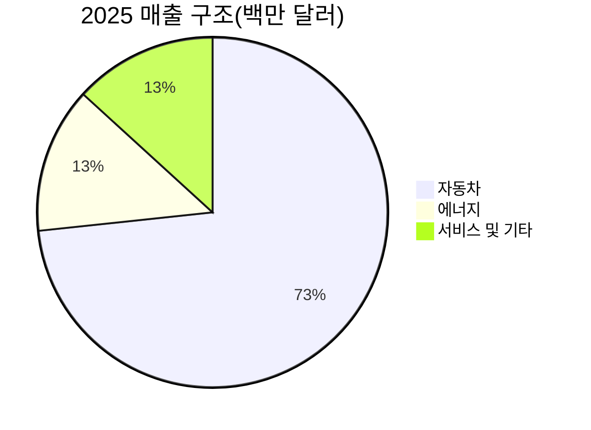
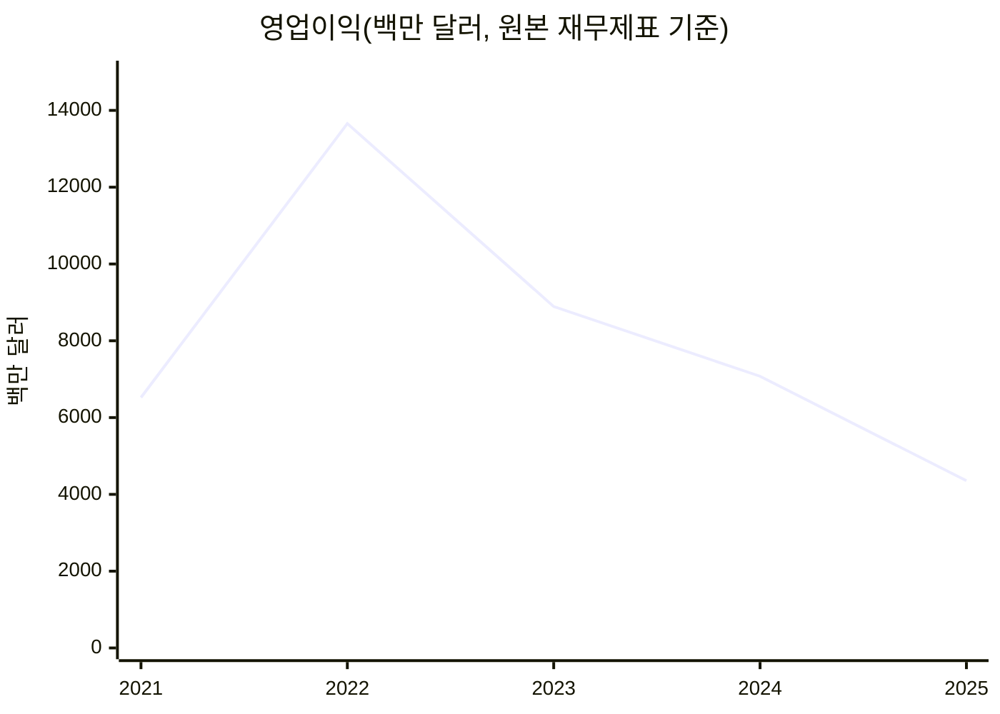

# 테슬라(TSLA) 독립 투자 연구: 제품의 진보가 보통주 주주의 현금 수익으로 바뀔 수 있는가?

연구일: 2026-10-19(베이징 시간). 시세는 미국 동부 시간 2026-10-16 정규 거래 종가 기준이다. 재무는 2026Q2까지, 영업 인도 실적은 2026Q3까지 갱신했다. Q3 실적은 10월 21일 발표 예정이며, 본문은 인도 데이터를 Q3 이익인 것처럼 쓰지 않았다. [S1][S2][S8]

방법: `/investment-research`를 독립적으로 실행했다. 7개 회사를 섞어 쓴 것이 아니며 `/investment-team`도 아니다. 금액은 기본적으로 **백만 달러**, 주당 가격은 달러다. 2036 시나리오 부분은 따로 십억 달러로 표기한다.

**정보 풍부도 등급: A. AI 연구의 한계 고지:** 자동차와 에너지 저장의 재무제표 증거는 충분하지만, 로봇과 무인 주행의 장기 단위 경제성은 같은 수준의 확실성에 한참 못 미친다. 수많은 공개 논의는 "기술 진보"를 "주주가 반드시 이익을 얻는다"로 오독하기 쉽다. 본 보고서의 강점은 기준 대조와 재계산 가능한 제약에 있으며, 자율주행 연구개발·사고 배상·공급망에 대한 1차 정보를 가졌다고 주장하지 않는다.

**종합 결론: 현재가 354.72달러에서 신규 자금은 관망하며, 가치투자 핵심 포지션 후보로 올리지 않는다.** 이유는 자동차 사업의 이익 압박, 가격에서 미검증 사업이 차지하는 비중이 높다는 점, 자본 배분과 희석 리스크, 그리고 3년 모델의 안전마진 부족에서 동시에 나온다. 10년 모델은 비중을 더 조이는 데만 쓰며 단독으로 투자를 부결할 수 없다. 무인 주행 상업화를 위해 높은 손실 확률을 감수하려는 투자자는 이를 독립된 리스크 예산으로 다뤄야 하며, 자동차 판매량으로 시가총액 전체를 보증해서는 안 된다.

본 보고서의 3년 할인 기준값은 128.40달러, 주관 확률 가중값은 159.32달러다. 기준 시나리오가 악화되지 않는다는 전제에서 약 96.30달러가 기준값 대비 25% 할인에 해당한다. 이들은 조건부 밸류에이션이며 주가 예측도, 가격이 거기에 도달한다는 약속도 아니다.

## 0. 편향 자가 점검

- 자료가 많다고 사업이 안정적인 것은 아니다. 매출이 있는 FSD와 미래의 완전 무인 운영은 서로 다른 두 종류의 증거다.
- 언론 보도의 절반을 지워도 자동차/에너지 저장 현금흐름에 대한 판단은 크게 변하지 않으며, 로봇 밸류에이션은 뚜렷이 줄어야 한다.
- 강세론자가 어리석다는 증거는 없다. 무인 주행 네트워크가 형성되고 이익이 대규모로 실현된다면 본 보고서는 심각하게 과소평가한 것일 수 있다.
- 가장 저지르기 쉬운 오류는 AI 연구개발을 오늘의 비용으로 계상하면서 미래 가치는 전혀 주지 않는 것이다. 반대의 오류는 모든 연구개발 약속을 확정 이익으로 환산하는 것이다. 단일 스토리가 아니라 세 시나리오로 처리한다.

## 1. 데이터 수집과 기준 검증

### 1.1 현재 가격과 재무상태표

| 지표 | 수치 | 출처와 설명 |
|---|---:|---|
| 10월 16일 종가 | 354.72 | StockAnalysis, Macrotrends, Yahoo 일치. 시간외 352.46과 섞어 쓰지 않는다 [S2][S7] |
| 발행 보통주(주) | 3,949,547,394 | 10-Q 표지의 2026-07-16 정확값. StockAnalysis는 약 39.50억 주 [S1][S2] |
| 주가×총주식 수 시가총액 | 1,400,983.45 | 제3자의 1,400,983백만 달러와 일치하며 차이는 반올림에서 나온다 |
| 현금 및 단기투자 | 43,524 | 2026Q2. 비트코인과 장기 지분투자는 포함하지 않는다 [S1][S4] |
| 부채 및 금융리스 | 9,342 | 유동 1,418＋장기 7,924 [S1] |
| 운용리스 부채 | 6,738 | 유동 1,022＋장기 5,716 [S1] |
| 순현금, 운용리스 제외 | 34,182 | 현금 및 단기투자에서 부채/금융리스를 뺀 값 |
| 순현금, 운용리스 포함 | 27,444 | StockAnalysis와 같은 기준 [S4] |
| 자기자본 | 86,858 | 비지배지분 제외 [S1][S4] |
| TTM 지배주주 순이익 | 3,804 | 회사 재무제표. 제3자의 EPS 분자는 3,806으로 완전히 같은 기준이 아니다 |
| TTM 영업현금흐름 | 18,685 | 회사와 제3자 일치 [S1][S5] |
| TTM 자본지출 | 12,923 | 회사의 현행 기준으로 태양광 시스템 포함 [S1][S5] |
| TTM 잉여현금흐름 | 5,762 | CFO에서 capex를 뺀 값. 주식 보상의 경제적 비용은 조정하지 않았다 |

**39.50억 주의 발행 주식 수와 약 35.40억 주의 분기 희석 가중 주식 수를 섞어 쓸 수 없다.** 미확정 보상의 회계 처리 때문에 둘은 다르다. 현재 주가를 TTM 희석 EPS 1.08로 나누면 328.44배, 현재 전체 주식 수 기준 시가총액을 지배주주 이익으로 나누면 368.29배다. 본문의 밸류에이션은 현재 발행 주식 수로 통일하며, 둘의 차이를 계산 오류로 오해하지 않는다. 향후 신규 보상은 따로 민감도를 보고, 이미 발행된 보상을 한 번 더 더하지 않는다.

### 1.2 최근 5개년 재무

아래 연도는 모두 역년이다. 매출, 매출총이익, 지배주주 이익, 현금흐름, 현금 및 단기투자는 회사의 2025 연간 업데이트/10-K와 StockAnalysis를 교차 대조했다. 영업이익은 회사의 구조조정 비용을 엄격히 그대로 둔다. [S3][S4][S5][S9]

| 지표 | 2021 | 2022 | 2023 | 2024 | 2025 |
|---|---:|---:|---:|---:|---:|
| 매출 | 53,823 | 81,462 | 96,773 | 97,690 | 94,827 |
| 매출총이익 | 13,606 | 20,853 | 17,660 | 17,450 | 17,094 |
| 매출총이익률 | 25.28% | 25.60% | 18.25% | 17.86% | 18.03% |
| 영업이익 | 6,523 | 13,656 | 8,891 | 7,076 | 4,355 |
| 영업이익률 | 12.12% | 16.76% | 9.19% | 7.24% | 4.59% |
| 지배주주 순이익 | 5,519 | 12,556 | 14,997 | 7,091 | 3,794 |
| 영업현금흐름 | 11,497 | 14,724 | 13,256 | 14,923 | 14,747 |
| 자본지출 | 6,514 | 7,163 | 8,899 | 11,342 | 8,527 |
| 잉여현금흐름 | 4,983 | 7,561 | 4,357 | 3,581 | 6,220 |
| 현금 및 단기투자 | 17,707 | 22,185 | 29,094 | 36,563 | 44,059 |

**발견해 처리한 차이:** StockAnalysis의 표준화 2024 영업이익 7,659는 원본 7,076보다 높으며, 차액 583은 구조조정 관련 재분류에 해당한다. 2022는 13,692로 기재돼 있으나 원본은 13,656으로 차액은 36이다. 2025Q3는 제3자 영업이익 1,862, 회사 1,624로 차액 238이다. 2025Q4는 제3자 1,171, 회사 1,409로 방향이 반대이고 차액은 238이다. 표준화된 분기 표로 이익의 변곡점을 판단할 수 없다. 이후의 모든 분석은 회사 공시를 쓰며 차이의 원값은 검증 로그에 보관한다. 2023 지배주주 순이익에는 거액의 이연법인세 수익도 있어 지속 가능한 이익의 정점으로 보지 않는다.

### 1.3 최근 4개 재무 분기

| 지표 | 2025Q3 | 2025Q4 | 2026Q1 | 2026Q2 |
|---|---:|---:|---:|---:|
| 자동차 매출 | 21,205 | 17,693 | 16,234 | 20,516 |
| 에너지 매출 | 3,415 | 3,837 | 2,408 | 3,139 |
| 서비스 및 기타 매출 | 3,475 | 3,371 | 3,745 | 4,581 |
| 총매출 | 28,095 | 24,901 | 22,387 | 28,236 |
| 매출총이익 | 5,054 | 5,009 | 4,720 | 4,751 |
| 영업이익 | 1,624 | 1,409 | 941 | 398 |
| 지배주주 순이익 | 1,373 | 840 | 477 | 1,114 |
| 잉여현금흐름 | 3,990 | 1,420 | 1,444 | -1,092 |

분기 데이터는 2026Q2 공식 업데이트 4, 27, 31쪽과 10-Q에서 가져왔고, StockAnalysis로 매출/현금흐름을 대조했다. 위의 영업이익 차이는 원본 보고 기준으로 해소했다. [S1][S4][S5]

| 매출 유형별 매출총이익률 | 2025Q3 | 2025Q4 | 2026Q1 | 2026Q2 |
|---|---:|---:|---:|---:|
| 자동차 | 17.05% | 20.42% | 21.08% | 16.88% |
| 에너지 | 31.42% | 28.62% | 39.53% | 20.39% |
| 서비스 및 기타 | 10.53% | 8.84% | 9.24% | 14.15% |

매출총이익률은 공식 매출과 그에 대응하는 원가로 다시 계산했다. 분기별 부문 원가 전체에 대한 독립 제3자의 칸별 재검증에는 여전히 공백이 있으며, 같은 발행인의 PDF와 10-Q를 독립된 두 제공자로 취급하지 않는다.

2026Q2 자동차, 에너지, 서비스 매출은 전년 대비 각각 23.14%, 12.55%, 50.39% 증가했다. 그러나 매출총이익은 매출과 같은 비율로 개선되지 않았다. 세 부문의 Q2 매출총이익률은 각각 16.88%, 20.39%, 14.15%다. 4개 분기 전체의 부문별 매출총이익률 계산과 원본 원가는 `calculations.json`과 `reproduce.py`를 참조한다. 이는 매출 유형별 분해이며 회사가 따로 공시한 소프트웨어 부문 이익이 아니다.

Q2 연구개발비는 2,371백만 달러다. FSD 활성 구독 지표는 148만이며 **일회성 일시불 구매를 포함하므로 148만 명의 월 과금 구독자와 같지 않다**. 지배주주 순이익은 SpaceX 지분의 미실현 이익, 디지털 자산, 세금 항목의 영향도 받는다. Q2 순이익 반등으로 영업이익 분석을 대신할 수 없다. [S1]

2026Q3 인도량은 486,532대, 에너지 저장 설치량은 13.7GWh다. 2025Q3의 497,099대와 비교하면 인도량은 2.13% 감소했다. 차량 인도량은 매출이 아니고 에너지 저장 설치량은 이익이 아니다. 본문은 아직 발표되지 않은 Q3 매출총이익률을 외삽하지 않는다. [S8]

> 추궁: 모든 AI 서사를 잠시 걷어내면 현재 재무제표가 뒷받침하는 것은 어떤 사업이고 어떤 가격인가?

## 2. 사업의 본질: 물리적 제품, 에너지 시스템, 소프트웨어를 하나의 플랫폼으로 조직하기

한 문장: **Tesla는 현재 주로 하드웨어를 제조·판매해 현금을 벌며, 차량 군단·충전·에너지 저장·자율주행 소프트웨어를 지속 과금 플랫폼으로 바꾸려 한다.**

자동차는 구매 빈도가 낮은 내구재다. 브랜드, OTA, 충전 경험은 고객 획득과 사후 서비스의 마찰을 줄일 수 있지만, 소비자에게는 대체 선택지가 많고 가격 인하는 신차 이익과 기존 차량의 잔존가치를 동시에 타격한다. 에너지 시스템은 초기 설치, 운영·유지보수, 소프트웨어 스케줄링으로 이뤄지며, 재구매는 신뢰성과 더 관련이 깊고 여전히 배터리 셀, 시공, 경쟁 입찰의 제약을 받는다. FSD는 고마진 재구매를 만들 수 있지만, 고객이 사는 것은 쓸 수 있는 기능이지 약속 속의 최종 등급이 아니다.

영업 레버리지의 핵심은 **매출 성장이 고정 연구개발, 컴퓨팅 감가상각, 신규 생산능력을 감당할 수 있는가**다. 2025 자본지출 감소가 FCF 회복을 도왔지만, 2026Q2 자본지출 5,789와 FCF의 마이너스 전환은 "현금흐름 개선"을 건설 주기와 떼어 볼 수 없음을 다시 보여 준다. TTM FCF에서 SBC 3,798을 빼면 1,964백만 달러다. 이는 주식 보상을 경제적 비용으로 보는 거친 점검이며 표준 FCF가 아니다. 같은 SBC를 이익에서 전액 한 번 더 차감할 수는 없다.

Tesla의 Q2 자동차 매출총이익률은 일부 전통 완성차 업체의 전체 매출총이익률보다 높지만, 금융·딜러·리스를 합산한 기준과 섞어 나열할 수 없다. GM의 TTM 전체 매출총이익률 10.18%는 방향 참고로만 쓴다. [S15] 소프트웨어 회사의 매출총이익률 수준을 자동차 하드웨어 매출에 그대로 적용해서는 안 된다.

> 돤융핑식 추궁: 이 사업은 어디가 좋은가? 엔지니어링과 일체형 인도 능력은 이미 성립했다. "지속 가능한 플랫폼 과금이라는 좋은 사업"은 여전히 유지율, 대당 수익성, 현금 회수로 증명해야 한다.

## 3. 다섯 유형의 해자 항목별 검증

| 유형 | 기존 증거 | 반증/경계 | 향후 5년 판단 |
|---|---|---|---|
| 브랜드와 가격결정력 | 직접 판매, 글로벌 제품 인지도, 생태계 경험 | 매출과 이익의 하락은 브랜드가 가격 인상을 보장하지 않음을 말해 준다. 정치적 인식이 사용자를 갈라놓을 수 있다 | 중간, 지역별로 분화 |
| 전환비용 | 차량 인포테인먼트, 충전, 가정용 에너지, 소프트웨어 습관 | 차량 교체는 본래 다시 선택하는 시점이며, 기업 데이터베이스 이전 비용보다 훨씬 낮다 | 소프트웨어 개선으로 강화될 수 있으나 영구적 잠금으로 보기에는 부족하다 |
| 네트워크 효과 | 차량 군단 데이터, 충전소 커버리지 | 데이터가 많다고 유효한 지도 학습 신호가 되는 것은 아니다. 충전 개방은 경쟁 제품에도 이익을 준다 | 안전 성능과 단위 원가가 함께 나아져야 확대로 본다 |
| 규모의 효과 | 공장, 배터리 구매, 글로벌 채널과 충전 인프라 | 중국 완성차 업체도 규모화했고, 낮은 가동률은 고정비로 되돌아온다 | 실재하지만 경기 순환성이 있다 |
| 기술/제조 | 차량 소프트웨어, OTA, 제어, 에너지 저장 통합과 제조 설계 | 선두가 곧 배타는 아니다. 인지 방식, 컴퓨팅, 법규 모두 바뀔 수 있다 | 단일 기술의 영구 우위에 베팅하지 않는다 |

Q2 기준 슈퍼차저 충전소 8,704곳, 커넥터 82,357개가 있어 인프라 자산이 실재함을 보여 준다. [S1] 그러나 "돈으로 공장을 복제하는 것"과 "고객 신뢰, 운영 경험, 성숙한 공급망을 복제하는 것"은 다르다. 경쟁자가 규모를 갖추고 낮은 수익률을 감내할 의지가 있다면 산업 전체의 이익을 끌어내릴 수 있다.

지난 5년간 에너지 저장과 소프트웨어 역량은 강해졌지만 자동차의 가격결정력은 함께 강해지지 않았다. 향후 10년에 남을 가능성이 가장 높은 것은 제조 통합과 인프라 역량이고, 가격을 매기기 가장 어려운 것은 무인 주행 네트워크가 초과 이익을 얻을 수 있는가다. 자율주행 상업화는 기술, 규제, 보험, 원격 지원, 차량 가동률을 동시에 넘어야 한다. 기술 시연만 마쳐서는 해자가 되기에 부족하다.

> 버핏식 추궁: 무엇이 해자를 무너뜨리는가? 동등한 경험의 저원가 대체재, 심각한 안전 사고, 자본 수익률이 조달 비용을 계속 밑도는 상황, 그리고 개방형 플랫폼이 이익을 다른 단계로 흘려보내는 것이다.

## 4. 역발상: 매수자가 가장 쉽게 틀리는 곳은 어디인가?

아래의 리스크 등급은 연구 판단이며 더할 수 있는 정밀한 확률이 아니다. 세 시나리오의 확률은 따로 제시해, 서로 겹치는 리스크를 독립 사건으로 오인하지 않도록 한다.

| 실패 경로 | 가능성 판단 | 주주에 대한 영향 | 검증 지표 |
|---|---|---|---|
| 자동차 판매량은 회복되나 대당 이익을 경쟁이 가져간다 | 중상 | 현금 엔진이 AI 투자를 뒷받침하기에 부족하다 | 자동차 매출총이익률, 재고, 할인, 크레딧 제외 이익 |
| Robotaxi는 운영되나 단위 경제성이 성립하지 않는다 | 중상 | 매출은 상당하나 잉여현금흐름이 약하다 | 유료 주행거리, 공차 운행, 원격 지원, 정비·보험 비용 |
| Optimus가 장기간 시범 단계에 머문다 | 중 | 자본지출과 인재 비용이 지속되고 잔존가치가 하락한다 | 외부 유료 고객, 재구매, 고장률, 매출총이익률 |
| 안전 사고나 규제로 특정 지역 운행이 중단된다 | 중. 극단적 꼬리는 신뢰성 있게 계량할 수 없다 | 앞당겨 발생할 수 있으며 할인율만 올려서는 안 된다 | 규제 허가, 사고 공시, 배상과 리콜 |
| 특수관계자 거래/인센티브로 회사 가치가 보통주 주주에게 귀속되지 않는다 | 중 | 희석, 기회 이전, 자금 점유 | 보상 조건, 특수관계자 구매, 투자와 지배권 |
| 기술 방향은 옳지만 과잉 건설한다 | 중상 | 감가상각이 이익을 잠식하고 자금 회수 기간이 길어진다 | 가동률, 현금 소진, 투하자본 수익률 |

역사적 유추는 메커니즘이지 결말의 예언이 아니다. 자동차 규모의 챔피언도 생산능력과 가격 사이클에 삼켜질 수 있다. 인터넷 인프라의 선구자는 수요가 실현됐어도 투자자가 매수 가격이 지나치게 높았던 탓에 장기간 손실을 볼 수 있었다. Tesla를 기술 회사 아니면 완성차 업체라는 이분법으로 분류하면 사업별로 다른 자본 밀도가 가려진다.

가장 강한 약세론: 현재 밸류에이션은 이미 자동차 밖의 극히 큰 이익 풀을 필요로 하는데, 오늘의 영업이익과 현금 전환에는 그에 상응하는 증거가 없다. 가장 강한 강세론의 반박: 기술 돌파는 이익 곡선을 비선형으로 만들 수 있고, 과거 PE는 진짜 옵션 가치를 과소평가한다. 본 보고서는 낙관 시나리오를 허용하되 비선형의 가능성을 필연으로 취급하지 않는다.

> 멍거식 추궁: 똑똑한 사람은 왜 사지 않는가? 기술을 부정해서가 아니라, 검증할 수 없는 이익 배분 메커니즘에 거대한 확정 가격을 치르고 싶지 않기 때문이다.

## 5. 경영진과 자본 배분

Elon Musk는 여전히 CEO이며, 제조·제품·자금 조달 동원 능력은 중요한 자산이다. 핵심 인물 의존, 다른 기업과의 병행 경영, 지배구조도 비용이다. 여기서는 개인에 대한 호불호로 자본 수익률 검증을 대신하지 않는다. [S1][S10]

| 의사결정 | 관찰된 결과 | 연구 평가 |
|---|---|---|
| 글로벌 제조와 직접 판매 확장 | 규모와 지역 간 인도 능력을 형성했다 | 제품 조직 능력이 강하다. 수익성은 여전히 가동률을 봐야 한다 |
| 에너지 저장과 에너지 통합 확장 | 2025 에너지 매출 12,771, 매출총이익 3,802 | 이미 상업적 가치가 있다. Q2 에너지 매출총이익률 하락은 선형 외삽이 불가함을 시사한다 |
| AI, 차량 군단, 칩에 대한 거액 투자 지속 | Q2 연구개발 2,371, 자본지출 5,789 | 방향은 옳을 수 있으나 증분 ROIC는 아직 현금흐름으로 증명되지 않았다 |
| 주식 보상과 실행 방식 | 2026Q2 발행 주식 수가 이전 연도보다 뚜렷이 많다 | 확정(vesting), 의결권, 보통주 분모를 함께 연구해야 한다 |

**소유권은 의결권과 같지 않다.** 2026-06-17 Schedule 13G는 Musk가 699,580,882주를 지배한다고 신고했다. 보고서의 19.9%는 특정 규제상 분모를 쓰며, 의결권 약정이 붙은 성과 보상 423,743,904주를 제외한다. 10-Q가 공시한 전체 발행 주식 수를 분모로 쓰면 그가 실질 소유/지시할 수 있는 주식이 전체 발행 주식 수에서 차지하는 기계적 비율은 약 17.71%다(실제 의결권 비율과 같지 않으며, 의결권 약정은 보상 주식을 Musk를 포함한 다른 주주들의 투표 비율대로 처리하도록 총무 담당 임원에게 요구한다). 지배권이 없는 보상을 명목상 합산하면 28.44%이나, 이를 28.44%의 자유롭게 보유한 경제적 지분이나 독립 의결권이라 부를 수 없다. [S10] 제3자의 "내부자 지분 28.53%"는 Musk의 실제 의결 비율이 아니다. [S2]

자본 배분 평가: 현금 보유고는 시행착오의 시간을 살 수 있지만, 자금이 넉넉하다고 모든 프로젝트에 투자해야 하는 것은 아니다. 핵심 규율은 외부 고객이 돈을 내려 하는가, 단위 자본당 현금을 창출하는가, 특수관계자 거래를 독립 이사와 보통주 주주에게 설명할 수 있는가여야 한다. 연구개발 ROI나 인수 성공률에 백분율을 지어낼 만큼 충분한 비교 데이터가 없다.

> 돤융핑식 추궁: CEO가 떠나도 자동차와 에너지 저장 조직은 계속 운영될 수 있다. 그러나 자율주행, 로봇 전략, 자금 조달 서사의 연속성 리스크는 뚜렷이 더 크다.

## 6. 산업, 경쟁과 AI 이익 전달

IEA는 2026년 전 세계 전기차(순수 전기차와 플러그인 하이브리드 합계) 판매량을 약 2,300만 대, 신차의 28%로 전망한다. 이는 Tesla가 독점할 수 있는 시장이 아니며, Tesla의 순수 전기차 인도량을 이 수치로 나눠 글로벌 순수 전기차 점유율이라 부를 수도 없다. IEA는 2025년 중국 완성차 업체가 전 세계 전기차 판매량의 약 60%를 공급했다고 지적한다. 규모의 학습곡선이 Tesla만의 것이 아니라는 뜻이다. [S11]

| 시장 | 주요 경쟁 메커니즘 | Tesla가 가치를 얻을 수 있는 조건 |
|---|---|---|
| 전기차 | BYD와 중국 완성차 업체의 원가/제품 개선 속도, 전통 완성차 업체의 채널과 금융 | 단위 원가, 경험, 잔존가치에서 종합적으로 앞서야 하며 가격 인하에만 기댈 수 없다 |
| 에너지 저장 | 배터리 셀, 인버터, 통합 사업자, 시스템 운영 사이의 이익 배분 | 전 생애주기 신뢰성, 스케줄링 수익, 인도 능력이 검증 가능해야 한다 |
| 무인 주행 모빌리티 | Waymo 등 다른 기술 방식, 차량 호출 플랫폼과 현지 운영사 | 낮은 사고 비용, 충분한 가동률, 규제의 확장 가능성, 원가 우위 |
| 로봇 | 범용 모델, 하드웨어 업체, 산업 자동화 공급사 | 실제 작업 시간을 대체하고 사용자의 총비용을 낮출 수 있어야 한다 |

향후 3년 AI가 이익에 전달되는 경로는 네 가지다. FSD 추가 구매/구독이 대당 생애가치를 높인다. 제조 최적화가 원가를 낮춘다. 로봇/무인 주행이 매출을 새로 더한다. 연구개발, 칩, 데이터센터, 보험, 컴플라이언스가 먼저 지출을 늘린다. **매출 옵션이 실현되기 전에는 마지막 경로가 앞의 세 경로보다 클 수 있다.**

공급망은 배터리 원료, 첨단 컴퓨팅 칩, 지역별 공장, 전력을 함께 고려해야 한다. 자체 칩/제조 시설은 의존도를 완화할 수 있지만 고정자본 리스크도 키운다. 공개 정보로는 공급사별 구매 비중을 온전히 제시하기에 부족하므로 집중도 수치를 지어내지 않는다.

20년 뒤 전기화와 자동화는 더 보편화될 가능성이 높지만, 산업의 확대가 Tesla가 같은 비율의 이익을 차지한다는 보장은 아니다. 문명 추세는 수요의 방향에 답하고, 경쟁과 소유권이 주주가 얼마를 가져갈지를 결정한다.

> 리루식 추궁: 산업이 10년간 크게 성장해도 보통주의 주당 잉여현금흐름은 정체될 수 있는가? 답은 가능하다는 것이다. 경쟁, 재투자, 희석 모두 이런 결과를 만들 수 있다.

## 7. 밸류에이션과 안전마진

### 7.1 현재 가격, EPS 기준과 전체 주식 수 기준의 구분

| 지표 | 본문 계산 | 설명 |
|---|---:|---|
| 시가총액/TTM 지배주주 이익 | 368.29배 | 현재 전체 발행 주식 수, 주된 밸류에이션 기준 |
| 주가/TTM 희석 EPS | 328.44배 | 실적의 가중 주식 수 기준, 차이를 보여 주는 용도 |
| PSR | 13.52배 | 시가총액/103,619 |
| EV/매출 | 13.26배 | EV는 운용리스 포함 순현금을 차감 |
| PBR | 16.13배 | 시가총액/86,858 |
| FCF 수익률 | 0.4113% | 5,762/시가총액 |
| 제3자 PEG | 9.70배 | 제3자의 예상 성장 기준. 본문의 가치 앵커로 쓰지 않는다 |

제3자의 현재 PE 368.10은 EPS 계산 분자 3,806을 바탕으로 한다. 본문의 368.29는 지배주주 순이익 3,804를 쓴다. 완전히 설명 가능하므로 어느 한쪽을 고칠 필요가 없다. 자체 과거 연말 PE(제3자의 일관된 시계열)는 2022년 30.91, 2023년 52.66, 2024년 181.82, 2025년 394.22배다. 이는 밸류에이션이 "반드시 회귀"한다는 앵커가 아니며, 2023년의 세금 항목과 그 이후의 이익 축소 때문에 PE의 비교 가능성은 약하다. [S6]

동종업계는 기회비용 대조로만 쓴다. GM은 같은 날 제3자 기준 TTM PE 42.29, PS 0.40배다. "완성차 업체에는 몇 배를 줘야 하는가"로 Tesla의 소프트웨어 가치를 곧바로 부정할 수 없고, 반대로 소프트웨어 기업의 밸류에이션으로 하드웨어 매출 전체를 덮을 수도 없다. BYD, Waymo 등에는 조정 없이 나란히 비교할 수 있는 같은 통화·같은 사업의 PE가 존재하지 않으며, 본 보고서는 가짜로 정밀한 동종업계 순위를 짜 맞추지 않는다. [S15]

### 7.2 3년 시나리오: 현재가에 안전마진이 있는가에 답한다

TTM 지배주주 이익 3,804를 출발점으로 하고, 목표는 연구 시점에서 3년 뒤의 정상상태 연간 이익 근사치다. 현재 발행 주식 수를 유지하고, 순현금은 일단 더하지 않으며(이익에 이자가 포함돼 있어 이중 계산을 피한다) 배당은 0이다. 성장률은 애널리스트 컨센서스가 아니라 아래 영업 가정에서 역산한 것이다. 소프트웨어 매출과 완성차 매출의 중복 계상을 피해야 한다.

| 시나리오 | 2029 이익(백만 달러) | 연환산 이익 성장률 | 3년 뒤 PE 가정 | 3년 뒤 주당 가격 | 10% 할인 현재가치 |
|---|---:|---:|---:|---:|---:|
| 비관 | 5,000 | 9.54% | 25배 | 31.65 | 23.78 |
| 기준 | 15,000 | 57.99% | 45배 | 170.91 | 128.40 |
| 낙관 | 35,000 | 109.54% | 70배 | 620.32 | 466.06 |

비관은 자동차의 박한 이익과 에너지 저장의 기여가 AI 비용 일부를 상쇄한다고 가정한다. 기준은 자동차 수익성 회복과 에너지 확장, 그리고 소프트웨어의 가시적 실현을 가정하되 글로벌 무인 네트워크 독점은 아니다. 낙관은 무인 주행 소프트웨어와 운영 이익의 뚜렷한 확대가 필요하다. 세 단계의 2029 이익은 "영업비용, 세금, 소수주주 지분을 차감한" 목표이며 매출총이익을 순이익으로 취급하지 않는다.

3년 PE는 성장 단계의 재평가 가정이며, 25/45/70배는 10년 잔존가치 PE가 아니다. 기준 시나리오의 이익이 빠르게 성장해도 현재 시가총액은 기준 할인가치보다 뚜렷이 높다. 비관 35%, 기준 45%, 낙관 20%의 주관적 가중치로는 현재가치가 159.32달러다. 변동성이 큰 옵션형 사업에는 좁고 믿을 만한 밸류에이션 구간이 없다.

**실행 가능한 연구 가격대:** 약 120—160달러에서 심층 재점검 구간에 들어간다. 약 96달러 아래에서야 기준값 대비 25% 할인이 제공되며, 그때도 사업 증거가 악화되지 않았어야 한다. 354.72달러는 낙관적 상업화에 값을 치르는 쪽에 더 가깝고, 본 보고서의 신규 자금 조건을 아직 충족하지 않는다.

### 7.3 역 DCF: 시장은 무엇을 요구하는가?

주주 현금흐름 모델을 쓴다. 출발 연도 이익 4,000백만 달러(현재 이익에 가까운 연구 가정), 10년간 매년 50%를 분배 가능하다고 보고 나머지는 재투자한다. r은 10%, 10년 차 이후 g는 2.5%, 정상상태 증분 ROIC는 20%, 잔존가치 PE는 11.6667배다. 현금흐름 분배는 회사의 배당 약속이 아니며, 현금을 추가로 더하지 않고 미래 희석도 따로 차감하지 않아 이미 느슨한 편이다.

이분법으로 역산하면 현재 시가총액은 10년간 이익이 연 약 52.45% 성장할 것을 요구하며, 최종 연도 이익은 약 271,310백만 달러다. 기간 중 전혀 분배하지 않고 미래 희석을 매년 1퍼센트포인트의 부담으로 근사하면, 10%의 근사 연환산 수익률을 얻기 위해 최종 연도 이익이 약 340,970백만 달러여야 한다. 두 기준을 하나의 목표로 섞을 수 없다. 공통된 함의는 시장이 요구하는 이익이 "기존 자동차 사업의 회복"보다 훨씬 크다는 것이다. 계산은 `reproduce.py`를 참조한다.

### 7.4 10년 영업 시나리오: 이익을 분해한다

단위를 **십억 달러**로 바꾼다. 모두 2036년 가정이며 공시된 실적이 아니다. 표의 이익은 세후 기여분을 쓰고 일반 비용/손실을 따로 열거했다. 아래 산식은 스크립트에서 다시 계산한다.

| 2036 이익 구성 | 비관 | 기준 | 낙관 |
|---|---|---|---|
| 자동차 및 일반 서비스 | 매출 100×순이익률 3%=3 | 매출 180×6%=10.8 | 매출 300×8%=24 |
| 에너지 | 매출 40×10%=4 | 매출 100×12%=12 | 매출 180×15%=27 |
| 독립 증분 소프트웨어/무인 모빌리티 | 매출 3×30%=0.9 | 매출 40×35%=14 | 매출 150×40%=60 |
| 로봇 | 0 | 매출 10×20%=2 | 매출 80×20%=16 |
| 미배분 비용 및 기타 손익 | -1.9 | -3.8 | -7 |
| 순이익 합계 | 6 | 35 | 120 |

기준 시나리오는 이미 규모화된 소프트웨어 이익을 포함하며 결코 완성차 업체로만 평가한 것이 아니다. 낙관은 여러 시장에서 동시에 성공해야 한다. 회사는 이들 가정에 통계적으로 검증 가능한 확률을 부여할 만큼 충분한 정보를 공개하지 않았으며, 35/45/20은 투명한 스트레스 테스트에만 쓴다.

### 7.5 잔존가치 모델과 할인율 민감도

달러 r은 10%로 잡는다. 최신으로 확보한 Fed H.15는 10월 16일 발표분으로, 10월 15일 10년물이 5.10%다. 5.10%＋연구 가정 ERP 4.90%×정규화 beta 1로 10%를 구성한다. 여기서 beta 1은 통일된 스트레스 테스트 기준이며 Tesla의 실제 과거 beta가 아니다. 시장 변동성 beta로 이산적 리스크를 가리지 않는다. 플랫폼 제3자의 과거 beta 약 1.92는 시장 리스크에 대한 주의로만 쓰며, 더 높은 실제 요구수익률을 쓰면 밸류에이션은 더 빡빡해질 뿐이다. [S2][S12]

정상상태 증분 ROIC는 20%로 잡는다. 제조, 에너지, 고마진 소프트웨어의 조합을 나타내며 현재 수익률보다 뚜렷이 높다. 전환 성공에 대한 가정이지 과거 ROIC의 직접 외삽이 아니다. g는 1%/2.5%/4%이며 2036년 이후의 명목 달러 성장률로, 앞선 10년의 성장률을 대체할 수 없다.

공식: `잔존가치 PE=(1-g/ROIC)/(r-g)`. 본문은 저장소가 규정한 당해 이익 배수를 따르며 (1+g)를 한 번 더 곱하지 않았다.

| 시나리오 | g | r-g | 잔존가치 PE | 2036 순이익(백만 달러) | 10년 근사 연환산 수익률 |
|---|---:|---:|---:|---:|---:|
| 비관 | 1.00% | 9.00% | 10.5556배 | 6,000 | -27.63% |
| 기준 | 2.50% | 7.50% | 11.6667배 | 35,000 | -12.60% |
| 낙관 | 4.00% | 6.00% | 13.3333배 | 120,000 | 0.34% |

도구는 IRR이라 부르지만 실제로는 잔존가치 시가총액의 기하 연환산에 "배당수익률－희석률"을 더한 단순화 값이다. 본문의 k=-1%(향후 통상적 신규 순희석 가정이며, 현재 이미 발행된 보상은 분모에 들어가 있다)이고, 기간별 현금흐름으로 근을 구한 정확한 IRR과 같지 않다. 시나리오 수익률의 확률 가중치는 약 -15.27%이며 포트폴리오 자산의 확정된 복리 수익률도 아니다. 그 역할은 장기 이익이 오늘의 가격을 감당하기에 부족하다는 리스크를 드러내는 것이다.

| r | 확률 가중 근사 연환산 | r을 넘는가 | 적법성 |
|---|---:|---|---|
| 8% | -12.53% | 아니오 | 달러 구간 밖, 참고용. 낙관의 r-g가 4퍼센트포인트여서 이를 근거로 가격을 매길 수 없다 |
| 9% | -14.02% | 아니오 | 구간 내. 가장 좁은 r-g가 5퍼센트포인트 |
| 10% | -15.27% | 아니오 | 기준 |
| 11% | -16.35% | 아니오 | 구간 내 |
| 12% | -17.29% | 아니오 | 구간 밖, 참고용 |

`flip --delta 0.02`를 실행했고, 양쪽 모두 통화별 합리적 구간 밖이어서 `--delta 0.01`을 다시 실행했다. **구간 내에서 결론은 뒤집히지 않는다. 9%—11% 모두 비중 스트레스 테스트를 통과하지 못했다.** 이것이 기업의 실패를 증명하지는 않으며, 3년 가격 판단과 사업 분석을 대신할 수도 없다. 2036년에도 초고속 확장 단계에 있다면 영구 모델은 정상상태에 너무 일찍 들어간 것일 수 있다. 그러나 성장 기간을 연장한 현금흐름을 명시적으로 구축해야 하며, 잔존가치 PE를 슬그머니 올려서는 안 된다.

**밸류에이션 괴리 대조:** 회사의 엔지니어링 가치와 AI 추세는 긍정적인 쪽이고, 3년 낙관 시나리오에는 여전히 상방이 있다. 3년 기준 가격 판단과 10년 스트레스 테스트는 모두 부정적인 쪽이다. 최종 관망은 다차원의 증거에서 나온다. 자동차의 가격결정력과 자본 소모, 지배구조/희석, 3년 안전마진 부족이며, 장기 모델은 핵심 대규모 비중을 한 번 더 거부할 뿐이다. "10년 수익률이 r보다 낮다"를 유일한 이유로 삼을 수 없다.

모델에 반영하지 않은 이산적 리스크: 특수관계자 거래를 통한 가치 이전은 아직 정량화하지 않았다. 자율주행의 지역별 운행 금지/중단은 비관 경로에 들어가 있으나 중단 기간과 사고 배상은 정밀 산정하지 않았다. 극단적 파산/몰수 꼬리에도 정밀한 확률을 주지 않았다. 따라서 세 시나리오는 완전한 손실 분포가 아니다. 도구 audit의 옛 "4.70%/중국 ERP" 설명은 스크립트의 고정 배경이며, 본문의 실제 입력 rf는 5.10%, 분석 통화는 USD다. 옛 문구를 최신 데이터로 취급하지 않는다.

> 버핏식 추궁: r이 2퍼센트포인트 틀리면 결론이 뒤집히는가? 이번에는 구간 내에서 뒤집히지 않는다. 더 민감한 것은 r의 소폭 조정이 아니라 2036 순이익과 무인 주행 성공 경로다.
>
> 돤융핑식 추궁: 주식시장이 5년간 닫혀도 보유하겠는가? 현재 가격과 본문의 증거로는 확실성 있는 핵심 보유 종목으로 삼고 싶지 않다.

## 8. 종합 의사결정 메모

| 차원 | 결론 | 신뢰도 |
|---|---|---|
| 사업의 질 | 자동차와 에너지 저장은 실재한다. 플랫폼 과금으로의 전환은 아직 검증 중이다 | 중 |
| 해자 | 제조, 소프트웨어 통합, 인프라에 가치가 있다. 가격결정력은 견고하지 않다 | 중 |
| 경영진 | 제품 조직 능력이 뛰어나다. 자본 배분과 주주 권리에는 할인이 필요하다 | 중 |
| 최대 리스크 | 플랫폼 가격을 치르고 결국 저수익 하드웨어와 지속적 투자만 얻는다 | 중상 |
| 문명 추세 | 전기화와 자동화의 방향은 강하나 이익의 귀속은 불확실하다 | 방향 높음, 몫 낮음 |
| 밸류에이션 | 3년 기준 안전마진 부족. 10년 스트레스 테스트는 미통과이고 구간 내에서 뒤집히지 않는다 | 계산 높음, 가정 낮음 |

**밸류에이션 해제 문구:** 밸류에이션 차원이 유일한 판정 기준은 아니며, 10년 스트레스 테스트 결과는 비중만 제약한다. 자산·부채 상황, 세무, 포트폴리오 정보를 알지 못하므로 개인 맞춤 비중 비율은 제시하지 않는다.

| 전략 | 조건부 제안 |
|---|---|
| 미보유자 | 현재는 관망한다. 120—160달러 구간에 들어오면 증거 검증을 다시 하고, 약 96달러 아래에서야 본문의 기준 할인 조건을 충족한다 |
| 보유자 | 매입 단가와 미래 수익률을 분리한다. 투자 이유가 여전히 자동차 판매량뿐이라면 플랫폼 프리미엄에 대한 의존을 낮춰야 한다 |
| 매도/비중 축소 신호 | 무인 주행 원가 통제 불능, 현금 소진의 장기적 예산 초과, 핵심 규제에 따른 운행 중단, 중대한 주주 이익 이전 |
| 비중 확대 신호 | 무인 주행 단위 경제성과 외부 매출의 독립 공시, 정상 투자 차감 후 현금흐름 개선, 주가가 안전마진을 제공 |

가장 추적이 필요한 것: 10월 21일 Q3 매출총이익과 현금흐름, FSD의 진정한 경상적 유료 매출, 에너지 단위 이익, Robotaxi의 보험/원격 지원/공차 운행 비용, 보통주 분모와 인센티브 확정. 인도량이 예상을 웃돌아도 이들 점검을 대신할 수 없다.

### 거장의 관점과 모의의 경계

저장소에서 이 주제와 관련된 1차 보관 자료를 검색했다. 돤융핑은 2012-08-12 원게시글에 이렇게 썼다. "나 자신은 확실히 테슬라에 관심이 없다." 출처는 저장소의 《돤융핑雪球全量原发言》과 원게시글[S13]이다. 이는 과거의 선호이며 2026년 목표가가 아니다. 본 보고서는 그의 "능력범위와 비즈니스 모델 우선"이라는 방법만 빌려 독립적으로 분석하며, 옛말을 오늘의 매도 제안으로 삼지 않는다.

버핏, 멍거, 리루: 이번에는 **현재 Tesla 가격**에 대한 그들의 판단을 뒷받침할 만한 원문을 읽지 못했다. 자료 부족으로 대변을 모의하지 않는다. 리루의 2024년 베이징대 강연 저장소 보관본은 읽었으나, 일반적인 문명/가치투자 이념을 Tesla 추천인 것처럼 꾸미지 않는다. 모든 "~식 추궁"은 본 보고서의 분석용 질문이며 거장의 인용이 아니다.

### 분석 신뢰도와 투자 확실성

실적의 매출, 현금흐름, 주식 수와 계산에 대한 분석 신뢰도는 높다. 분기 표준화 데이터의 차이는 원본 보고 기준으로 대조를 마쳤다. 미래의 소프트웨어 매출, 무인 주행 책임, 정상상태 ROIC, 시나리오 확률, 로봇 이익은 신뢰도가 낮은 추론에 속한다. **정보 풍부도 A등급은 결코 투자 확실성 A등급과 같지 않다.**

## 부록 A: 핵심 데이터 교차검증 기록

| 필드 | 원본 출처 | 제3자 | 처리 |
|---|---:|---:|---|
| FY2025 매출 | 94,827 | 94,827 | 일치 |
| FY2025 지배주주 이익 | 3,794 | 3,794 | 일치 |
| FY2025 현금 및 단기투자 | 44,059 | 44,059 | 일치 |
| Q2 현금 및 단기투자 | 43,524 | 43,524 | 일치 |
| TTM 지배주주/주당 계산 분자 | 3,804 | 3,806 | 차이 0.053%. 소수 지분 매입 등 EPS 분자 조정으로 설명된다 |
| FY2024 영업이익 | 7,076 | 7,659 | 1% 초과. 원본 보고를 채택하고 제3자 표준화 값은 같은 기준의 값으로 쓰지 않는다 |
| 2025Q3 영업이익 | 1,624 | 1,862 | 1% 초과. 원본 보고를 채택하고 차이를 남겨 둔다 |
| 순현금(운용리스 포함) | 27,444 | 27,444 | 9,342의 부채와 6,738의 운용리스를 맞췄다 |

Macrotrends 시세는 검색할 수 있었으나 매출/순이익/주식 수 페이지는 이번에 403을 반환했다. 전체 재무 검증을 마쳤다고 주장하지 않으며, 회사/SEC 원본 공시와 StockAnalysis로 대체했다. 제3자의 표준화는 회사와 완전히 독립된 감사가 아니고 공통의 상류 데이터를 쓸 수도 있다. 이번 작업은 발표 채널과 기준을 가로지른 재검증이다.

프로그램 기록: [validation-log.txt](validation-log.txt), [calculations.json](calculations.json), [terminal-config.json](terminal-config.json), [reproduce.py](reproduce.py). 로그는 임계값을 넘는 차이를 남겨 두며, 스크립트 출력의 "통과"를 미래 예측이 옳다는 뜻으로 이해해서는 안 된다. 표본 점검 결과와 수작업 분류는 같은 디렉터리의 감사 파일을 참조한다. 모델 가정은 산식 재검증만 하며 외부 사실의 이중 출처인 것처럼 꾸미지 않는다.

## 부록 B: 출처

- [S1] [Tesla 2026Q2 10-Q](https://www.sec.gov/Archives/edgar/data/1318605/000162828026049270/tsla-20260630.htm); [Q2 공식 업데이트](https://assets-ir.tesla.com/tesla-contents/IR/TSLA-Q2-2026-Update.pdf), 주로 4, 5, 27—31쪽.
- [S2] [StockAnalysis TSLA 통계](https://stockanalysis.com/stocks/tsla/statistics/), 10/16 종가 스냅숏.
- [S3] [Tesla 2025 10-K](https://www.sec.gov/Archives/edgar/data/1318605/000162828026003952/tsla-20251231.htm).
- [S4] [StockAnalysis 재무](https://stockanalysis.com/stocks/tsla/financials/); [재무상태표](https://stockanalysis.com/stocks/tsla/financials/balance-sheet/); [분기 손익](https://stockanalysis.com/stocks/tsla/financials/income-statement/?p=quarterly).
- [S5] [StockAnalysis 현금흐름](https://stockanalysis.com/stocks/tsla/financials/cash-flow-statement/).
- [S6] [StockAnalysis 과거 비율](https://stockanalysis.com/stocks/tsla/financials/ratios/).
- [S7] [Macrotrends 주가 이력](https://www.macrotrends.net/stocks/charts/TSLA/tesla/stock-price-history); [Yahoo 시세](https://ca.finance.yahoo.com/quote/TSLA/).
- [S8] [Tesla 2026Q3 인도와 설치](https://ir.tesla.com/press-release/tesla-third-quarter-2026-production-deliveries-and-deployments), 2026-10-02.
- [S9] [Tesla 2025 연간 실적 업데이트 SEC Exhibit 99.1](https://www.sec.gov/Archives/edgar/data/1318605/000162828026003837/exhibit991.htm), 2021—2025 비교 가능 표 포함.
- [S10] [Musk 2026-06-17 Schedule 13G](https://www.sec.gov/Archives/edgar/data/1318605/000110465926075203/xslSCHEDULE_13G_X02/primary_doc.xml).
- [S11] [IEA Global EV Outlook 2026](https://www.iea.org/reports/global-ev-outlook-2026/executive-summary).
- [S12] [Federal Reserve H.15](https://www.federalreserve.gov/releases/H15/), 2026-10-16판, 마지막 열 10/15.
- [S13] [돤융핑 2012-08-12 雪球 원게시글](https://xueqiu.com/1247347556/22105245), 이번에 실제로 읽은 것은 저장소 보관본 `reports/돤융핑/돤융핑-쉐추-전체원문발언.md`이며, 원게시글에 이번에 직접 접근할 수 있었다고 주장하지 않는다.
- [S14] [Tesla 투자자 관계](https://ir.tesla.com/), 실적 발표일과 문서 목록 검증에 사용.
- [S15] [GM 같은 날 밸류에이션/재무 통계](https://stockanalysis.com/stocks/gm/statistics/), 제한적 동종업계 참고로만 사용.

본 보고서는 학습과 연구용이며 개인 계좌에 대한 투자 지시가 아니다.
