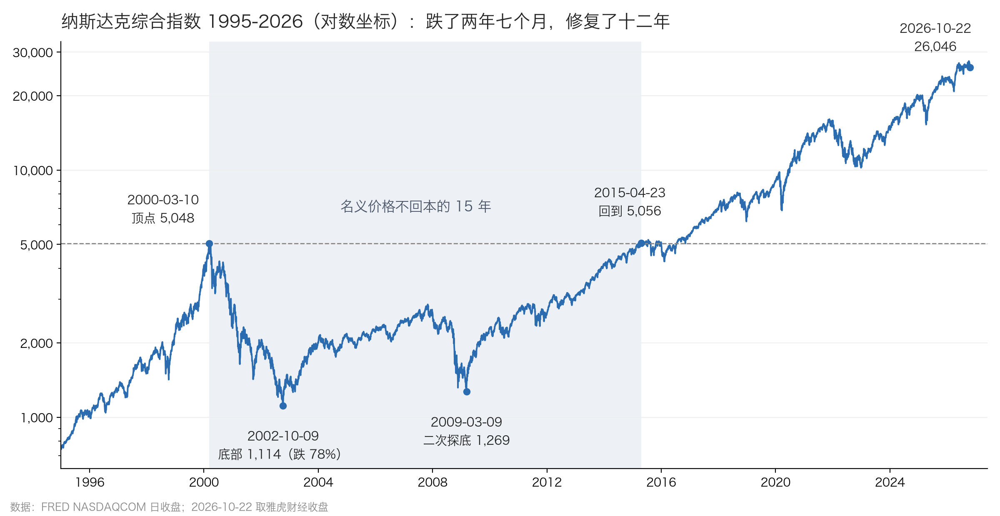
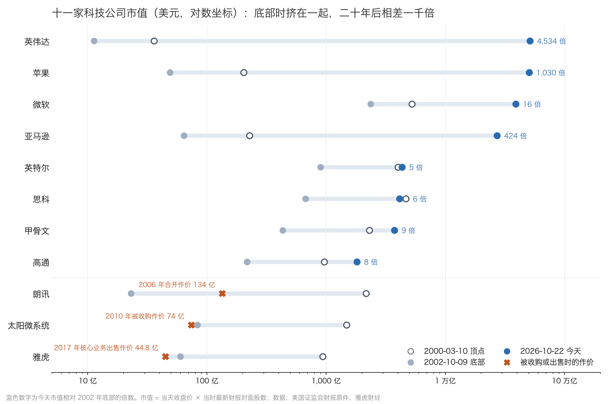

# 나스닥 78% 붕괴: 애플은 바닥에서 1000배 올랐다

2002년 10월 9일, 애플 시가총액은 49억 달러였고 장부상 현금과 단기투자는 43억 달러였다. 현금을 빼면 시장이 애플의 사업에 매긴 값은 10억 달러가 채 안 됐다.

같은 날 나스닥 종합지수는 1,114포인트로 마감했다. 2년 7개월 전에는 5,048포인트였으니 78%가 빠진 것이다.

2026년 10월 22일, 애플 시가총액은 5.05조 달러로 그날의 1,030배다.

같은 붕괴를 겪고도 어떤 회사는 천 배 넘게 되올랐고 어떤 회사는 사라졌다. 당시의 실적 원본과 오늘의 실적을 나란히 놓고 보면 경계선은 하나뿐이다. 붕괴 이후에도 이익이 계속 늘어날 수 있었는가.

## 1. 붕괴 때는 모든 회사가 함께 떨어진다

나스닥은 2000년 3월 10일 5,048포인트로 마감했고, 2002년 10월 9일 1,114포인트까지 떨어졌다. 2008년 금융위기에 또 한 번 떨어졌고, 2015년 4월이 되어서야 5,048포인트로 돌아왔다.

이 붕괴는 좋은 회사와 나쁜 회사를 가리지 않았다. 2000년 3월부터 2002년 10월까지 애플 시가총액은 76%, 아마존은 72%, 마이크로소프트는 55%, 시스코는 86%, 야후는 94%, 루슨트는 99% 떨어졌다.

애플은 당시 PER이 32배에 불과해 기술 대기업 가운데 가장 싼 축이었는데도 4분의 3이 빠졌다.

폭락의 원인은 밸류에이션이다. 나스닥100의 PER은 1999년 말 104배였고, 2000년 정점에서는 기관마다 150~300배로 추산했으며, 2002년 말에는 38배로 내려왔다. 밸류에이션이 하늘에서 땅으로 떨어지면 모든 회사가 한 차례씩 따라 떨어져야 한다.

그러나 다 떨어진 뒤 어디로 가는지는 밸류에이션이 아니라 이익이 정한다.

## 2. 24년 뒤: 이익이 오른 만큼 시가총액이 올랐다

| 회사 | 2002년 바닥 시가총액 | 오늘 시가총액 | 시가총액 상승 | 연간 이익: 2002년 → 오늘 | 이익 상승 |
| --- | --- | --- | --- | --- | --- |
| 엔비디아 | 11.3억 | 51,234억 | 4,534배 | 2.1억 → 1,929억 | 937배 |
| 애플 | 49억 | 50,457억 | 1,030배 | 1.8억 → 1,289억 | 733배 |
| 아마존 | 64억 | 27,143억 | 424배 | 적자 2.8억 → 1,353억 | 흑자 전환 |
| 마이크로소프트 | 2,366억 | 38,947억 | 16배 | 78억 → 1,337억 | 17배 |
| 오라클 | 432억 | 3,747억 | 9배 | 21억 → 188억 | 9배 |
| 시스코 | 672억 | 4,122억 | 6배 | 19억 → 133억 | 7배 |
| 인텔 | 897억 | 4,340억 | 5배 | 20억 → 적자 113억 | 적자 전환 |
| 루슨트 | 23억 | 2006년 134억에 알카텔로 합병 | — | 적자 177억 | — |
| 썬마이크로시스템즈 | 83억 | 2010년 74억에 오라클에 인수 | — | 적자 6억 | — |
| 야후 | 60억 | 2017년 핵심 사업 44.8억에 매각 | — | 적자 0.7억 | — |

금액 단위는 달러다. 시가총액은 당일 종가에 당시 실적의 주식 수를 곱해 계산했다. 이익은 최근 4개 분기 순이익이며, 평가일 이전에 공시된 실적을 썼다.

마이크로소프트는 이익이 17배, 시가총액이 16배 올랐다. 오라클은 9배 대 9배, 시스코는 7배 대 6배다. 20년이 넘는 길이에서 주가는 거의 이익의 그림자다.

엔비디아와 애플의 시가총액은 이익보다 더 많이 올랐다. 2002년 시장이 두 회사를 극도로 비관해 밸류에이션을 너무 낮게 매겼기 때문이다. 이익이 2억에서 천억대로 늘고 여기에 밸류에이션 회복이 겹쳐서 천 배가 넘는 상승이 나왔다.

반대편에서 루슨트, 썬마이크로시스템즈, 야후는 이익이 돌아오지 않았고 시가총액도 돌아오지 않았다. 인텔은 이익이 적자로 돌아섰고 24년 동안 5배 오르는 데 그쳤다.

## 3. 회사를 이해한다는 것은 이익이 더 늘 수 있는지를 보는 것이다

승자는 바닥에서 전혀 승자처럼 보이지 않았다.

- **애플**: 매출이 아직 줄고 있었고 시가총액은 현금과 거의 같았다. 1년 전 내놓은 iPod은 당시 어떤 밸류에이션도 받쳐 주지 못했다.
- **아마존**: 순자산이 마이너스 14억 달러였고 시장은 PSR 1.9배만 줬다. 그러나 매출은 여전히 21% 늘고 있었고, 매출총이익률은 18%에서 26%로 올랐으며, 일회성 항목을 빼면 이미 손익분기에 가까웠다.
- **엔비디아**: 미국 증권거래위원회의 질의로 3년치 실적을 막 재작성한 상태였고 PER은 5배에 불과했다. 그러나 매출은 여전히 두 배씩 늘고 있었다.

패자의 문제는 정점에서도 이미 드러나 있었다.

- **루슨트**: 고객이 빚을 내 망을 깔던 통신사였고, 버블이 터지자 주문이 끊겼다. 2000년 3월 기준 최근 분기 매출은 전년 대비 0.6% 느는 데 그쳤는데 시가총액은 2,168억 달러였다. 2002년에는 분기 매출이 전년 대비 반토막 났다.
- **야후**: 매출이 거의 전부 광고였고 큰 광고주는 인터넷 스타트업이었다. 바닥에서 사업 자체는 무너지지 않았고 매출은 정점보다 31% 많았다. 이후 검색에서 구글에 졌고 이익 성장이 끊겼다.

회사를 이해한다는 것은 지금 얼마나 뜨거운지를 보는 것이 아니라, 10년 뒤 이익이 지금보다 훨씬 커질 수 있는지를 판단하는 것이다. 애플, 아마존, 엔비디아는 2002년 이익이 아주 작거나 적자였지만 모두 여전히 자라는 것이 하나씩 있었다. 애플의 신제품, 아마존의 매출총이익률, 엔비디아의 매출이다. 루슨트와 야후는 당시 이익이 더 크고 이름도 더 높았지만, 그 이익은 버블 고객과 대체될 자리 위에 세워져 있었다.

## 4. 이해했더라도 가격을 봐야 한다

시스코는 반대 방향의 경고다. 2000년 시스코는 매출이 49% 늘었고 매출총이익률이 65%였으며 한때 세계 시가총액 1위였다. 당시 아무도 시스코가 우수한 회사라는 점을 의심하지 않았다. 이후 이익은 7배로 늘었지만 매수 시점 PER이 231배였기 때문에 오늘 시가총액은 여전히 2000년 3월보다 12% 낮다.

마이크로소프트는 2000년 순이익률 40%, PER 60배였고, 주가는 2016년이 되어서야 1999년 고점으로 돌아왔다.

우수한 회사는 폭락을 건너갈 수 있다. 전제는 이익이 계속 느는 것이다. 그 회사가 얼마의 수익을 돌려주는지는 매수할 때 얼마를 냈는지에도 달려 있다. 2002년 바닥에서 애플을 샀다면 24년간 1,030배다. 2000년 정점에서 샀다면 249배다. 2000년 정점에서 시스코를 샀다면 시가총액은 지금까지 그때 수준으로 돌아오지 못했다.

## 5. 애플은 생존자이고, 미리 이해할 수 있었던 것은 일부뿐이다

이 글이 애플, 아마존, 엔비디아를 골라낸 것은 오늘 결말을 알기 때문이다. 2002년 10월에 서 있었다면 같은 가격대에 야후와 썬마이크로시스템즈도 함께 끼어 있었다.

더 큰 표본은 더 잔혹하다. 미국 애리조나주립대 교수 베셈바인더는 1926년 이후 미국에 상장된 모든 주식을 집계했다. 대다수 주식의 생애 수익률은 1개월 만기 국채를 이기지 못했고, 미국 주식시장 전체의 순자산 증가는 전부 성과가 가장 좋은 4%의 회사에서 나왔다([《금융경제학저널》 2018](https://ideas.repec.org/a/eee/jfinec/v129y2018i3p440-457.html)). 이 글의 11곳도 마찬가지다. 3곳은 수백~수천 배 올랐고, 3곳은 사라졌으며, 나머지 5곳은 몇 배에서 십몇 배 오르는 데 그쳤다.

미리 이해할 수 있었던 것은 당시 실적에 적혀 있던 것들이다. 아마존의 매출총이익률은 오르고 적자는 줄고 있었고, 엔비디아의 매출은 두 배씩 늘고 있었다. 애플의 천 배는 주로 2007년에야 나온 iPhone에서 왔고, 2002년 실적에서는 보이지 않는다. 여기에는 운의 몫이 크다.

그래서 "핵심은 회사를 이해하는 것"에는 한정이 하나 붙어야 한다. 오늘의 실적으로 그 회사의 이익이 왜 훨씬 더 늘어날지 분명히 설명할 수 있어야 이해한 것이다. 설명하지 못하면 이해하지 못했다고 인정한다. 나스닥 자체가 15년 뒤 본전을 되찾은 것은 지수가 실패자를 계속 빼고 새 승자를 편입했기 때문이다. 지수를 산 사람은 애플을 미리 맞힐 필요가 없다.

## 맺음

2002년 10월 9일, 애플, 아마존, 엔비디아는 야후, 루슨트와 함께 골짜기 바닥에 누워 있었고, 주가는 누가 누구인지 알려 주지 못했다.

알려 줄 수 있는 것은 그 뒤 20년의 이익뿐이다.

---

**데이터 출처**: 지수는 세인트루이스 연방준비은행 데이터베이스([NASDAQCOM](https://fred.stlouisfed.org/series/NASDAQCOM))와 야후 파이낸스에서 가져왔다. 나스닥100 PER은 [나스닥 지수 리서치 2025](https://www.nasdaq.com/docs/is-ai-another-bubble-for-the-nasdaq-100), [2022](https://indexes.nasdaqomx.com/docs/NDX%20Research%202022.pdf)에서 가져왔다. 회사 재무는 각 회사가 평가일 이전에 미국 증권거래위원회에 제출한 실적 원본에서, 오늘의 데이터는 미국 증권거래위원회의 구조화 실적 인터페이스에서 가져왔다. 과거 주가는 당일 실제 체결 종가다. 오늘은 2026년 10월 22일 종가를 가리킨다.
